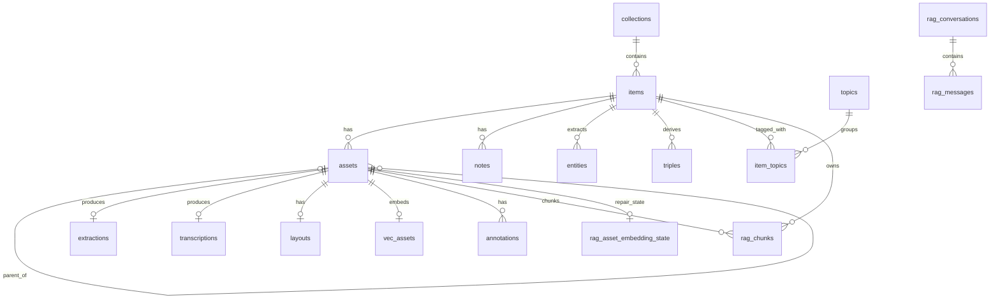

# EntropIA Pro/Lite SQLite

**Español:** [SQLite.md](./SQLite.md)

Operational guide to the current SQLite schema, its runtime creation, and diagnostic queries. The migration horizon is **`0058_processing_ner_tasks`**.

## Current contract at a glance

| Layer | Authority | What it creates |
|---|---|---|
| Migrated schema | `packages/store/src/migrations/*.sql` (`0001`..`0058`), applied by Rust (`apps/desktop/src-tauri/src/db/migrations.rs`); `schema_full.sql` fixture | Business tables, batch processing, Writing, Zotero/Biblioteca, web captures, custom schemas, `vec_assets`, `rag_chunks`, FTS, and migration indexes/triggers |
| Rust startup/runtime | `db/repairs.rs`, `db/schema_audit.rs`, `settings.rs`, `nlp/embeddings.rs`, `sync/schema.rs` | Idempotent repairs, the trigger/view audit, `app_settings`, `rag_asset_embedding_state`, and ten `sync_*` tables |
| SQLite/FTS5 internals | SQLite | `sqlite_sequence` and the shadow tables of `fts_items`, `rag_chunks_fts`, and `bibliographic_profile_fts` |

`packages/store/src/schema.ts` is a partial ORM model. It does not replace the migrated DDL or the DDL created by Rust. The migration registry the renderer uses (`packages/store/src/migrations.generated.ts`) is generated from the `.sql` files with `pnpm --filter @entropia/store generate-migrations`; each migration's design notes live in `packages/store/src/migrations/NOTES.md`.

Research keeps its jobs' state in a separate database, `research/estado.sqlite`, inside the same data directory. It is not covered by this guide.

## Locations

Tauri resolves the system data directory and EntropIA opens `entropia.sqlite` inside the shared `com.entropia.shared` directory.

| System | Path |
|---|---|
| Windows | `%APPDATA%\com.entropia.shared\entropia.sqlite` |
| macOS | `~/Library/Application Support/com.entropia.shared/entropia.sqlite` |
| Linux | `~/.local/share/com.entropia.shared/entropia.sqlite` |
| Dev profile (debug builds only, `ENTROPIA_DEV_PROFILE=<name>`) | `<data>/com.entropia.shared/dev-profiles/<name>/entropia.sqlite` |
| Recognized legacy | eight identifiers in `LEGACY_APP_IDENTIFIERS` (`lib.rs`): `<data>/<identifier>/entropia.sqlite` |

Pro, Lite, and development share a single database. The shared directory is
not any variant's `app_data_dir()`: the identifiers cannot change because they
are what lets Lite and Pro be installed side by side, so the canonical one is a
fixed directory that sits next to each variant's own. In the Microsoft Store
MSIX build, Windows may redirect that directory inside
`%LOCALAPPDATA%\Packages\CONICET.EntropIALite_…\LocalCache\Roaming\`.

The backend does not use the legacy path as the active database. Before opening the current database, it migrates or merges the legacy directory, compares the richness of both databases when both exist, keeps a backup before replacing the current one, and rewrites legacy asset paths. The `.legacy-app-dir-merged` marker prevents repeating the full merge.

Open the database with `sqlite3` (close EntropIA before writing to it):

```powershell
sqlite3 "$env:APPDATA\com.entropia.shared\entropia.sqlite"
```

Backups (**Settings → Backups**) are `entropia-backup-<UTC>` folders holding a consistent snapshot of the database (`VACUUM INTO`) plus the rest of the data directory, except the live database files, locks, `dev-profiles`, and `models`. They can be opened with `sqlite3` without touching the active database.

## Creation sequence

1. Rust resolves the directory, migrates the legacy directory, and opens UI/worker connections with `PRAGMA journal_mode=WAL` and `PRAGMA foreign_keys=ON` (`db/open.rs`).
2. `db::repairs::migrate_archive` runs the pre-repairs, applies pending migrations in name order —each inside its own `BEGIN IMMEDIATE … COMMIT` together with its `_migrations` row— and repeats the repairs as a post step. All of it happens in the backend `setup`, before the webview loads.
3. `db::schema_audit::audit_and_repair` rebuilds the canonical trigger and view set in memory and, in one transaction, replaces any object that is missing or has a different definition.
4. Rust ensures `app_settings`, `vec_assets`, `rag_asset_embedding_state`, and the sync schema; sync runs `ensure_capture` to create the capture triggers on every available table.
5. The renderer runs `runMigrations()` as a verification only: it checks the horizon is applied and runs no DDL. Since Phase 4.4a a SQLite authorizer rejects every schema statement (CREATE/DROP/ALTER, REINDEX, ANALYZE) coming from the renderer.
6. At close, when worthwhile, the app compacts the database with `VACUUM` and switches it to `auto_vacuum = INCREMENTAL` (`db/compact.rs`); from then on it reclaims free pages in bounded steps at startup.

`apps/desktop/src-tauri/tests/fixtures/schema_full.sql` represents the migrated result of a fresh install and `schema_canonical.json` is the canonical dump that pins the Rust runner to the TypeScript one. They do not include runtime-only tables (`app_settings`, `rag_asset_embedding_state`, `sync_*`) or the shadow tables SQLite creates when materializing FTS5.

## Table classification

### Migrated business tables

`collections`, `items`, `assets`, `notes`, `topics`, `item_topics`, `annotations`, `entities`, `triples`, `extractions`, `transcriptions`, `layouts`, `llm_results`, `rag_conversations`, `rag_messages`.

### Batch processing (`0032`+)

`processing_batches`, `processing_batch_collections`, `processing_batch_members`, `processing_tasks`, `processing_batch_tasks`, `processing_requests`, `processing_attempts`, `processing_checkpoints`, `processing_asset_revisions`, `processing_meta`.

### Writing (`0035`, `0036`)

`writing_documents`, `writing_document_collections`, `writing_document_versions`, `writing_journal`, `writing_document_citations`, `writing_zotero_citations`, `writing_provenance_events`, `writing_agent_suggestions`.

### Zotero and Biblioteca (`0040`–`0056`)

- Catalog: `zotero_connections`, `zotero_libraries`, `bibliographic_items`, `zotero_collections`, `zotero_tags`, `zotero_attachments`, `zotero_item_collections`, `zotero_item_tags`.
- Reconciliation: `zotero_item_tombstones`, `zotero_collection_tombstones`, `zotero_tag_tombstones`, `zotero_attachment_tombstones`, `zotero_reconciliation_runs`, `zotero_reconciliation_seen`.
- Semantic index: `bibliographic_semantic_profiles`, `bibliographic_embedding_contracts`, `bibliographic_index_generations`, `bibliographic_item_embeddings`, `bibliographic_profile_fts`.
- Text and passages: `bibliographic_extractions`, `bibliographic_page_texts`, `bibliographic_chunks`, `bibliographic_chunk_spans`, `bibliographic_chunk_embeddings`, `bibliographic_ingest_operations`.

### Web captures and custom schemas (`0057`, `0058`)

`web_sources`, `web_captures` (captures of the experimental Navegador) and `extraction_schemas`, `extraction_records` (Batch custom schemas; local, not synced).

### Migrated technical tables

`_migrations`, `vec_assets`, `rag_chunks`, `fts_items`, `fts_items_vocab`, `rag_chunks_fts`.

### Created or managed by Rust at runtime

`app_settings`, `rag_asset_embedding_state`, `sync_meta`, `sync_oplog`, `sync_row_versions`, `sync_conflicts`, `sync_pending_rows`, `sync_pending_blobs`, `sync_web_pending_blobs`, `sync_pending_fts`, `sync_topic_aliases`, `sync_blob_index`.

### SQLite/FTS5 internals

- `sqlite_sequence`, because of the `AUTOINCREMENT` in `_migrations` and `sync_oplog`.
- `fts_items_config`, `fts_items_data`, `fts_items_docsize`, `fts_items_idx`.
- `rag_chunks_fts_config`, `rag_chunks_fts_content`, `rag_chunks_fts_data`, `rag_chunks_fts_docsize`, `rag_chunks_fts_idx`.
- `bibliographic_profile_fts_config`, `bibliographic_profile_fts_content`, `bibliographic_profile_fts_data`, `bibliographic_profile_fts_docsize`, `bibliographic_profile_fts_idx`.

Shadow tables are FTS5 implementation details, not business entities. An old database may also keep `vec_items` or `embeddings_fallback`; they are legacy leftovers and are not part of the current runtime contract. Historical migration `0021_drop_unused_processing_table` drops `jobs`; `processing_*` is the current batch system and has nothing to do with that table. The `_backup_00NN_*` tables some rebuild migrations create are dropped inside the same migration: if one shows up, that migration did not finish.

## Column tree

The tree uses the canonical order of a fresh install; a `layouts` table upgraded from a legacy shape may retain `blocks` at the end due to `ALTER TABLE`. Implicit `rowid` is not repeated except where it is part of the FTS contract. `items.source_dir` and `items.imported_at` are generated columns (`0031`) derived from `metadata`: `PRAGMA table_xinfo` reports them as hidden and sync does not replicate them; each device recomputes them.

```text
entropia.sqlite
├── migrated: business
│   ├── collections: id, name, description, created_at, updated_at
│   ├── items: id, title, collection_id, metadata, created_at, updated_at, search_text, source_dir, imported_at
│   ├── assets: id, item_id, path, type, size, created_at, sort_index, parent_asset_id, page_number
│   ├── notes: id, item_id, content, created_at, updated_at, asset_id
│   ├── topics: id, name, created_at
│   ├── item_topics: id, item_id, topic_id, created_at
│   ├── annotations: id, asset_id, page, kind, color, x, y, width, height, created_at, updated_at
│   ├── entities: id, item_id, entity_type, value, start_offset, end_offset, confidence, source, model_name, created_at, latitude, longitude, geo_status, asset_id, manual_lat, manual_lon
│   ├── triples: id, item_id, subject, predicate, object, created_at, asset_id
│   ├── extractions: id, asset_id, text_content, method, confidence, created_at
│   ├── transcriptions: id, asset_id, text_content, language, duration_ms, model, segments, confidence, created_at
│   ├── layouts: id, asset_id, regions, blocks, model, image_width, image_height, created_at
│   ├── llm_results: id, target_id, target_type, job_type, result, created_at
│   ├── rag_conversations: id, title, created_at, updated_at
│   └── rag_messages: id, conversation_id, sort_index, role, content, sources, model, created_at
├── migrated: batch processing
│   ├── processing_batches: id, request_id, origin, state, desired_state, operations, config_snapshot_json, planning_cursor, planning_done, revision, created_at, updated_at, started_at, finished_at, last_error, priority
│   ├── processing_batch_collections: batch_id, collection_id_snapshot, name_snapshot
│   ├── processing_batch_members: batch_id, ordinal, asset_id_snapshot, item_id_snapshot, collection_id_snapshot, title_snapshot, classification, reason
│   ├── processing_tasks: id, kind, asset_id_snapshot, input_revision, input_fingerprint, contract_hash, state, stage, progress_done, progress_total, outcome, attempt_count, retry_cycle, retry_count, next_retry_at, owner_session, lease_epoch, heartbeat_at, lease_expires_at, last_error_code, last_error_message, result_receipt_json, created_at, updated_at, source_invalidation_count, domain, subject_kind, subject_id
│   ├── processing_batch_tasks: batch_id, task_id, kind, asset_id_snapshot, request_state, dependency_task_id, domain, subject_kind, subject_id
│   ├── processing_requests: request_id, action, batch_id, payload_hash, state, selection_cursor, response_json, created_at
│   ├── processing_attempts: task_id, attempt_number, lease_epoch, started_at, finished_at, outcome, retryable, error_code, error_message, provider_request_id
│   ├── processing_checkpoints: task_id, unit_key, input_fingerprint, contract_hash, payload, payload_checksum, created_at
│   ├── processing_asset_revisions: asset_id, source_revision, embedding_completed_revision, invalidated_at, invalidation_reason, auto_suppressed_revision
│   └── processing_meta: key, value
├── migrated: Writing
│   ├── writing_documents: id, title, document_type, status, schema_version, current_content_json, revision, plain_text_cache, citation_style_id, citation_locale, bibliography_enabled, created_at, updated_at, last_opened_at
│   ├── writing_document_collections: document_id, collection_id, is_primary, created_at
│   ├── writing_document_versions: id, document_id, version_number, content_json, schema_version, document_settings_json, reason, content_hash, created_at
│   ├── writing_journal: document_id, seq, base_revision, schema_version, delta_json, checksum, created_at
│   ├── writing_document_citations: id, document_id, citation_node_id, collection_id, item_id, asset_id, page_number, start_char, end_char, source_region_json, quoted_text, source_text_hash, locator_json, metadata_snapshot_json, integrity_status, created_at, updated_at
│   ├── writing_zotero_citations: id, document_id, citation_node_id, citation_cluster_id, item_position, source_origin, source_instance_id, library_type, library_id, item_key, item_version, locator_type, locator, prefix, suffix, suppress_author, author_only, item_csl_json_snapshot, integrity_status, created_at, updated_at
│   ├── writing_provenance_events: id, document_id, version_id, range_anchor_json, origin_type, operation_type, source_reference_json, model_provider, model_name, prompt_template_id, created_at
│   └── writing_agent_suggestions: id, document_id, selection_anchor_json, source_revision, selected_content_hash, action_type, original_text, suggested_text, rationale, evidence_json, status, provider, model, created_at, resolved_at
├── migrated: Zotero and Biblioteca
│   ├── zotero_connections: id, source_origin, source_instance_id, endpoint, capabilities_json, credential_ref, state, revision, created_at, updated_at
│   ├── zotero_libraries: id, connection_id, library_type, library_id, name, last_modified_version, revision, created_at, updated_at
│   ├── bibliographic_items: id, library_id, item_key, item_version, native_json_snapshot, csl_json_snapshot, item_type, title, creators_json, publication_title, publisher, date, doi, isbn, abstract, language, url, revision, created_at, updated_at, verified_at
│   ├── zotero_collections: id, library_id, collection_key, name, parent_collection_key, native_json_snapshot, native_version, revision, created_at, updated_at, verified_at
│   ├── zotero_tags: id, library_id, tag_text, tag_type, native_json_snapshot, native_version, revision, created_at, updated_at, verified_at
│   ├── zotero_attachments: id, item_id, attachment_key, content_type, link_mode, filename, native_path, url, md5, mtime, native_json_snapshot, native_version, revision, created_at, updated_at, verified_at
│   ├── zotero_item_collections: library_id, item_id, collection_id
│   ├── zotero_item_tags: library_id, item_id, tag_id
│   ├── zotero_item_tombstones: item_id, observed_at, remote_version, reason
│   ├── zotero_collection_tombstones: collection_id, observed_at, remote_version, reason
│   ├── zotero_tag_tombstones: tag_id, observed_at, remote_version, reason
│   ├── zotero_attachment_tombstones: attachment_id, observed_at, remote_version, reason
│   ├── zotero_reconciliation_runs: library_id, run_id, connection_revision, state, phase, cursor_start, cursor_limit, remote_total, target_version, checkpoint_version, retry_count, attempt_count, next_retry_at, last_attempt_at, latest_error_phase, latest_error_code, latest_error_message, latest_error_retryable, latest_error_at, revision, checkpointed_at, completed_at, created_at, updated_at
│   ├── zotero_reconciliation_seen: library_id, run_id, entity_kind, entity_key, parent_key, remote_version, observed_at
│   ├── bibliographic_semantic_profiles: item_id, profile_revision, template_version, canonical_text, input_hash, field_provenance_json, created_at, updated_at
│   ├── bibliographic_embedding_contracts: contract_hash, provider, model, dimensions, chunking_contract, created_at
│   ├── bibliographic_index_generations: id, contract_hash, status, expected_inputs, completed_inputs, created_at, activated_at, retired_at
│   ├── bibliographic_item_embeddings: item_id, generation_id, embedding_contract, embedding_model, dimensions, embedding, input_hash, profile_revision, created_at, updated_at
│   ├── bibliographic_extractions: attachment_id, item_id, page_count, method, text_content, text_hash, text_chars, quality, source_mtime, source_bytes, created_at, updated_at
│   ├── bibliographic_page_texts: attachment_id, page_number, method, text_content, text_hash, text_chars, quality, created_at, updated_at
│   ├── bibliographic_chunks: id, item_id, attachment_id, ordinal, text_content, text_hash, chunking_contract, created_at, updated_at
│   ├── bibliographic_chunk_spans: chunk_id, page_number, start_char, end_char
│   ├── bibliographic_chunk_embeddings: chunk_id, generation_id, embedding_contract, embedding_model, dimensions, embedding, input_hash, created_at, updated_at
│   └── bibliographic_ingest_operations: id, request_id, kind, library_id, payload_json, state, attempt_count, receipt_json, last_error_code, last_error_message, created_at, updated_at
├── migrated: web captures and custom schemas
│   ├── web_sources: id, original_url, final_url, canonical_url, title, site_name, first_accessed_at, created_at, updated_at
│   ├── web_captures: id, web_source_id, accessed_at, final_url, kind, mime_type, text, text_rel_path, quote_prefix, quote_suffix, rel_path, sha256, hash_of, size_bytes, extractor_version, title, created_at
│   ├── extraction_schemas: id, name, fields_json, model, created_at, updated_at
│   └── extraction_records: id, schema_id, asset_id, item_id, record_json, created_at
├── migrated: technical/RAG
│   ├── _migrations: id, name, applied_at
│   ├── vec_assets: asset_id, item_id, embedding, embedding_model, embedding_contract, dimensions
│   ├── rag_chunks: id, asset_id, item_id, source_kind, source_id, chunk_ordinal, text_content, start_char, end_char, source_text_hash, chunking_contract, embedding, embedding_model, embedding_contract, dimensions
│   ├── fts_items: item_id, title, metadata, extracted_text
│   ├── fts_items_vocab: term, doc, cnt
│   ├── rag_chunks_fts: chunk_id, text_content
│   └── bibliographic_profile_fts: item_id, canonical_text
├── Rust runtime
│   ├── app_settings: key, value
│   ├── rag_asset_embedding_state: asset_id, item_id, rag_incomplete, failure_count, next_retry_at_ms, last_error, updated_at_ms
│   ├── sync_meta: key, value
│   ├── sync_oplog: seq, table_name, row_id, op, changed_at
│   ├── sync_row_versions: table_name, row_id, server_seq
│   ├── sync_conflicts: id, table_name, row_id, reason, loser_payload, winner_summary, created_at, acknowledged
│   ├── sync_pending_rows: table_name, row_id, server_seq, deleted, changed_at, device_id, payload, retry_count, parked_schema_head
│   ├── sync_pending_blobs: asset_id, sha256, rel_path, size, retry_count, last_error, last_attempt_at
│   ├── sync_web_pending_blobs: capture_id, role, sha256, rel_path, size, retry_count, last_error, last_attempt_at
│   ├── sync_pending_fts: item_id
│   ├── sync_topic_aliases: remote_id, local_id
│   └── sync_blob_index: asset_id, sha256, size, file_mtime_ms, uploaded
└── FTS5 shadow
    ├── fts_items_config: k, v
    ├── fts_items_data: id, block
    ├── fts_items_docsize: id, sz, origin
    ├── fts_items_idx: segid, term, pgno
    ├── rag_chunks_fts_config: k, v
    ├── rag_chunks_fts_content: id, c0, c1
    ├── rag_chunks_fts_data: id, block
    ├── rag_chunks_fts_docsize: id, sz
    ├── rag_chunks_fts_idx: segid, term, pgno
    ├── bibliographic_profile_fts_config: k, v
    ├── bibliographic_profile_fts_content: id, c0, c1
    ├── bibliographic_profile_fts_data: id, block
    ├── bibliographic_profile_fts_docsize: id, sz
    └── bibliographic_profile_fts_idx: segid, term, pgno
```

## Client type contract

The formal contract (semantic column types, timestamp units, and JSON/BLOB shapes) is materialized in the `entropiaR` manifest (`inst/schemas/manifest.json` in the R package) and applied when data is materialized with `entropia_collect()`. This section summarizes the rules a read-only client must apply.

### Timestamp units (the most common pitfall)

| Unit                                | Magnitude criterion      | Columns                                                                                                                                                                                                                                                                          |
| ----------------------------------- | ------------------------ | -------------------------------------------------------------------------------------------------------------------------------------------------------------------------------------------------------------------------------------------------------------------------------- |
| Epoch **ms** (13 digits) | value ≥ 1e12 | `created_at`/`updated_at` in `collections`, `items`, `assets`, `extractions`, `transcriptions`, `layouts`, `notes`, `annotations`, `llm_results`, `rag_conversations`, `rag_messages`; `sync_conflicts.created_at`; `rag_asset_embedding_state.next_retry_at_ms`/`updated_at_ms`; the `processing_*` family timestamps (their triggers write `strftime('%s','now') * 1000`) |
| Epoch **seconds** (10 digits)       | value < 1e12             | `_migrations.applied_at`                                                                                                                                                                                                                                                         |
| **`datetime_auto`** (ms or seconds) | guard `< 1e12 ⟹ seconds` | `entities.created_at`, `triples.created_at`                                                                                                                                                                                                                                      |
| ISO-8601 string | inside JSON | `items.metadata.__entropia_file_metadata.importedAt` (`YYYY-MM-DDTHH:MM:SSZ`), and therefore the generated `items.imported_at` column |

> `entities.created_at` and `triples.created_at` use `strftime('%s','now')` (epoch **seconds**) as their DDL default, but the app writes epoch **ms** in practice. A client must apply the `< 1e12` magnitude guard (the same rule used by migration `0019`) rather than assuming one unit. For the Writing, Zotero/Biblioteca, and web capture families, apply the same guard before converting.

### JSON columns stored as TEXT

| Column                                            | Shape                                                                                               |
| ------------------------------------------------- | --------------------------------------------------------------------------------------------------- |
| `items.metadata` | object; nested `__entropia_file_metadata` (`originalName`, `originalPath`, `importedAt` ISO-8601); Internet Archive PDFs add their provenance |
| `transcriptions.segments`                         | array of `{start_ms, end_ms, text}`                                                                 |
| `layouts.regions` / `layouts.blocks`              | arrays of regions/blocks                                                                            |
| `rag_messages.sources`                            | array of citations                                                                                  |
| `llm_results.result`                              | job result (text or JSON depending on `job_type`)                                                   |
| `sync_conflicts.loser_payload` / `winner_summary` | LWW conflict payloads |
| `processing_batches.operations` / `config_snapshot_json` | the batch's frozen operations and configuration |
| `writing_documents.current_content_json`, `writing_document_versions.content_json` | the manuscript's ProseMirror document |
| `bibliographic_items.native_json_snapshot` / `csl_json_snapshot` / `creators_json` | the Zotero record as received and its CSL version |
| `extraction_schemas.fields_json` / `extraction_records.record_json` | the custom schema's fields and one extracted row |

### Embedding BLOB

`vec_assets.embedding`, `rag_chunks.embedding`, `bibliographic_item_embeddings.embedding`, and `bibliographic_chunk_embeddings.embedding` are raw **little-endian** `f32` vectors: `dimensions` × 4 bytes (1024 dims = 4096 bytes). They should not be selected by default in joins; access is explicit (in `entropiaR`, `with_vector = TRUE`).

### Deterministic IDs (useful for joins)

| Table            | Format                                     |
| ---------------- | ------------------------------------------ |
| `extractions`    | `ext-` ∥ `asset_id`                        |
| `transcriptions` | `trx-` ∥ `asset_id`                        |
| `layouts`        | `lay-` ∥ `asset_id`                        |
| `llm_results`    | `llr-{target_type}-{target_id}-{job_type}` |
| `rag_chunks`     | `ragchk-` ∥ content sha256                 |

The remaining PKs are `TEXT` UUIDv4 values; the `vec_assets` PK is `asset_id`.

### Hiding and secrets

- `entities.source = 'manual_deleted'` is a soft delete: the row remains, but the app hides it. A reader that needs the visible set must filter it out.
- API keys live in the operating system's credential store; `app_settings` holds configuration (and an old database may still keep `*_api_key` values from before that migration). It is not part of any `entropiaR` read surface; a client must not expose its raw values. `sync_meta` does contain permitted keys (see the sync section).

### Conceptual references without physical FKs

`notes/entities/triples.asset_id`, `llm_results.target_id`, `rag_chunks.source_id` (→ `extractions.id`/`transcriptions.id` according to `source_kind`), and sync references (`sync_row_versions.row_id`, etc.) have no physical constraint. `PRAGMA foreign_keys` is active only where an FK is declared; a client must validate these references itself.

## PKs, FKs, and constraints

| Table                       | PK                     | Physical FKs and main constraints                                                                                                                                                      |
| --------------------------- | ---------------------- | -------------------------------------------------------------------------------------------------------------------------------------------------------------------------------------- |
| `_migrations`               | `id` AUTOINCREMENT     | `name UNIQUE NOT NULL`                                                                                                                                                                 |
| `collections`               | `id`                   | `name`, `created_at`, `updated_at` NOT NULL                                                                                                                                            |
| `items`                     | `id`                   | `collection_id -> collections.id`; `search_text` is GENERATED STORED                                                                                                                   |
| `assets`                    | `id`                   | `item_id -> items.id`; `parent_asset_id -> assets.id ON DELETE CASCADE`; partial UNIQUE `(parent_asset_id, page_number)` when parent is not NULL                                       |
| `notes`                     | `id`                   | `item_id -> items.id`; `asset_id` is a conceptual reference without a physical FK                                                                                                      |
| `topics`                    | `id`                   | `name UNIQUE NOT NULL`                                                                                                                                                                 |
| `item_topics`               | `id`                   | both FKs use `ON DELETE CASCADE`; UNIQUE `(item_id, topic_id)`                                                                                                                         |
| `annotations`               | `id`                   | `asset_id -> assets.id ON DELETE CASCADE`; `kind IN ('rectangle','underline','crop','erase','rotation')`                                                                               |
| `entities`                  | `id`                   | `item_id -> items.id ON DELETE CASCADE`; conceptual `asset_id`; `entity_type` has a CHECK; offsets/confidence/geo_status have defaults                                                 |
| `triples`                   | `id`                   | `item_id -> items.id ON DELETE CASCADE`; conceptual `asset_id`                                                                                                                         |
| `extractions`               | `id`                   | `asset_id -> assets.id ON DELETE CASCADE`; UNIQUE `(asset_id)`                                                                                                                         |
| `transcriptions`            | `id`                   | `asset_id -> assets.id ON DELETE CASCADE`; UNIQUE `(asset_id)`                                                                                                                         |
| `layouts`                   | `id`                   | `asset_id -> assets.id ON DELETE CASCADE`; UNIQUE `(asset_id)`, therefore 0..1 layout per asset; `blocks DEFAULT '[]'`                                                                 |
| `llm_results`               | `id`                   | conceptual `target_id`; `target_type IN ('asset','item','collection','unknown')`                                                                                                       |
| `rag_conversations`         | `id`                   | timestamps and title are NOT NULL                                                                                                                                                      |
| `rag_messages`              | `id`                   | `conversation_id -> rag_conversations.id ON DELETE CASCADE`; `role IN ('user','assistant')`                                                                                            |
| `vec_assets`                | `asset_id`             | no physical FK; `item_id`, embedding, and contract are NOT NULL                                                                                                                        |
| `rag_chunks`                | `id`                   | FKs to `assets` and `items`, both CASCADE; `source_kind IN ('extraction','transcription')`; offsets/dimensions have CHECKs; UNIQUE `(asset_id, source_kind, source_id, chunk_ordinal)` |
| `rag_asset_embedding_state` | `asset_id`             | no physical FK; flags/counters/timestamps default to `0`                                                                                                                               |
| `app_settings`, `sync_meta` | `key`                  | `value NOT NULL`                                                                                                                                                                       |
| `sync_oplog`                | `seq` AUTOINCREMENT    | `op IN ('I','U','D')`                                                                                                                                                                  |
| `sync_row_versions`         | `(table_name, row_id)` | no physical FKs                                                                                                                                                                        |
| `sync_pending_rows`         | `(table_name, row_id)` | retry defaults; no physical FKs                                                                                                                                                        |
| `sync_conflicts`            | `id`                   | `acknowledged DEFAULT 0`                                                                                                                                                               |
| `sync_pending_blobs`        | `asset_id`             | `retry_count DEFAULT 0` |
| `sync_web_pending_blobs` | `(capture_id, role)` | `role IN ('file','text')`; `retry_count DEFAULT 0` |
| `sync_pending_fts`          | `item_id`              | no physical FK                                                                                                                                                                         |
| `sync_topic_aliases`        | `remote_id`            | `local_id NOT NULL`                                                                                                                                                                    |
| `sync_blob_index`           | `asset_id`             | `uploaded DEFAULT 0`                                                                                                                                                                   |

`rag_chunks.source_id` logically points to `extractions.id` or `transcriptions.id` according to `source_kind`, but has no physical FK. The same applies to several auxiliary and sync references: runtime code owns their integrity.

### New families (`0032`–`0058`)

| Table | PK | Physical FKs and main constraints |
|---|---|---|
| `processing_batches` | `id` | `origin IN ('user','manual','repair','bibliography')`; `state` from `preparing` to `completed_with_errors`; `desired_state IN ('run','pause','cancel')`; `priority IN (0,1,2)` |
| `processing_tasks` | `id` | `kind IN ('ocr','embedding','bibliography_sync','bibliography_profile','bibliography_extract','ner','triples','schema_extract')`; `state IN ('pending','blocked','running','retry_wait','interrupted','succeeded','failed','skipped','cancelled')`; partial UNIQUE per active subject (`domain`, `subject_kind`, `subject_id`) |
| `processing_batch_collections`, `processing_batch_members`, `processing_requests` | `(batch_id, …)` / `request_id` | `batch_id -> processing_batches.id ON DELETE CASCADE` |
| `processing_batch_tasks` | `(batch_id, task_id)` | `batch_id` CASCADE; `task_id` and `dependency_task_id -> processing_tasks.id` |
| `processing_attempts`, `processing_checkpoints` | `(task_id, attempt_number)` / `(task_id, unit_key)` | `task_id -> processing_tasks.id ON DELETE CASCADE` |
| `processing_asset_revisions` | `asset_id` | `asset_id -> assets.id ON DELETE CASCADE` |
| `writing_documents` | `id` | no FK |
| `writing_document_versions`, `writing_document_citations`, `writing_zotero_citations`, `writing_agent_suggestions` | `id` | `document_id -> writing_documents.id ON DELETE CASCADE`; `writing_document_versions.reason IN ('auto','close','checkpoint','restore','migration')` |
| `writing_document_collections` | `(document_id, collection_id)` | both FKs CASCADE |
| `writing_journal` | `(document_id, seq)` | `document_id` CASCADE |
| `writing_provenance_events` | `id` | `document_id` CASCADE; `version_id -> writing_document_versions.id` |
| `zotero_connections` → `zotero_libraries` → `bibliographic_items`, `zotero_collections`, `zotero_tags` | `id` | FK chain with CASCADE (`connection_id`, `library_id`) |
| `zotero_attachments` | `id` | `item_id -> bibliographic_items.id ON DELETE CASCADE` |
| `zotero_item_collections`, `zotero_item_tags` | `(library_id, item_id, …)` | composite FKs with CASCADE: a work cannot be linked to a collection or tag from another library |
| `zotero_*_tombstones` | the entity id | FK to the entity with CASCADE |
| `zotero_reconciliation_runs` / `_seen` | `library_id` / composite key | FKs to `zotero_libraries` and to the run, with CASCADE |
| `bibliographic_semantic_profiles` | `item_id` | `item_id -> bibliographic_items.id ON DELETE CASCADE` |
| `bibliographic_index_generations` | `id` | `contract_hash -> bibliographic_embedding_contracts.contract_hash`; one active generation per contract (partial index) |
| `bibliographic_item_embeddings`, `bibliographic_chunk_embeddings` | `(item_id|chunk_id, generation_id)` | `generation_id -> bibliographic_index_generations.id`; the work or chunk with CASCADE |
| `bibliographic_extractions`, `bibliographic_page_texts` | `attachment_id` / `(attachment_id, page_number)` | `attachment_id -> zotero_attachments.id ON DELETE CASCADE` |
| `bibliographic_chunks` | `id` | `item_id` and `attachment_id` with CASCADE |
| `bibliographic_chunk_spans` | `(chunk_id, page_number, start_char)` | `chunk_id` CASCADE |
| `bibliographic_ingest_operations` | `id` | `library_id -> zotero_libraries.id ON DELETE CASCADE` |
| `web_captures` | `id` | `web_source_id -> web_sources.id ON DELETE CASCADE` |
| `extraction_records` | `id` | `schema_id -> extraction_schemas.id` and `asset_id -> assets.id`, both CASCADE |

## Relevant indexes

### Business and processing

- Items/assets: `idx_items_search(search_text)`, `idx_items_collection(collection_id)`, `idx_items_collection_source_dir(collection_id, source_dir, title COLLATE NOCASE, id)`, `idx_items_collection_source_dir_import(collection_id, source_dir, imported_at)`, `idx_items_import_source(collection_id, lower(json_extract(metadata, '$.__entropia_file_metadata.originalPath')))`, `idx_assets_item(item_id)`, `idx_assets_item_sort(item_id, sort_index)`, `idx_assets_parent_asset_id(parent_asset_id)`, `idx_assets_parent_page(parent_asset_id, page_number)` partial UNIQUE, `idx_items_collection_title(collection_id, title COLLATE NOCASE, id)`.
- `idx_items_collection_title` covers the collection grid query end to end: the `collection_id` filter, the `ORDER BY title COLLATE NOCASE, id` every card list uses, and the keyset cursor built on that same pair. Without the sort columns in the index, SQLite filters through `idx_items_collection` and then sorts the whole result set in a temp b-tree every time a collection is opened.
- Asset derivatives: `idx_extractions_asset_id`, `idx_extractions_asset_id_unique` UNIQUE, `idx_transcriptions_asset_id`, `idx_transcriptions_asset_id_unique` UNIQUE, `idx_layouts_asset_id`, `idx_layouts_asset_id_unique` UNIQUE, `annotations_asset_id_idx`, `annotations_asset_page_idx`.
- Semantics: `idx_notes_item`, `idx_notes_asset_id`, `idx_entities_item_id`, `idx_entities_type`, `idx_entities_geo_status`, `idx_entities_asset_id`, `triples_item_id_idx`, `idx_triples_asset_id`.
- Topics/LLM: `idx_item_topics_item_topic` UNIQUE, `idx_item_topics_topic_id`, `idx_llm_results_target`, `idx_llm_results_target_typed`.

### RAG, state, and sync

- `idx_rag_messages_conversation(conversation_id, sort_index)`.
- `idx_vec_assets_item_id(item_id)`.
- `idx_rag_chunks_asset_id(asset_id)`, `idx_rag_chunks_item_id(item_id)`, `idx_rag_chunks_embedding_contract(embedding_model, embedding_contract, dimensions)`.
- `idx_rag_asset_embedding_state_due(rag_incomplete, next_retry_at_ms)`.
- `idx_sync_oplog_row(table_name, row_id)`.

### Batches, Writing, and Biblioteca

- Batches: `idx_processing_batches_priority`, `idx_processing_tasks_state_id`, `idx_processing_tasks_claimable`, `idx_processing_tasks_subject_active_unique` (partial UNIQUE), `idx_processing_batch_tasks_batch`, `idx_processing_batch_tasks_task`, `idx_processing_batch_tasks_dependency`, `idx_processing_members_batch_asset`, `idx_processing_attempts_task`.
- Writing: `idx_writing_documents_status_updated`, `idx_writing_document_versions_document`, `idx_writing_journal_replay`, `idx_writing_document_citations_asset`, `idx_writing_zotero_citations_item`, `idx_writing_document_collections_collection`, `idx_writing_provenance_events_document`, `idx_writing_agent_suggestions_document`.
- Zotero/Biblioteca: per-library identity indexes (`idx_bibliographic_items_library_key`, `idx_zotero_collections_library_key`, `idx_zotero_tags_library_text`, `idx_zotero_attachments_item_key`, `idx_zotero_libraries_identity`), `idx_bibliographic_items_title`, `idx_bibliographic_chunks_item`, `idx_bibliographic_page_texts_attachment`, `idx_bibliographic_generations_single_active`, and the embeddings' hash and generation indexes.
- Others: `idx_web_sources_final_url`, `idx_web_sources_updated`, `idx_web_captures_source`, `idx_extraction_records_schema_asset`.

SQLite also creates automatic indexes for PK/UNIQUE constraints; they are omitted because their `sqlite_autoindex_*` names are implementation details.

## Runtime triggers

| Family                  | Count | Scope                             | Behavior                                                                                                                                                                                     |
| ----------------------- | ----: | --------------------------------- | -------------------------------------------------------------------------------------------------------------------------------------------------------------------------------------------- |
| `collection_activity_*` |    33 | 11 tables x INSERT/UPDATE/DELETE  | Monotonically updates `collections.updated_at` for `items`, `assets`, `notes`, `extractions`, `layouts`, `transcriptions`, `annotations`, `entities`, `triples`, `vec_assets`, `llm_results` |
| `rag_chunks_fts_*`      |     2 | INSERT and DELETE on `rag_chunks` | Inserts/deletes the corresponding document in `rag_chunks_fts`                                                                                                                               |
| `trg_processing_extractions_*`, `trg_processing_transcriptions_*` | 6 | INSERT/UPDATE/DELETE on `extractions` and `transcriptions` | Bump the asset's source revision in `processing_asset_revisions` so batches invalidate stale embeddings |
| `processing_tasks_settle_dependents` | 1 | `processing_tasks` | When a task ends, moves the blocked tasks that depended on it to `pending` or, if it did not succeed, marks them `failed` with `dependency_failed` |
| `bibliographic_profile_fts_*` | 3 | INSERT/UPDATE/DELETE on `bibliographic_semantic_profiles` | Keep `bibliographic_profile_fts` current |
| `trg_sync_*` | 54 | 18 tables x INSERT/UPDATE/DELETE | Appends operations to `sync_oplog` when capture is enabled and a pull is not being applied |

The exact sync allowlist is: `collections`, `items`, `assets`, `notes`, `annotations`, `extractions`, `transcriptions`, `layouts`, `entities`, `triples`, `topics`, `item_topics`, `llm_results`, `rag_conversations`, `rag_messages`, `vec_assets`, `web_sources`, `web_captures` (the last two only travel when the server announces the `web-capture-v1` capability).

Manuscripts (`writing_*`) and finished investigations do not go through these triggers: they have their own sync cycles (`sync/writing_*.rs`, `sync/research_*.rs`) with their own state in `sync_meta`. The `processing_*`, `zotero_*`/`bibliographic_*`, and `extraction_*` families are local.

`rag_chunks` and `rag_asset_embedding_state` are **not in the sync allowlist**: chunks and repair state are derived/local. FTS and `sync_*` tables are not synced either. Sync triggers require `sync_meta.capture_enabled='1'` and `sync_meta.applying<>'1'`; without a `device_id`, `ensure_capture` clears `sync_oplog`. The current template version is `triggers_version='2'`. `ensure_capture` always runs all 54 `CREATE TRIGGER IF NOT EXISTS`, so it self-heals after a migration that rebuilds a table.

`rag_chunks_fts` has no UPDATE trigger. Runtime replaces chunks through delete/insert; manually updating `rag_chunks.text_content` would leave FTS stale and must be avoided or paired with explicit reindexing.

## FTS5 contracts

### `fts_items`: contentless and aligned by `rowid`

`fts_items` uses `content=''` and the `unicode61 remove_diacritics 1` tokenizer. Its declared columns are not retrievable content: they may read as NULL in a contentless table. The contract is `fts_items.rowid = items.rowid`; identity/title/metadata reads must JOIN `items` by `rowid`.

```sql
SELECT
  i.id AS item_id,
  i.title,
  bm25(fts_items) AS rank
FROM fts_items
JOIN items i ON i.rowid = fts_items.rowid
WHERE fts_items MATCH 'archivo OR documento'
ORDER BY bm25(fts_items)
LIMIT 20;
```

Do not use `SELECT item_id, title FROM fts_items` to retrieve payload and do not delete by `item_id`. Inserts write explicit `rowid`; when drift occurs, the safe procedure is `INSERT INTO fts_items(fts_items) VALUES('delete-all')` followed by a rebuild. `0004` establishes the baseline and `0018` corrects existing databases.

### `rag_chunks_fts`: content-bearing chunk-level FTS

`rag_chunks_fts` stores `chunk_id` and `text_content`; it joins to `rag_chunks.id` and uses the same tokenizer.

```sql
SELECT
  rc.id AS chunk_id,
  rc.asset_id,
  rc.item_id,
  rc.source_kind,
  rc.chunk_ordinal,
  snippet(rag_chunks_fts, 1, '[', ']', '...', 20) AS preview
FROM rag_chunks_fts
JOIN rag_chunks rc ON rc.id = rag_chunks_fts.chunk_id
WHERE rag_chunks_fts MATCH 'archivo OR documento'
ORDER BY bm25(rag_chunks_fts)
LIMIT 20;
```

### `fts_items_vocab` and `bibliographic_profile_fts`

`fts_items_vocab` is an `fts5vocab(fts_items, 'row')` table: it exposes the index terms with their document and occurrence counts, and approximate search uses it to suggest spelling variants. `bibliographic_profile_fts` indexes each Biblioteca work's canonical profile (`item_id`, `canonical_text`) with the same tokenizer and is kept current by triggers on `bibliographic_semantic_profiles`.

```sql
SELECT term, doc, cnt
FROM fts_items_vocab
WHERE term LIKE 'archiv%'
ORDER BY doc DESC
LIMIT 20;
```

## ERD

```text
collections 1 ── N items 1 ── N assets
                                ├── 0..1 extractions
                                ├── 0..1 transcriptions
                                ├── 0..1 layouts
                                ├── 0..1 vec_assets
                                ├── 0..N annotations
                                ├── 0..N rag_chunks
                                ├── 0..1 rag_asset_embedding_state (conceptual/runtime)
                                └── 0..N child assets (parent_asset_id)

items ──< notes / entities / triples / rag_chunks
items >──< topics via item_topics
rag_conversations 1 ── N rag_messages

fts_items.rowid ── items.rowid
rag_chunks_fts.chunk_id ── rag_chunks.id

processing_batches 1 ── N processing_batch_tasks N ── 1 processing_tasks
processing_tasks 1 ── N processing_attempts / processing_checkpoints

writing_documents 1 ── N writing_document_versions / writing_journal
                    ├── N writing_document_citations (── items/assets, conceptual)
                    ├── N writing_zotero_citations (── bibliographic_items, conceptual)
                    └── N writing_document_collections N ── 1 collections

zotero_connections 1 ── N zotero_libraries 1 ── N bibliographic_items 1 ── N zotero_attachments
bibliographic_items 1 ── 0..1 bibliographic_semantic_profiles
zotero_attachments 1 ── 0..1 bibliographic_extractions, N bibliographic_page_texts, N bibliographic_chunks
bibliographic_chunks 1 ── N bibliographic_chunk_spans / bibliographic_chunk_embeddings

extraction_schemas 1 ── N extraction_records N ── 1 assets
web_sources 1 ── N web_captures
```



Relationships involving `rag_asset_embedding_state`, FTS, and several auxiliary `asset_id` columns are conceptual; the constraints table above distinguishes physical enforcement.

## Structural inspection

These queries inspect the database you actually opened; they do not assume that every runtime layer has already initialized.

```sql
.tables
.schema

SELECT type, name, tbl_name
FROM sqlite_master
WHERE name NOT LIKE 'sqlite_autoindex_%'
ORDER BY type, name;

SELECT name, applied_at
FROM _migrations
ORDER BY name DESC
LIMIT 10;

SELECT name
FROM _migrations
WHERE name = '0058_processing_ner_tasks';

-- If any shows up, a rebuild migration did not finish.
SELECT name FROM sqlite_master WHERE type = 'table' AND name LIKE '\_backup\_%' ESCAPE '\';

PRAGMA table_xinfo(items);
PRAGMA foreign_key_list(assets);
PRAGMA index_list(rag_chunks);
```

This guide's inventory is derived from the migrated fixture and authoritative runtime DDL; it does not claim to have queried a specific user's database. A real database may lack runtime tables whose subsystem has not initialized yet or may contain legacy leftovers.

## Operational queries

### Assets and processing

```sql
SELECT
  a.id,
  a.item_id,
  a.parent_asset_id,
  a.page_number,
  a.path,
  a.type,
  a.sort_index,
  CASE WHEN e.asset_id IS NOT NULL THEN 1 ELSE 0 END AS has_extraction,
  CASE WHEN t.asset_id IS NOT NULL THEN 1 ELSE 0 END AS has_transcription,
  CASE WHEN l.asset_id IS NOT NULL THEN 1 ELSE 0 END AS has_layout
FROM assets a
LEFT JOIN extractions e ON e.asset_id = a.id
LEFT JOIN transcriptions t ON t.asset_id = a.id
LEFT JOIN layouts l ON l.asset_id = a.id
WHERE a.item_id = 'ITEM_ID'
ORDER BY a.sort_index, a.page_number, a.created_at;
```

### Content and semantic enrichment

```sql
SELECT id, title, collection_id, metadata, search_text, created_at, updated_at
FROM items
WHERE id = 'ITEM_ID';

SELECT id, asset_id, model, image_width, image_height, regions, blocks, created_at
FROM layouts
WHERE asset_id = 'ASSET_ID';

SELECT
  id,
  item_id,
  asset_id,
  entity_type,
  value,
  confidence,
  latitude,
  longitude,
  manual_lat,
  manual_lon,
  geo_status,
  source,
  model_name
FROM entities
WHERE item_id = 'ITEM_ID'
ORDER BY confidence DESC, value;

SELECT id, asset_id, page, kind, color, x, y, width, height, created_at, updated_at
FROM annotations
WHERE asset_id = 'ASSET_ID'
ORDER BY page, created_at;
```

### RAG conversations and messages

```sql
SELECT
  c.id AS conversation_id,
  c.title,
  m.id AS message_id,
  m.sort_index,
  m.role,
  m.model,
  m.created_at,
  m.content,
  m.sources
FROM rag_conversations c
LEFT JOIN rag_messages m ON m.conversation_id = c.id
WHERE c.id = 'CONVERSATION_ID'
ORDER BY m.sort_index;
```

### Chunks and embedding contracts

```sql
SELECT
  id,
  asset_id,
  item_id,
  source_kind,
  source_id,
  chunk_ordinal,
  start_char,
  end_char,
  length(text_content) AS text_chars,
  length(embedding) AS embedding_bytes,
  embedding_model,
  embedding_contract,
  dimensions,
  chunking_contract
FROM rag_chunks
WHERE asset_id = 'ASSET_ID'
ORDER BY source_kind, source_id, chunk_ordinal;
```

```sql
SELECT
  asset_id,
  item_id,
  length(embedding) AS embedding_bytes,
  embedding_model,
  embedding_contract,
  dimensions
FROM vec_assets
WHERE asset_id = 'ASSET_ID';
```

### RAG repair state

```sql
SELECT
  asset_id,
  item_id,
  rag_incomplete,
  failure_count,
  next_retry_at_ms,
  datetime(next_retry_at_ms / 1000, 'unixepoch', 'localtime') AS next_retry_local,
  last_error,
  updated_at_ms
FROM rag_asset_embedding_state
WHERE rag_incomplete = 1
ORDER BY next_retry_at_ms, asset_id;
```

A row marks incomplete RAG persistence or a pending retry. Once `vec_assets + rag_chunks` completes successfully, runtime deletes the state row; absence of a row does not by itself prove that an embedding exists.

### Sync diagnostics

```sql
SELECT key, value
FROM sync_meta
ORDER BY key;

SELECT table_name, row_id, MAX(seq) AS latest_seq, COUNT(*) AS operations
FROM sync_oplog
GROUP BY table_name, row_id
ORDER BY latest_seq;

SELECT id, table_name, row_id, reason, created_at, acknowledged
FROM sync_conflicts
WHERE acknowledged = 0
ORDER BY created_at DESC;

SELECT 'pending_rows' AS queue, COUNT(*) AS pending FROM sync_pending_rows
UNION ALL
SELECT 'pending_blobs', COUNT(*) FROM sync_pending_blobs
UNION ALL
SELECT 'pending_fts', COUNT(*) FROM sync_pending_fts;

SELECT table_name, COUNT(*) AS versioned_rows, MAX(server_seq) AS latest_server_seq
FROM sync_row_versions
GROUP BY table_name
ORDER BY table_name;

SELECT uploaded, COUNT(*) AS blobs, SUM(size) AS bytes
FROM sync_blob_index
GROUP BY uploaded
ORDER BY uploaded;

SELECT remote_id, local_id
FROM sync_topic_aliases
ORDER BY remote_id;

SELECT COUNT(*) AS sync_trigger_count
FROM sqlite_master
WHERE type = 'trigger' AND name LIKE 'trg_sync_%';

SELECT name, tbl_name
FROM sqlite_master
WHERE type = 'trigger' AND name LIKE 'trg_sync_%'
ORDER BY tbl_name, name;
```

On a fully migrated schema with capture ensured, the expected count is 54. A lower value may mean tables/migrations are missing or `ensure_capture` has not run again yet.

### Batches and processing tasks

```sql
SELECT id, origin, state, desired_state, priority, operations,
       datetime(created_at / 1000, 'unixepoch', 'localtime') AS created_local,
       last_error
FROM processing_batches
ORDER BY created_at DESC
LIMIT 20;

SELECT kind, state, COUNT(*) AS tasks
FROM processing_tasks
GROUP BY kind, state
ORDER BY kind, state;

SELECT t.id, t.kind, t.subject_kind, t.subject_id, t.state, t.attempt_count,
       t.last_error_code, t.last_error_message
FROM processing_batch_tasks bt
JOIN processing_tasks t ON t.id = bt.task_id
WHERE bt.batch_id = 'BATCH_ID' AND t.state IN ('failed', 'blocked', 'interrupted', 'retry_wait')
ORDER BY t.updated_at DESC;

SELECT attempt_number, outcome, retryable, error_code, error_message,
       datetime(started_at / 1000, 'unixepoch', 'localtime') AS started_local
FROM processing_attempts
WHERE task_id = 'TASK_ID'
ORDER BY attempt_number;
```

### Writing

```sql
SELECT id, title, status, revision, schema_version,
       datetime(updated_at / 1000, 'unixepoch', 'localtime') AS updated_local
FROM writing_documents
ORDER BY updated_at DESC;

SELECT version_number, reason, content_hash, created_at
FROM writing_document_versions
WHERE document_id = 'DOCUMENT_ID'
ORDER BY version_number DESC;

SELECT integrity_status, COUNT(*) FROM writing_document_citations
WHERE document_id = 'DOCUMENT_ID' GROUP BY integrity_status;
```

### Biblioteca (Zotero)

```sql
SELECT l.id, l.library_type, l.library_id, l.name, COUNT(i.id) AS works
FROM zotero_libraries l
LEFT JOIN bibliographic_items i ON i.library_id = l.id
GROUP BY l.id
ORDER BY works DESC;

SELECT library_id, state, phase, remote_total, retry_count,
       latest_error_code, latest_error_message
FROM zotero_reconciliation_runs;

SELECT method, quality, COUNT(*) AS pages
FROM bibliographic_page_texts
GROUP BY method, quality
ORDER BY pages DESC;

SELECT id, contract_hash, status, expected_inputs, completed_inputs, activated_at
FROM bibliographic_index_generations
ORDER BY created_at DESC;
```

A generation with `status = 'active'` enables meaning search; while `completed_inputs < expected_inputs` indexing is still under way.

### Custom schemas

```sql
SELECT s.name, s.model, COUNT(r.id) AS records
FROM extraction_schemas s
LEFT JOIN extraction_records r ON r.schema_id = s.id
GROUP BY s.id
ORDER BY s.name;
```

## Diagnostic checklist

1. Confirm that you opened the right database: the shared one or a dev profile's, and not a backup.
2. Verify that `_migrations` contains `0058_processing_ner_tasks`, the current horizon, and that no `_backup_*` tables remain.
3. Check `PRAGMA foreign_keys`, `journal_mode`, and the real structure with `table_xinfo`/`index_list`.
4. For item FTS, join `fts_items` to `items` by `rowid`; do not read payload from the contentless table.
5. For RAG, inspect `vec_assets`, `rag_chunks`, `rag_chunks_fts`, and `rag_asset_embedding_state` together.
6. For sync, inspect session/capture in `sync_meta`, the oplog, pending queues, conflicts, and all 54 triggers.
7. For batches, inspect `processing_batches`, the per-kind state in `processing_tasks`, and the failed attempts.
8. For the Biblioteca, inspect the reconciliation run, the per-page text, and the active index generation.
9. Treat `schema.ts`, shadow tables, and legacy leftovers according to their layer; do not confuse them with the complete migrated physical schema.
