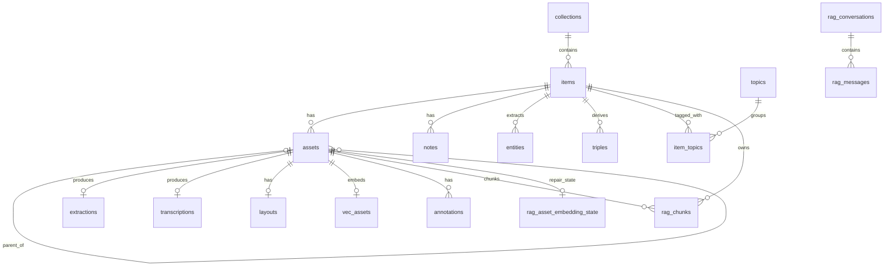

# SQLite de EntropIA Pro/Lite

**English:** [SQLite.en.md](./SQLite.en.md)

Guía operativa del esquema SQLite actual, su creación en runtime y las consultas de diagnóstico. El horizonte migrado es **`0058_processing_ner_tasks`**.

## Contrato actual en una mirada

| Capa | Autoridad | Qué crea |
|---|---|---|
| Esquema migrado | `packages/store/src/migrations/*.sql` (`0001`..`0058`), aplicado por Rust (`apps/desktop/src-tauri/src/db/migrations.rs`); fixture `schema_full.sql` | Tablas de negocio, procesamiento por lotes, Escritura, Zotero/Biblioteca, capturas web, esquemas propios, `vec_assets`, `rag_chunks`, FTS e índices/triggers de migración |
| Inicio/runtime Rust | `db/repairs.rs`, `db/schema_audit.rs`, `settings.rs`, `nlp/embeddings.rs`, `sync/schema.rs` | Reparaciones idempotentes, auditoría de triggers/vistas, `app_settings`, `rag_asset_embedding_state` y diez tablas `sync_*` |
| Internas de SQLite/FTS5 | SQLite | `sqlite_sequence` y tablas shadow de `fts_items`, `rag_chunks_fts` y `bibliographic_profile_fts` |

`packages/store/src/schema.ts` es un modelo ORM parcial. No reemplaza al DDL migrado ni al DDL creado por Rust. El registro de migraciones que usa el renderer (`packages/store/src/migrations.generated.ts`) se genera desde los `.sql` con `pnpm --filter @entropia/store generate-migrations`; las notas de diseño de cada migración están en `packages/store/src/migrations/NOTES.md`.

Investigar guarda el estado de sus trabajos en una base aparte, `research/estado.sqlite`, dentro del mismo directorio de datos. No forma parte de esta guía.

## Ubicaciones

Tauri resuelve el directorio de datos del sistema y EntropIA abre `entropia.sqlite` dentro del directorio compartido `com.entropia.shared`.

| Sistema | Ruta |
|---|---|
| Windows | `%APPDATA%\com.entropia.shared\entropia.sqlite` |
| macOS | `~/Library/Application Support/com.entropia.shared/entropia.sqlite` |
| Linux | `~/.local/share/com.entropia.shared/entropia.sqlite` |
| Perfil de desarrollo (solo builds debug con `ENTROPIA_DEV_PROFILE=<nombre>`) | `<datos>/com.entropia.shared/dev-profiles/<nombre>/entropia.sqlite` |
| Legacy reconocido | ocho identificadores en `LEGACY_APP_IDENTIFIERS` (`lib.rs`): `<datos>/<identificador>/entropia.sqlite` |

Pro, Lite y desarrollo comparten una única base. El directorio compartido no es el
`app_data_dir()` de ninguna: los identificadores no pueden cambiar porque son lo
que permite instalar Lite y Pro en paralelo, así que el canónico es un
directorio fijo hermano de los de cada variante. En la versión MSIX de Microsoft
Store, Windows puede redirigir ese directorio dentro de
`%LOCALAPPDATA%\Packages\CONICET.EntropIALite_…\LocalCache\Roaming\`.

El backend no usa la ruta legacy como base activa. Antes de abrir la base actual, migra o combina el directorio legacy, compara la riqueza de ambas bases cuando existen las dos, conserva un backup antes de reemplazar la actual y reescribe rutas legacy de assets. El marcador `.legacy-app-dir-merged` evita repetir el merge completo.

Abrir la base con `sqlite3` (cerrá EntropIA antes de escribir en ella):

```powershell
sqlite3 "$env:APPDATA\com.entropia.shared\entropia.sqlite"
```

Las copias de seguridad (**Configuración → Copias**) son carpetas `entropia-backup-<UTC>` con una instantánea consistente de la base (`VACUUM INTO`) y el resto del directorio de datos, salvo los archivos vivos de la base, los locks, `dev-profiles` y `models`. Se pueden abrir con `sqlite3` sin tocar la base activa.

## Secuencia de creación

1. Rust resuelve el directorio, migra el directorio legacy y abre conexiones UI/worker con `PRAGMA journal_mode=WAL` y `PRAGMA foreign_keys=ON` (`db/open.rs`).
2. `db::repairs::migrate_archive` corre las reparaciones previas, aplica las migraciones pendientes en orden de nombre —cada una dentro de su propio `BEGIN IMMEDIATE … COMMIT` junto con su fila en `_migrations`— y repite las reparaciones como post-paso. Todo ocurre en el `setup` del backend, antes de que cargue el webview.
3. `db::schema_audit::audit_and_repair` reconstruye en memoria el conjunto canónico de triggers y vistas y reemplaza, en una transacción, cualquier objeto ausente o con definición distinta.
4. Rust asegura `app_settings`, `vec_assets`, `rag_asset_embedding_state` y el esquema sync; sync ejecuta `ensure_capture` para crear los triggers de captura sobre todas las tablas disponibles.
5. El renderer ejecuta `runMigrations()` solo como verificación: comprueba que el horizonte esté aplicado y no ejecuta DDL. Desde la Fase 4.4a un authorizer de SQLite rechaza toda sentencia de esquema (CREATE/DROP/ALTER, REINDEX, ANALYZE) que venga del renderer.
6. Al cerrar, si conviene, la app compacta la base con `VACUUM` y la pasa a `auto_vacuum = INCREMENTAL` (`db/compact.rs`); desde entonces recupera páginas libres de a tramos al iniciar.

`apps/desktop/src-tauri/tests/fixtures/schema_full.sql` representa el resultado migrado de una instalación nueva y `schema_canonical.json` es el volcado canónico que ata el runner de Rust al de TypeScript. No incluyen las tablas exclusivamente runtime (`app_settings`, `rag_asset_embedding_state`, `sync_*`) ni las tablas shadow que SQLite crea al materializar FTS5.

## Clasificación de tablas

### Negocio migrado

`collections`, `items`, `assets`, `notes`, `topics`, `item_topics`, `annotations`, `entities`, `triples`, `extractions`, `transcriptions`, `layouts`, `llm_results`, `rag_conversations`, `rag_messages`.

### Procesamiento por lotes (`0032`+)

`processing_batches`, `processing_batch_collections`, `processing_batch_members`, `processing_tasks`, `processing_batch_tasks`, `processing_requests`, `processing_attempts`, `processing_checkpoints`, `processing_asset_revisions`, `processing_meta`.

### Escritura (`0035`, `0036`)

`writing_documents`, `writing_document_collections`, `writing_document_versions`, `writing_journal`, `writing_document_citations`, `writing_zotero_citations`, `writing_provenance_events`, `writing_agent_suggestions`.

### Zotero y Biblioteca (`0040`–`0056`)

- Catálogo: `zotero_connections`, `zotero_libraries`, `bibliographic_items`, `zotero_collections`, `zotero_tags`, `zotero_attachments`, `zotero_item_collections`, `zotero_item_tags`.
- Reconciliación: `zotero_item_tombstones`, `zotero_collection_tombstones`, `zotero_tag_tombstones`, `zotero_attachment_tombstones`, `zotero_reconciliation_runs`, `zotero_reconciliation_seen`.
- Índice semántico: `bibliographic_semantic_profiles`, `bibliographic_embedding_contracts`, `bibliographic_index_generations`, `bibliographic_item_embeddings`, `bibliographic_profile_fts`.
- Texto y pasajes: `bibliographic_extractions`, `bibliographic_page_texts`, `bibliographic_chunks`, `bibliographic_chunk_spans`, `bibliographic_chunk_embeddings`, `bibliographic_ingest_operations`.

### Capturas web y esquemas propios (`0057`, `0058`)

`web_sources`, `web_captures` (capturas del Navegador experimental) y `extraction_schemas`, `extraction_records` (esquemas propios de Lotes; locales, no se sincronizan).

### Técnicas migradas

`_migrations`, `vec_assets`, `rag_chunks`, `fts_items`, `fts_items_vocab`, `rag_chunks_fts`.

### Creadas o gestionadas en runtime Rust

`app_settings`, `rag_asset_embedding_state`, `sync_meta`, `sync_oplog`, `sync_row_versions`, `sync_conflicts`, `sync_pending_rows`, `sync_pending_blobs`, `sync_web_pending_blobs`, `sync_pending_fts`, `sync_topic_aliases`, `sync_blob_index`.

### Internas de SQLite/FTS5

- `sqlite_sequence`, por el `AUTOINCREMENT` de `_migrations` y `sync_oplog`.
- `fts_items_config`, `fts_items_data`, `fts_items_docsize`, `fts_items_idx`.
- `rag_chunks_fts_config`, `rag_chunks_fts_content`, `rag_chunks_fts_data`, `rag_chunks_fts_docsize`, `rag_chunks_fts_idx`.
- `bibliographic_profile_fts_config`, `bibliographic_profile_fts_content`, `bibliographic_profile_fts_data`, `bibliographic_profile_fts_docsize`, `bibliographic_profile_fts_idx`.

Las tablas shadow son implementación de FTS5, no entidades de negocio. Una base vieja también puede conservar `vec_items` o `embeddings_fallback`; son leftovers legacy y no pertenecen al contrato runtime actual. La migración histórica `0021_drop_unused_processing_table` elimina `jobs`; `processing_*` es el sistema de lotes actual y no tiene relación con esa tabla. Las tablas `_backup_00NN_*` que crean algunas migraciones de reconstrucción se eliminan dentro de la misma migración: si aparece una, la migración no terminó.

## Árbol de columnas

El árbol usa el orden canónico de una instalación nueva; una tabla `layouts` actualizada desde un formato legacy puede conservar `blocks` al final por efecto de `ALTER TABLE`. `items.source_dir` e `items.imported_at` son columnas generadas (`0031`) a partir de `metadata`: `PRAGMA table_xinfo` las muestra como ocultas y sync no las replica; cada equipo las recalcula. `rowid` implícito no se repite salvo donde forma parte del contrato FTS.

```text
entropia.sqlite
├── migrado: negocio
│   ├── collections: id, name, description, created_at, updated_at
│   ├── items: id, title, collection_id, metadata, created_at, updated_at, search_text, source_dir, imported_at
│   ├── assets: id, item_id, path, type, size, created_at, sort_index, parent_asset_id, page_number
│   ├── notes: id, item_id, content, created_at, updated_at, asset_id
│   ├── topics: id, name, created_at
│   ├── item_topics: id, item_id, topic_id, created_at
│   ├── annotations: id, asset_id, page, kind, color, x, y, width, height, created_at, updated_at
│   ├── entities: id, item_id, entity_type, value, start_offset, end_offset, confidence, source, model_name, created_at, latitude, longitude, geo_status, asset_id, manual_lat, manual_lon
│   ├── triples: id, item_id, subject, predicate, object, created_at, asset_id
│   ├── extractions: id, asset_id, text_content, method, confidence, created_at
│   ├── transcriptions: id, asset_id, text_content, language, duration_ms, model, segments, confidence, created_at
│   ├── layouts: id, asset_id, regions, blocks, model, image_width, image_height, created_at
│   ├── llm_results: id, target_id, target_type, job_type, result, created_at
│   ├── rag_conversations: id, title, created_at, updated_at
│   └── rag_messages: id, conversation_id, sort_index, role, content, sources, model, created_at
├── migrado: procesamiento por lotes
│   ├── processing_batches: id, request_id, origin, state, desired_state, operations, config_snapshot_json, planning_cursor, planning_done, revision, created_at, updated_at, started_at, finished_at, last_error, priority
│   ├── processing_batch_collections: batch_id, collection_id_snapshot, name_snapshot
│   ├── processing_batch_members: batch_id, ordinal, asset_id_snapshot, item_id_snapshot, collection_id_snapshot, title_snapshot, classification, reason
│   ├── processing_tasks: id, kind, asset_id_snapshot, input_revision, input_fingerprint, contract_hash, state, stage, progress_done, progress_total, outcome, attempt_count, retry_cycle, retry_count, next_retry_at, owner_session, lease_epoch, heartbeat_at, lease_expires_at, last_error_code, last_error_message, result_receipt_json, created_at, updated_at, source_invalidation_count, domain, subject_kind, subject_id
│   ├── processing_batch_tasks: batch_id, task_id, kind, asset_id_snapshot, request_state, dependency_task_id, domain, subject_kind, subject_id
│   ├── processing_requests: request_id, action, batch_id, payload_hash, state, selection_cursor, response_json, created_at
│   ├── processing_attempts: task_id, attempt_number, lease_epoch, started_at, finished_at, outcome, retryable, error_code, error_message, provider_request_id
│   ├── processing_checkpoints: task_id, unit_key, input_fingerprint, contract_hash, payload, payload_checksum, created_at
│   ├── processing_asset_revisions: asset_id, source_revision, embedding_completed_revision, invalidated_at, invalidation_reason, auto_suppressed_revision
│   └── processing_meta: key, value
├── migrado: Escritura
│   ├── writing_documents: id, title, document_type, status, schema_version, current_content_json, revision, plain_text_cache, citation_style_id, citation_locale, bibliography_enabled, created_at, updated_at, last_opened_at
│   ├── writing_document_collections: document_id, collection_id, is_primary, created_at
│   ├── writing_document_versions: id, document_id, version_number, content_json, schema_version, document_settings_json, reason, content_hash, created_at
│   ├── writing_journal: document_id, seq, base_revision, schema_version, delta_json, checksum, created_at
│   ├── writing_document_citations: id, document_id, citation_node_id, collection_id, item_id, asset_id, page_number, start_char, end_char, source_region_json, quoted_text, source_text_hash, locator_json, metadata_snapshot_json, integrity_status, created_at, updated_at
│   ├── writing_zotero_citations: id, document_id, citation_node_id, citation_cluster_id, item_position, source_origin, source_instance_id, library_type, library_id, item_key, item_version, locator_type, locator, prefix, suffix, suppress_author, author_only, item_csl_json_snapshot, integrity_status, created_at, updated_at
│   ├── writing_provenance_events: id, document_id, version_id, range_anchor_json, origin_type, operation_type, source_reference_json, model_provider, model_name, prompt_template_id, created_at
│   └── writing_agent_suggestions: id, document_id, selection_anchor_json, source_revision, selected_content_hash, action_type, original_text, suggested_text, rationale, evidence_json, status, provider, model, created_at, resolved_at
├── migrado: Zotero y Biblioteca
│   ├── zotero_connections: id, source_origin, source_instance_id, endpoint, capabilities_json, credential_ref, state, revision, created_at, updated_at
│   ├── zotero_libraries: id, connection_id, library_type, library_id, name, last_modified_version, revision, created_at, updated_at
│   ├── bibliographic_items: id, library_id, item_key, item_version, native_json_snapshot, csl_json_snapshot, item_type, title, creators_json, publication_title, publisher, date, doi, isbn, abstract, language, url, revision, created_at, updated_at, verified_at
│   ├── zotero_collections: id, library_id, collection_key, name, parent_collection_key, native_json_snapshot, native_version, revision, created_at, updated_at, verified_at
│   ├── zotero_tags: id, library_id, tag_text, tag_type, native_json_snapshot, native_version, revision, created_at, updated_at, verified_at
│   ├── zotero_attachments: id, item_id, attachment_key, content_type, link_mode, filename, native_path, url, md5, mtime, native_json_snapshot, native_version, revision, created_at, updated_at, verified_at
│   ├── zotero_item_collections: library_id, item_id, collection_id
│   ├── zotero_item_tags: library_id, item_id, tag_id
│   ├── zotero_item_tombstones: item_id, observed_at, remote_version, reason
│   ├── zotero_collection_tombstones: collection_id, observed_at, remote_version, reason
│   ├── zotero_tag_tombstones: tag_id, observed_at, remote_version, reason
│   ├── zotero_attachment_tombstones: attachment_id, observed_at, remote_version, reason
│   ├── zotero_reconciliation_runs: library_id, run_id, connection_revision, state, phase, cursor_start, cursor_limit, remote_total, target_version, checkpoint_version, retry_count, attempt_count, next_retry_at, last_attempt_at, latest_error_phase, latest_error_code, latest_error_message, latest_error_retryable, latest_error_at, revision, checkpointed_at, completed_at, created_at, updated_at
│   ├── zotero_reconciliation_seen: library_id, run_id, entity_kind, entity_key, parent_key, remote_version, observed_at
│   ├── bibliographic_semantic_profiles: item_id, profile_revision, template_version, canonical_text, input_hash, field_provenance_json, created_at, updated_at
│   ├── bibliographic_embedding_contracts: contract_hash, provider, model, dimensions, chunking_contract, created_at
│   ├── bibliographic_index_generations: id, contract_hash, status, expected_inputs, completed_inputs, created_at, activated_at, retired_at
│   ├── bibliographic_item_embeddings: item_id, generation_id, embedding_contract, embedding_model, dimensions, embedding, input_hash, profile_revision, created_at, updated_at
│   ├── bibliographic_extractions: attachment_id, item_id, page_count, method, text_content, text_hash, text_chars, quality, source_mtime, source_bytes, created_at, updated_at
│   ├── bibliographic_page_texts: attachment_id, page_number, method, text_content, text_hash, text_chars, quality, created_at, updated_at
│   ├── bibliographic_chunks: id, item_id, attachment_id, ordinal, text_content, text_hash, chunking_contract, created_at, updated_at
│   ├── bibliographic_chunk_spans: chunk_id, page_number, start_char, end_char
│   ├── bibliographic_chunk_embeddings: chunk_id, generation_id, embedding_contract, embedding_model, dimensions, embedding, input_hash, created_at, updated_at
│   └── bibliographic_ingest_operations: id, request_id, kind, library_id, payload_json, state, attempt_count, receipt_json, last_error_code, last_error_message, created_at, updated_at
├── migrado: capturas web y esquemas propios
│   ├── web_sources: id, original_url, final_url, canonical_url, title, site_name, first_accessed_at, created_at, updated_at
│   ├── web_captures: id, web_source_id, accessed_at, final_url, kind, mime_type, text, text_rel_path, quote_prefix, quote_suffix, rel_path, sha256, hash_of, size_bytes, extractor_version, title, created_at
│   ├── extraction_schemas: id, name, fields_json, model, created_at, updated_at
│   └── extraction_records: id, schema_id, asset_id, item_id, record_json, created_at
├── migrado: técnico/RAG
│   ├── _migrations: id, name, applied_at
│   ├── vec_assets: asset_id, item_id, embedding, embedding_model, embedding_contract, dimensions
│   ├── rag_chunks: id, asset_id, item_id, source_kind, source_id, chunk_ordinal, text_content, start_char, end_char, source_text_hash, chunking_contract, embedding, embedding_model, embedding_contract, dimensions
│   ├── fts_items: item_id, title, metadata, extracted_text
│   ├── fts_items_vocab: term, doc, cnt
│   ├── rag_chunks_fts: chunk_id, text_content
│   └── bibliographic_profile_fts: item_id, canonical_text
├── runtime Rust
│   ├── app_settings: key, value
│   ├── rag_asset_embedding_state: asset_id, item_id, rag_incomplete, failure_count, next_retry_at_ms, last_error, updated_at_ms
│   ├── sync_meta: key, value
│   ├── sync_oplog: seq, table_name, row_id, op, changed_at
│   ├── sync_row_versions: table_name, row_id, server_seq
│   ├── sync_conflicts: id, table_name, row_id, reason, loser_payload, winner_summary, created_at, acknowledged
│   ├── sync_pending_rows: table_name, row_id, server_seq, deleted, changed_at, device_id, payload, retry_count, parked_schema_head
│   ├── sync_pending_blobs: asset_id, sha256, rel_path, size, retry_count, last_error, last_attempt_at
│   ├── sync_web_pending_blobs: capture_id, role, sha256, rel_path, size, retry_count, last_error, last_attempt_at
│   ├── sync_pending_fts: item_id
│   ├── sync_topic_aliases: remote_id, local_id
│   └── sync_blob_index: asset_id, sha256, size, file_mtime_ms, uploaded
└── shadow FTS5
    ├── fts_items_config: k, v
    ├── fts_items_data: id, block
    ├── fts_items_docsize: id, sz, origin
    ├── fts_items_idx: segid, term, pgno
    ├── rag_chunks_fts_config: k, v
    ├── rag_chunks_fts_content: id, c0, c1
    ├── rag_chunks_fts_data: id, block
    ├── rag_chunks_fts_docsize: id, sz
    ├── rag_chunks_fts_idx: segid, term, pgno
    ├── bibliographic_profile_fts_config: k, v
    ├── bibliographic_profile_fts_content: id, c0, c1
    ├── bibliographic_profile_fts_data: id, block
    ├── bibliographic_profile_fts_docsize: id, sz
    └── bibliographic_profile_fts_idx: segid, term, pgno
```

## Contrato de tipos para clientes

El contrato formal (tipos semánticos por columna, unidades de timestamp, formas de JSON/BLOB) está materializado en el manifest de `entropiaR` (`inst/schemas/manifest.json` del paquete R) y se aplica al materializar con `entropia_collect()`. Esta sección resume lo que un cliente de solo lectura debe aplicar.

### Unidades de timestamp (la trampa más común)

| Unidad | Criterio de magnitud | Columnas |
|---|---|---|
| Epoch **ms** (13 dígitos) | valor ≥ 1e12 | `created_at`/`updated_at` de `collections`, `items`, `assets`, `extractions`, `transcriptions`, `layouts`, `notes`, `annotations`, `llm_results`, `rag_conversations`, `rag_messages`; `sync_conflicts.created_at`; `rag_asset_embedding_state.next_retry_at_ms`/`updated_at_ms`; los timestamps de la familia `processing_*` (sus triggers escriben `strftime('%s','now') * 1000`) |
| Epoch **segundos** (10 dígitos) | valor < 1e12 | `_migrations.applied_at` |
| **`datetime_auto`** (ms o segundos) | guard `< 1e12 ⟹ segundos` | `entities.created_at`, `triples.created_at` |
| ISO-8601 string | dentro de JSON | `items.metadata.__entropia_file_metadata.importedAt` (`YYYY-MM-DDTHH:MM:SSZ`), y por lo tanto la columna generada `items.imported_at` |

> `entities.created_at` y `triples.created_at` tienen como DDL default `strftime('%s','now')` (epoch **segundos**), pero la app escribe epoch **ms** en la práctica. Un cliente debe aplicar el guard de magnitud `< 1e12` (la misma regla que usó la migración `0019`), no asumir una sola unidad. Para las familias de Escritura, Zotero/Biblioteca y capturas web, aplicá el mismo guard antes de convertir.

### Columnas JSON dentro de TEXT

| Columna | Shape |
|---|---|
| `items.metadata` | objeto; `__entropia_file_metadata` anidado (`originalName`, `originalPath`, `importedAt` ISO-8601); los PDF de Internet Archive agregan su procedencia |
| `transcriptions.segments` | array de `{start_ms, end_ms, text}` |
| `layouts.regions` / `layouts.blocks` | arrays de regiones/bloques |
| `rag_messages.sources` | array de citas |
| `llm_results.result` | resultado del job (texto o JSON según `job_type`) |
| `sync_conflicts.loser_payload` / `winner_summary` | payloads del conflicto LWW |
| `processing_batches.operations` / `config_snapshot_json` | operaciones y configuración congeladas del lote |
| `writing_documents.current_content_json`, `writing_document_versions.content_json` | documento ProseMirror del manuscrito |
| `bibliographic_items.native_json_snapshot` / `csl_json_snapshot` / `creators_json` | ficha de Zotero tal como llegó y su versión CSL |
| `extraction_schemas.fields_json` / `extraction_records.record_json` | campos del esquema propio y una fila extraída |

### BLOB de embedding

`vec_assets.embedding`, `rag_chunks.embedding`, `bibliographic_item_embeddings.embedding` y `bibliographic_chunk_embeddings.embedding` son vectores `f32` **little-endian** crudos: `dimensions` × 4 bytes (1024 dims = 4096 bytes). No deben seleccionarse por defecto en joins; el acceso es explícito (en `entropiaR`, `with_vector = TRUE`).

### IDs determinísticos (útiles para joins)

| Tabla | Formato |
|---|---|
| `extractions` | `ext-` ∥ `asset_id` |
| `transcriptions` | `trx-` ∥ `asset_id` |
| `layouts` | `lay-` ∥ `asset_id` |
| `llm_results` | `llr-{target_type}-{target_id}-{job_type}` |
| `rag_chunks` | `ragchk-` ∥ sha256 del contenido |

El resto de PK son `TEXT` UUIDv4; la PK de `vec_assets` es `asset_id`.

### Ocultamiento y secretos

- `entities.source = 'manual_deleted'` = soft-delete: la fila persiste pero la app la oculta. Un lector que quiera el conjunto visible debe filtrarla.
- Las API keys viven en el almacén de credenciales del sistema operativo; `app_settings` guarda configuración (y, en bases viejas, puede conservar claves `*_api_key` previas a esa migración). No forma parte de ninguna superficie de lectura de `entropiaR`; un cliente no debe exponer sus valores crudos. `sync_meta` sí tiene keys permitidas (ver sección sync).

### Referencias conceptuales sin FK física

`notes/entities/triples.asset_id`, `llm_results.target_id`, `rag_chunks.source_id` (→ `extractions.id`/`transcriptions.id` según `source_kind`) y las referencias sync (`sync_row_versions.row_id`, etc.) no tienen constraint física. `PRAGMA foreign_keys` está activo solo donde hay FK declarada; un cliente debe validar estas referencias por su cuenta.

## PK, FK y constraints

| Tabla | PK | FK físicas y constraints principales |
|---|---|---|
| `_migrations` | `id` AUTOINCREMENT | `name UNIQUE NOT NULL` |
| `collections` | `id` | `name`, `created_at`, `updated_at` NOT NULL |
| `items` | `id` | `collection_id -> collections.id`; `search_text` es GENERATED STORED |
| `assets` | `id` | `item_id -> items.id`; `parent_asset_id -> assets.id ON DELETE CASCADE`; UNIQUE parcial `(parent_asset_id, page_number)` cuando el padre no es NULL |
| `notes` | `id` | `item_id -> items.id`; `asset_id` es referencia conceptual sin FK física |
| `topics` | `id` | `name UNIQUE NOT NULL` |
| `item_topics` | `id` | ambas FK tienen `ON DELETE CASCADE`; UNIQUE `(item_id, topic_id)` |
| `annotations` | `id` | `asset_id -> assets.id ON DELETE CASCADE`; `kind IN ('rectangle','underline','crop','erase','rotation')` |
| `entities` | `id` | `item_id -> items.id ON DELETE CASCADE`; `asset_id` conceptual; `entity_type` tiene CHECK; defaults de offsets/confidence/geo_status |
| `triples` | `id` | `item_id -> items.id ON DELETE CASCADE`; `asset_id` conceptual |
| `extractions` | `id` | `asset_id -> assets.id ON DELETE CASCADE`; UNIQUE `(asset_id)` |
| `transcriptions` | `id` | `asset_id -> assets.id ON DELETE CASCADE`; UNIQUE `(asset_id)` |
| `layouts` | `id` | `asset_id -> assets.id ON DELETE CASCADE`; UNIQUE `(asset_id)`, por lo tanto 0..1 layout por asset; `blocks DEFAULT '[]'` |
| `llm_results` | `id` | `target_id` conceptual; `target_type IN ('asset','item','collection','unknown')` |
| `rag_conversations` | `id` | timestamps y título NOT NULL |
| `rag_messages` | `id` | `conversation_id -> rag_conversations.id ON DELETE CASCADE`; `role IN ('user','assistant')` |
| `vec_assets` | `asset_id` | sin FK física; `item_id`, embedding y contrato NOT NULL |
| `rag_chunks` | `id` | FK a `assets` e `items`, ambas CASCADE; `source_kind IN ('extraction','transcription')`; offsets/dimensiones con CHECK; UNIQUE `(asset_id, source_kind, source_id, chunk_ordinal)` |
| `rag_asset_embedding_state` | `asset_id` | sin FK física; flags/contadores/timestamps con defaults `0` |
| `app_settings`, `sync_meta` | `key` | `value NOT NULL` |
| `sync_oplog` | `seq` AUTOINCREMENT | `op IN ('I','U','D')` |
| `sync_row_versions` | `(table_name, row_id)` | sin FK físicas |
| `sync_pending_rows` | `(table_name, row_id)` | defaults de retry; sin FK físicas |
| `sync_conflicts` | `id` | `acknowledged DEFAULT 0` |
| `sync_pending_blobs` | `asset_id` | `retry_count DEFAULT 0` |
| `sync_web_pending_blobs` | `(capture_id, role)` | `role IN ('file','text')`; `retry_count DEFAULT 0` |
| `sync_pending_fts` | `item_id` | sin FK física |
| `sync_topic_aliases` | `remote_id` | `local_id NOT NULL` |
| `sync_blob_index` | `asset_id` | `uploaded DEFAULT 0` |

`rag_chunks.source_id` apunta lógicamente a `extractions.id` o `transcriptions.id` según `source_kind`, pero no tiene FK física. Lo mismo ocurre con varias referencias auxiliares y sync: su integridad depende del runtime.

### Familias nuevas (`0032`–`0058`)

| Tabla | PK | FK físicas y constraints principales |
|---|---|---|
| `processing_batches` | `id` | `origin IN ('user','manual','repair','bibliography')`; `state` entre `preparing`…`completed_with_errors`; `desired_state IN ('run','pause','cancel')`; `priority IN (0,1,2)` |
| `processing_tasks` | `id` | `kind IN ('ocr','embedding','bibliography_sync','bibliography_profile','bibliography_extract','ner','triples','schema_extract')`; `state IN ('pending','blocked','running','retry_wait','interrupted','succeeded','failed','skipped','cancelled')`; UNIQUE parcial por sujeto activo (`domain`, `subject_kind`, `subject_id`) |
| `processing_batch_collections`, `processing_batch_members`, `processing_requests` | `(batch_id, …)` / `request_id` | `batch_id -> processing_batches.id ON DELETE CASCADE` |
| `processing_batch_tasks` | `(batch_id, task_id)` | `batch_id` CASCADE; `task_id` y `dependency_task_id -> processing_tasks.id` |
| `processing_attempts`, `processing_checkpoints` | `(task_id, attempt_number)` / `(task_id, unit_key)` | `task_id -> processing_tasks.id ON DELETE CASCADE` |
| `processing_asset_revisions` | `asset_id` | `asset_id -> assets.id ON DELETE CASCADE` |
| `writing_documents` | `id` | sin FK |
| `writing_document_versions`, `writing_document_citations`, `writing_zotero_citations`, `writing_agent_suggestions` | `id` | `document_id -> writing_documents.id ON DELETE CASCADE`; `writing_document_versions.reason IN ('auto','close','checkpoint','restore','migration')` |
| `writing_document_collections` | `(document_id, collection_id)` | ambas FK con CASCADE |
| `writing_journal` | `(document_id, seq)` | `document_id` CASCADE |
| `writing_provenance_events` | `id` | `document_id` CASCADE; `version_id -> writing_document_versions.id` |
| `zotero_connections` → `zotero_libraries` → `bibliographic_items`, `zotero_collections`, `zotero_tags` | `id` | cadena de FK con CASCADE (`connection_id`, `library_id`) |
| `zotero_attachments` | `id` | `item_id -> bibliographic_items.id ON DELETE CASCADE` |
| `zotero_item_collections`, `zotero_item_tags` | `(library_id, item_id, …)` | FK compuestas con CASCADE: una obra no puede asociarse a una colección o etiqueta de otra biblioteca |
| `zotero_*_tombstones` | id de la entidad | FK a la entidad con CASCADE |
| `zotero_reconciliation_runs` / `_seen` | `library_id` / clave compuesta | FK a `zotero_libraries` y a la corrida, con CASCADE |
| `bibliographic_semantic_profiles` | `item_id` | `item_id -> bibliographic_items.id ON DELETE CASCADE` |
| `bibliographic_index_generations` | `id` | `contract_hash -> bibliographic_embedding_contracts.contract_hash`; una sola generación activa por contrato (índice parcial) |
| `bibliographic_item_embeddings`, `bibliographic_chunk_embeddings` | `(item_id|chunk_id, generation_id)` | `generation_id -> bibliographic_index_generations.id`; la obra o el chunk con CASCADE |
| `bibliographic_extractions`, `bibliographic_page_texts` | `attachment_id` / `(attachment_id, page_number)` | `attachment_id -> zotero_attachments.id ON DELETE CASCADE` |
| `bibliographic_chunks` | `id` | `item_id` y `attachment_id` con CASCADE |
| `bibliographic_chunk_spans` | `(chunk_id, page_number, start_char)` | `chunk_id` CASCADE |
| `bibliographic_ingest_operations` | `id` | `library_id -> zotero_libraries.id ON DELETE CASCADE` |
| `web_captures` | `id` | `web_source_id -> web_sources.id ON DELETE CASCADE` |
| `extraction_records` | `id` | `schema_id -> extraction_schemas.id` y `asset_id -> assets.id`, ambas CASCADE |

## Índices relevantes

### Negocio y procesamiento

- Items/assets: `idx_items_search(search_text)`, `idx_items_collection(collection_id)`, `idx_items_collection_source_dir(collection_id, source_dir, title COLLATE NOCASE, id)`, `idx_items_collection_source_dir_import(collection_id, source_dir, imported_at)`, `idx_items_import_source(collection_id, lower(json_extract(metadata, '$.__entropia_file_metadata.originalPath')))`, `idx_assets_item(item_id)`, `idx_assets_item_sort(item_id, sort_index)`, `idx_assets_parent_asset_id(parent_asset_id)`, `idx_assets_parent_page(parent_asset_id, page_number)` UNIQUE parcial, `idx_items_collection_title(collection_id, title COLLATE NOCASE, id)`.
- `idx_items_collection_title` cubre de punta a punta la consulta de la grilla de colecciones: el filtro por `collection_id`, el `ORDER BY title COLLATE NOCASE, id` y el cursor keyset construido sobre ese mismo par. Sin las columnas de orden en el índice, SQLite filtra por `idx_items_collection` y después ordena todo el resultado en un b-tree temporal cada vez que se abre una colección.
- Derivados por asset: `idx_extractions_asset_id`, `idx_extractions_asset_id_unique` UNIQUE, `idx_transcriptions_asset_id`, `idx_transcriptions_asset_id_unique` UNIQUE, `idx_layouts_asset_id`, `idx_layouts_asset_id_unique` UNIQUE, `annotations_asset_id_idx`, `annotations_asset_page_idx`.
- Semántica: `idx_notes_item`, `idx_notes_asset_id`, `idx_entities_item_id`, `idx_entities_type`, `idx_entities_geo_status`, `idx_entities_asset_id`, `triples_item_id_idx`, `idx_triples_asset_id`.
- Topics/LLM: `idx_item_topics_item_topic` UNIQUE, `idx_item_topics_topic_id`, `idx_llm_results_target`, `idx_llm_results_target_typed`.

### RAG, estado y sync

- `idx_rag_messages_conversation(conversation_id, sort_index)`.
- `idx_vec_assets_item_id(item_id)`.
- `idx_rag_chunks_asset_id(asset_id)`, `idx_rag_chunks_item_id(item_id)`, `idx_rag_chunks_embedding_contract(embedding_model, embedding_contract, dimensions)`.
- `idx_rag_asset_embedding_state_due(rag_incomplete, next_retry_at_ms)`.
- `idx_sync_oplog_row(table_name, row_id)`.

### Lotes, Escritura y Biblioteca

- Lotes: `idx_processing_batches_priority`, `idx_processing_tasks_state_id`, `idx_processing_tasks_claimable`, `idx_processing_tasks_subject_active_unique` (UNIQUE parcial), `idx_processing_batch_tasks_batch`, `idx_processing_batch_tasks_task`, `idx_processing_batch_tasks_dependency`, `idx_processing_members_batch_asset`, `idx_processing_attempts_task`.
- Escritura: `idx_writing_documents_status_updated`, `idx_writing_document_versions_document`, `idx_writing_journal_replay`, `idx_writing_document_citations_asset`, `idx_writing_zotero_citations_item`, `idx_writing_document_collections_collection`, `idx_writing_provenance_events_document`, `idx_writing_agent_suggestions_document`.
- Zotero/Biblioteca: índices de identidad por biblioteca (`idx_bibliographic_items_library_key`, `idx_zotero_collections_library_key`, `idx_zotero_tags_library_text`, `idx_zotero_attachments_item_key`, `idx_zotero_libraries_identity`), `idx_bibliographic_items_title`, `idx_bibliographic_chunks_item`, `idx_bibliographic_page_texts_attachment`, `idx_bibliographic_generations_single_active` y los índices por hash y generación de los embeddings.
- Otros: `idx_web_sources_final_url`, `idx_web_sources_updated`, `idx_web_captures_source`, `idx_extraction_records_schema_asset`.

SQLite también crea índices automáticos para PK/UNIQUE; no se enumeran porque sus nombres `sqlite_autoindex_*` son detalles de implementación.

## Triggers runtime

| Familia | Cantidad | Alcance | Comportamiento |
|---|---:|---|---|
| `collection_activity_*` | 33 | 11 tablas x INSERT/UPDATE/DELETE | Actualiza monotónicamente `collections.updated_at` para `items`, `assets`, `notes`, `extractions`, `layouts`, `transcriptions`, `annotations`, `entities`, `triples`, `vec_assets`, `llm_results` |
| `rag_chunks_fts_*` | 2 | INSERT y DELETE sobre `rag_chunks` | Inserta/elimina el documento correspondiente en `rag_chunks_fts` |
| `trg_processing_extractions_*`, `trg_processing_transcriptions_*` | 6 | INSERT/UPDATE/DELETE sobre `extractions` y `transcriptions` | Marcan la revisión de origen del asset en `processing_asset_revisions` para que el lote invalide embeddings viejos |
| `processing_tasks_settle_dependents` | 1 | `processing_tasks` | Cuando una tarea termina, pasa a `pending` las tareas bloqueadas que dependían de ella o, si no tuvo éxito, las marca `failed` con `dependency_failed` |
| `bibliographic_profile_fts_*` | 3 | INSERT/UPDATE/DELETE sobre `bibliographic_semantic_profiles` | Mantienen `bibliographic_profile_fts` |
| `trg_sync_*` | 54 | 18 tablas x INSERT/UPDATE/DELETE | Agrega operaciones a `sync_oplog` cuando capture está habilitado y no se está aplicando un pull |

La allowlist sync exacta es: `collections`, `items`, `assets`, `notes`, `annotations`, `extractions`, `transcriptions`, `layouts`, `entities`, `triples`, `topics`, `item_topics`, `llm_results`, `rag_conversations`, `rag_messages`, `vec_assets`, `web_sources`, `web_captures` (estas dos solo viajan si el servidor anuncia la capacidad `web-capture-v1`).

Los manuscritos (`writing_*`) y las investigaciones terminadas no pasan por estos triggers: tienen ciclos de sync propios (`sync/writing_*.rs`, `sync/research_*.rs`) con su propio estado en `sync_meta`. Las familias `processing_*`, `zotero_*`/`bibliographic_*` y `extraction_*` son locales.

`rag_chunks` y `rag_asset_embedding_state` **no están en la allowlist sync**: chunks y estado de reparación son derivados/locales. Tampoco se sincronizan tablas FTS ni `sync_*`. Los triggers sync requieren `sync_meta.capture_enabled='1'` y `sync_meta.applying<>'1'`; sin `device_id`, `ensure_capture` vacía `sync_oplog`. La versión actual del template es `triggers_version='2'`. `ensure_capture` corre siempre los 54 `CREATE TRIGGER IF NOT EXISTS`, así que se auto-repara después de una migración que reconstruye una tabla.

`rag_chunks_fts` no tiene trigger UPDATE. El runtime reemplaza chunks mediante delete/insert; una actualización SQL manual de `rag_chunks.text_content` dejaría el FTS desfasado y debe evitarse o acompañarse de una reindexación explícita.

## Contratos FTS5

### `fts_items`: contentless y alineado por `rowid`

`fts_items` usa `content=''` y tokenizer `unicode61 remove_diacritics 1`. Sus columnas declaradas no son contenido recuperable: en una tabla contentless pueden leerse como NULL. El contrato es `fts_items.rowid = items.rowid`; toda lectura de identidad/título/metadata debe hacer JOIN con `items` por `rowid`.

```sql
SELECT
  i.id AS item_id,
  i.title,
  bm25(fts_items) AS rank
FROM fts_items
JOIN items i ON i.rowid = fts_items.rowid
WHERE fts_items MATCH 'archivo OR documento'
ORDER BY bm25(fts_items)
LIMIT 20;
```

No uses `SELECT item_id, title FROM fts_items` para recuperar payload ni borres por `item_id`. Los inserts escriben `rowid` explícito; ante drift, el procedimiento seguro es `INSERT INTO fts_items(fts_items) VALUES('delete-all')` seguido de rebuild. `0004` establece el baseline y `0018` corrige bases existentes.

### `rag_chunks_fts`: FTS con contenido a nivel chunk

`rag_chunks_fts` conserva `chunk_id` y `text_content`; se vincula a `rag_chunks.id` y usa el mismo tokenizer.

```sql
SELECT
  rc.id AS chunk_id,
  rc.asset_id,
  rc.item_id,
  rc.source_kind,
  rc.chunk_ordinal,
  snippet(rag_chunks_fts, 1, '[', ']', '...', 20) AS preview
FROM rag_chunks_fts
JOIN rag_chunks rc ON rc.id = rag_chunks_fts.chunk_id
WHERE rag_chunks_fts MATCH 'archivo OR documento'
ORDER BY bm25(rag_chunks_fts)
LIMIT 20;
```

### `fts_items_vocab` y `bibliographic_profile_fts`

`fts_items_vocab` es una tabla `fts5vocab(fts_items, 'row')`: expone los términos del índice con su cantidad de documentos y de apariciones, y la usa la búsqueda aproximada para proponer variantes de escritura. `bibliographic_profile_fts` indexa el perfil canónico de cada obra de la Biblioteca (`item_id`, `canonical_text`) con el mismo tokenizer y se mantiene por triggers sobre `bibliographic_semantic_profiles`.

```sql
SELECT term, doc, cnt
FROM fts_items_vocab
WHERE term LIKE 'archiv%'
ORDER BY doc DESC
LIMIT 20;
```

## ERD

```text
collections 1 ── N items 1 ── N assets
                                ├── 0..1 extractions
                                ├── 0..1 transcriptions
                                ├── 0..1 layouts
                                ├── 0..1 vec_assets
                                ├── 0..N annotations
                                ├── 0..N rag_chunks
                                ├── 0..1 rag_asset_embedding_state (conceptual/runtime)
                                └── 0..N child assets (parent_asset_id)

items ──< notes / entities / triples / rag_chunks
items >──< topics via item_topics
rag_conversations 1 ── N rag_messages

fts_items.rowid ── items.rowid
rag_chunks_fts.chunk_id ── rag_chunks.id

processing_batches 1 ── N processing_batch_tasks N ── 1 processing_tasks
processing_tasks 1 ── N processing_attempts / processing_checkpoints

writing_documents 1 ── N writing_document_versions / writing_journal
                    ├── N writing_document_citations (── items/assets, conceptual)
                    ├── N writing_zotero_citations (── bibliographic_items, conceptual)
                    └── N writing_document_collections N ── 1 collections

zotero_connections 1 ── N zotero_libraries 1 ── N bibliographic_items 1 ── N zotero_attachments
bibliographic_items 1 ── 0..1 bibliographic_semantic_profiles
zotero_attachments 1 ── 0..1 bibliographic_extractions, N bibliographic_page_texts, N bibliographic_chunks
bibliographic_chunks 1 ── N bibliographic_chunk_spans / bibliographic_chunk_embeddings

extraction_schemas 1 ── N extraction_records N ── 1 assets
web_sources 1 ── N web_captures
```



Las relaciones con `rag_asset_embedding_state`, FTS y varias columnas `asset_id` auxiliares son conceptuales; la tabla de constraints anterior distingue el enforcement físico.

## Inspección estructural

Estas consultas inspeccionan la base que realmente abriste; no presuponen que todas las capas runtime ya se hayan inicializado.

```sql
.tables
.schema

SELECT type, name, tbl_name
FROM sqlite_master
WHERE name NOT LIKE 'sqlite_autoindex_%'
ORDER BY type, name;

SELECT name, applied_at
FROM _migrations
ORDER BY name DESC
LIMIT 10;

SELECT name
FROM _migrations
WHERE name = '0058_processing_ner_tasks';

-- Si aparece alguna, una migración de reconstrucción no terminó.
SELECT name FROM sqlite_master WHERE type = 'table' AND name LIKE '\_backup\_%' ESCAPE '\';

PRAGMA table_xinfo(items);
PRAGMA foreign_key_list(assets);
PRAGMA index_list(rag_chunks);
```

El inventario de esta guía se deriva del fixture migrado y de los DDL runtime autoritativos; no afirma haber consultado una base de usuario concreta. En una base real pueden faltar tablas runtime todavía no inicializadas o aparecer leftovers legacy.

## Queries operativas

### Assets y procesamiento

```sql
SELECT
  a.id,
  a.item_id,
  a.parent_asset_id,
  a.page_number,
  a.path,
  a.type,
  a.sort_index,
  CASE WHEN e.asset_id IS NOT NULL THEN 1 ELSE 0 END AS has_extraction,
  CASE WHEN t.asset_id IS NOT NULL THEN 1 ELSE 0 END AS has_transcription,
  CASE WHEN l.asset_id IS NOT NULL THEN 1 ELSE 0 END AS has_layout
FROM assets a
LEFT JOIN extractions e ON e.asset_id = a.id
LEFT JOIN transcriptions t ON t.asset_id = a.id
LEFT JOIN layouts l ON l.asset_id = a.id
WHERE a.item_id = 'ITEM_ID'
ORDER BY a.sort_index, a.page_number, a.created_at;
```

### Contenido y enriquecimiento semántico

```sql
SELECT id, title, collection_id, metadata, search_text, created_at, updated_at
FROM items
WHERE id = 'ITEM_ID';

SELECT id, asset_id, model, image_width, image_height, regions, blocks, created_at
FROM layouts
WHERE asset_id = 'ASSET_ID';

SELECT
  id,
  item_id,
  asset_id,
  entity_type,
  value,
  confidence,
  latitude,
  longitude,
  manual_lat,
  manual_lon,
  geo_status,
  source,
  model_name
FROM entities
WHERE item_id = 'ITEM_ID'
ORDER BY confidence DESC, value;

SELECT id, asset_id, page, kind, color, x, y, width, height, created_at, updated_at
FROM annotations
WHERE asset_id = 'ASSET_ID'
ORDER BY page, created_at;
```

### Conversaciones y mensajes RAG

```sql
SELECT
  c.id AS conversation_id,
  c.title,
  m.id AS message_id,
  m.sort_index,
  m.role,
  m.model,
  m.created_at,
  m.content,
  m.sources
FROM rag_conversations c
LEFT JOIN rag_messages m ON m.conversation_id = c.id
WHERE c.id = 'CONVERSATION_ID'
ORDER BY m.sort_index;
```

### Chunks y contratos de embedding

```sql
SELECT
  id,
  asset_id,
  item_id,
  source_kind,
  source_id,
  chunk_ordinal,
  start_char,
  end_char,
  length(text_content) AS text_chars,
  length(embedding) AS embedding_bytes,
  embedding_model,
  embedding_contract,
  dimensions,
  chunking_contract
FROM rag_chunks
WHERE asset_id = 'ASSET_ID'
ORDER BY source_kind, source_id, chunk_ordinal;
```

```sql
SELECT
  asset_id,
  item_id,
  length(embedding) AS embedding_bytes,
  embedding_model,
  embedding_contract,
  dimensions
FROM vec_assets
WHERE asset_id = 'ASSET_ID';
```

### Estado de reparación RAG

```sql
SELECT
  asset_id,
  item_id,
  rag_incomplete,
  failure_count,
  next_retry_at_ms,
  datetime(next_retry_at_ms / 1000, 'unixepoch', 'localtime') AS next_retry_local,
  last_error,
  updated_at_ms
FROM rag_asset_embedding_state
WHERE rag_incomplete = 1
ORDER BY next_retry_at_ms, asset_id;
```

Una fila marca persistencia RAG incompleta o un retry pendiente. Al completarse correctamente `vec_assets + rag_chunks`, el runtime elimina la fila de estado; ausencia de fila no significa por sí sola que exista un embedding.

### Diagnóstico sync

```sql
SELECT key, value
FROM sync_meta
ORDER BY key;

SELECT table_name, row_id, MAX(seq) AS latest_seq, COUNT(*) AS operations
FROM sync_oplog
GROUP BY table_name, row_id
ORDER BY latest_seq;

SELECT id, table_name, row_id, reason, created_at, acknowledged
FROM sync_conflicts
WHERE acknowledged = 0
ORDER BY created_at DESC;

SELECT 'pending_rows' AS queue, COUNT(*) AS pending FROM sync_pending_rows
UNION ALL
SELECT 'pending_blobs', COUNT(*) FROM sync_pending_blobs
UNION ALL
SELECT 'pending_fts', COUNT(*) FROM sync_pending_fts;

SELECT table_name, COUNT(*) AS versioned_rows, MAX(server_seq) AS latest_server_seq
FROM sync_row_versions
GROUP BY table_name
ORDER BY table_name;

SELECT uploaded, COUNT(*) AS blobs, SUM(size) AS bytes
FROM sync_blob_index
GROUP BY uploaded
ORDER BY uploaded;

SELECT remote_id, local_id
FROM sync_topic_aliases
ORDER BY remote_id;

SELECT COUNT(*) AS sync_trigger_count
FROM sqlite_master
WHERE type = 'trigger' AND name LIKE 'trg_sync_%';

SELECT name, tbl_name
FROM sqlite_master
WHERE type = 'trigger' AND name LIKE 'trg_sync_%'
ORDER BY tbl_name, name;
```

En un esquema completamente migrado y con capture asegurado, el conteo esperado es 54. Un valor menor puede indicar que faltan tablas/migraciones o que `ensure_capture` todavía no se reejecutó.

### Lotes y tareas de procesamiento

```sql
SELECT id, origin, state, desired_state, priority, operations,
       datetime(created_at / 1000, 'unixepoch', 'localtime') AS created_local,
       last_error
FROM processing_batches
ORDER BY created_at DESC
LIMIT 20;

SELECT kind, state, COUNT(*) AS tasks
FROM processing_tasks
GROUP BY kind, state
ORDER BY kind, state;

SELECT t.id, t.kind, t.subject_kind, t.subject_id, t.state, t.attempt_count,
       t.last_error_code, t.last_error_message
FROM processing_batch_tasks bt
JOIN processing_tasks t ON t.id = bt.task_id
WHERE bt.batch_id = 'BATCH_ID' AND t.state IN ('failed', 'blocked', 'interrupted', 'retry_wait')
ORDER BY t.updated_at DESC;

SELECT attempt_number, outcome, retryable, error_code, error_message,
       datetime(started_at / 1000, 'unixepoch', 'localtime') AS started_local
FROM processing_attempts
WHERE task_id = 'TASK_ID'
ORDER BY attempt_number;
```

### Escritura

```sql
SELECT id, title, status, revision, schema_version,
       datetime(updated_at / 1000, 'unixepoch', 'localtime') AS updated_local
FROM writing_documents
ORDER BY updated_at DESC;

SELECT version_number, reason, content_hash, created_at
FROM writing_document_versions
WHERE document_id = 'DOCUMENT_ID'
ORDER BY version_number DESC;

SELECT integrity_status, COUNT(*) FROM writing_document_citations
WHERE document_id = 'DOCUMENT_ID' GROUP BY integrity_status;
```

### Biblioteca (Zotero)

```sql
SELECT l.id, l.library_type, l.library_id, l.name, COUNT(i.id) AS works
FROM zotero_libraries l
LEFT JOIN bibliographic_items i ON i.library_id = l.id
GROUP BY l.id
ORDER BY works DESC;

SELECT library_id, state, phase, remote_total, retry_count,
       latest_error_code, latest_error_message
FROM zotero_reconciliation_runs;

SELECT method, quality, COUNT(*) AS pages
FROM bibliographic_page_texts
GROUP BY method, quality
ORDER BY pages DESC;

SELECT id, contract_hash, status, expected_inputs, completed_inputs, activated_at
FROM bibliographic_index_generations
ORDER BY created_at DESC;
```

Una generación con `status = 'active'` habilita la búsqueda por significado; mientras `completed_inputs < expected_inputs` el indexado sigue en curso.

### Esquemas propios

```sql
SELECT s.name, s.model, COUNT(r.id) AS records
FROM extraction_schemas s
LEFT JOIN extraction_records r ON r.schema_id = s.id
GROUP BY s.id
ORDER BY s.name;
```

## Checklist de diagnóstico

1. Confirmá que abriste la base correcta: la compartida o la de un perfil de desarrollo, y no una copia de seguridad.
2. Verificá que `_migrations` contenga `0058_processing_ner_tasks`, el horizonte actual, y que no queden tablas `_backup_*`.
3. Revisá `PRAGMA foreign_keys`, `journal_mode` y la estructura real con `table_xinfo`/`index_list`.
4. Para FTS de ítems, uní `fts_items` con `items` por `rowid`; no leas payload de la tabla contentless.
5. Para RAG, revisá en conjunto `vec_assets`, `rag_chunks`, `rag_chunks_fts` y `rag_asset_embedding_state`.
6. Para sync, revisá sesión/capture en `sync_meta`, oplog, pendientes, conflictos y los 54 triggers.
7. Para lotes, revisá `processing_batches`, el estado por tipo en `processing_tasks` y los intentos fallidos.
8. Para la Biblioteca, revisá la corrida de reconciliación, el texto por página y la generación activa del índice.
9. Tratá `schema.ts`, tablas shadow y leftovers legacy según su capa; no los confundas con el esquema físico migrado completo.
