# EntropIA Pro and Lite

## User manual

**EntropIA version:** 1.7.1 · **Updated:** 14 November 2026 · **Español:** [Manual de usuario](manual-usuario.md)

To check which version and which variant you have installed, look at the status bar at the bottom: the application name reads **EntropIA Pro** or **EntropIA Lite**.

**Written for:** researchers, teachers, students and anyone who works with documents, images, PDFs, audio and research archives.

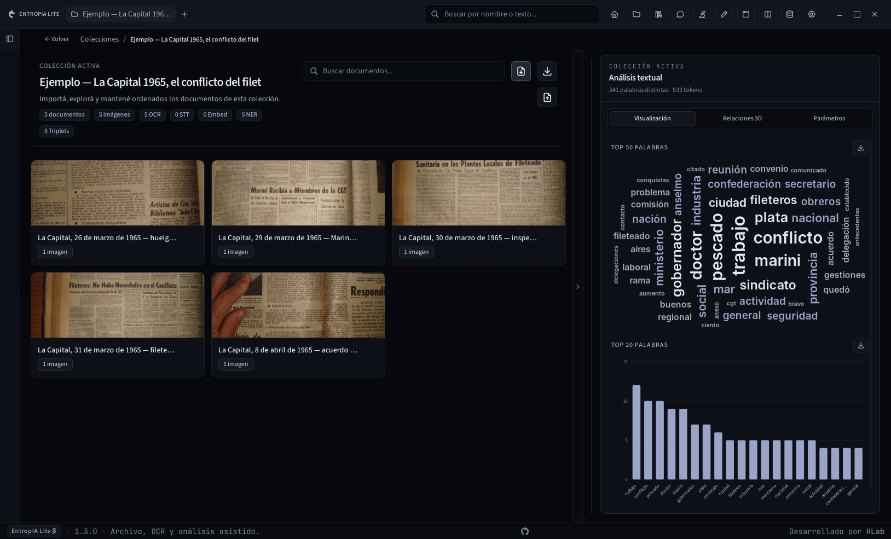

This manual follows the whole journey: **set up the workspace → gather sources → get and review text → search and analyse → investigate → write with citations → export and back up**. You do not need to configure every feature to get started.

**One manual for both variants.** EntropIA ships as **Lite** (all AI through Internet services) and **Pro** (AI engines that run on your computer, plus the same remote services as an option). Screens, buttons and workflows are the same; what changes is *who does* the text recognition, the transcription and the AI tasks. This manual describes the common base and marks the differences with **In Pro** or **In Lite** notes. The full summary is in [Lite and Pro: what changes](#lite-y-pro).

> **Features of the next version.** This manual follows the version under development. The following is already described but arrives in the version after 1.7.1; if your status bar says 1.7.1 or lower you will not see it yet: the [help chat](#ayuda-en-la-app); in the [Internet Archive importer](#internet-archive), file kinds, images, whole-record selection and batch import; **Save the graph for Gephi** in [3D relations](#relaciones-3d); the **OpenAI-compatible server** on the OpenRouter card ([16.1](#capitulo-16-configuracion-y-herramientas-generales)); **Rename speakers**; and, in Pro, the local GLM-OCR engine, the Qwen3-VL corrector, Parakeet with speaker detection, layout-assisted OCRL and the `models_setup` MCP tool.

> **How to read the images.** The screenshots show EntropIA Lite with a sample corpus; your titles, counts and results will differ, and in Pro some screens add controls for the local engines. Crops are labelled "Detail" and keep the original interface. Diagrams explain processes; they do not depict screens. Most screenshots come from version 1.3.0. Those of the Chat, Investigate and its report, the Browser and the Zotero detail come from 1.1.1, because they show AI answers, web pages or a Zotero library that the sample corpus cannot reproduce; those screens have not changed visibly. What is new from 1.4.0 to 1.7.1 (layout box correction, process history, image versions, entity aliases, the **Phrases** tab, the help chat, among others) is described without screenshots. The screenshots show the Spanish interface; this edition gives each control its name in the English interface. In the web edition, click any image to open it full size in another tab.

### Choose your path

| I want to… | Start with… |
|---|---|
| Use EntropIA for the first time | [Quick start](#capitulo-1-inicio-rapido). |
| Ask the app how to do something or what to do when something fails | [Help chat](#ayuda-en-la-app). |
| Know whether Lite or Pro suits me, or what changes in mine | [Lite and Pro: what changes](#lite-y-pro). |
| Configure OCR, audio or AI assistance | [Providers and settings](#capitulo-16-configuracion-y-herramientas-generales); in Pro, also [local engines](#motores-locales-pro). |
| Organise an archive and extract text | [Collections](#capitulo-4-crear-y-organizar-un-corpus) and [OCR / transcription](#capitulo-6-obtener-texto-de-documentos). |
| Bring books or documents from Internet Archive | [Import from Internet Archive](#internet-archive). |
| Browse the web and save pages or PDFs as sources | [Browser](#navegador). |
| Find evidence and compare sources | [Searches](#capitulo-7-buscar-informacion), [analysis](#capitulo-8-analizar-documentos-y-colecciones) and [Research](#capitulo-10-investigacion). |
| Write with notes and a bibliography | [Writing](#capitulo-11-escritura) and [Zotero and Library](#capitulo-12-zotero). |
| Search inside my Zotero library | [Library](#biblioteca). |
| Highlight and comment Zotero PDFs | [Annotate Library PDFs](#anotaciones-zotero). |
| Recover a paragraph that OCR cut or missed | [Fix a layout box](#corregir-cajas). |
| See which processes a document went through, with which tool and model | [Process history](#historial-de-procesos). |
| Let Claude Code, Codex, OpenCode, Pi or another MCP assistant read my archive | [External assistants (MCP)](#asistentes-externos). |
| Merge the different spellings of the same name | [Entity aliases](#alias-de-entidades). |
| See which words a term appears with in a collection | [Phrases and associated words](#frases). |
| Go back to another version of an image I edited | [Image versions](#versiones-de-imagen). |
| Keep or share results | [Export and download](#capitulo-17-exportar-y-descargar). |
| Back up everything | [Backups](#copias-de-seguridad). |
| Solve a problem | [What do I do if…?](#capitulo-19-que-hago-si). |

## Contents

- [1. Quick start](#capitulo-1-inicio-rapido)
- [2. Introduction to EntropIA Pro and Lite](#capitulo-2-introduccion-a-entropia-lite)
- [3. Basic concepts](#capitulo-3-conceptos-basicos)
- [4. Create and organise a document collection](#capitulo-4-crear-y-organizar-un-corpus)
- [5. Work with documents, pages and files](#capitulo-5-trabajar-con-documentos-y-assets)
- [6. Get text from documents](#capitulo-6-obtener-texto-de-documentos)
- [7. Search for information](#capitulo-7-buscar-informacion)
- [8. Analyse documents and collections](#capitulo-8-analizar-documentos-y-colecciones)
- [9. Notes and topics](#capitulo-9-notas-y-topicos)
- [10. Research](#capitulo-10-investigacion)
- [11. Writing](#capitulo-11-escritura)
- [12. Zotero and Library](#capitulo-12-zotero)
- [13. Chat, help and EntropIA agents](#capitulo-13-chat-y-agentes-de-entropia)
- [14. Batch processing](#capitulo-14-procesamiento-por-lotes)
- [15. Sync and cloud](#capitulo-15-sincronizacion-y-nube)
- [16. Settings and general tools](#capitulo-16-configuracion-y-herramientas-generales)
- [17. Export, download and back up](#capitulo-17-exportar-y-descargar)
- [18. Step-by-step examples](#capitulo-18-ejemplos-paso-a-paso)
- [19. What do I do if…?](#capitulo-19-que-hago-si)
- [20. Tips and good practice](#capitulo-20-consejos-y-buenas-practicas)
- [21. Glossary](#capitulo-21-glosario)
- [Annex A. Search algorithms](#anexo-a-algoritmos-de-busqueda)

---

<a id="capitulo-1-inicio-rapido"></a>
## Chapter 1. Quick start

If this is your first time using EntropIA, start here. In this walkthrough you will create a collection, import a document, get its text and find a word in the material. If you get stuck at any step, click the [help](#ayuda-en-la-app) bubble on the status bar and ask the app.

### 1.1. What we will do

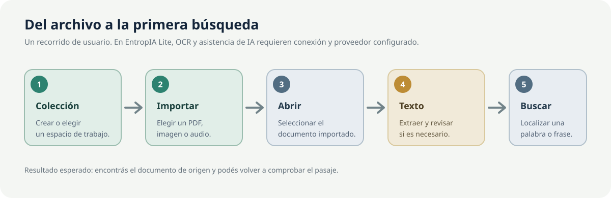

Pick a scanned PDF or a **PNG or JPG** image you can use as an example. If it contains private information, choose another file for the test: in Lite, when you ask for text recognition, EntropIA sends the page or image to the GLM-OCR service over the Internet.

**Before you start:**

- **In Lite**, recognising text in images or PDFs requires an Internet connection and a GLM-OCR access key. If it is already configured, go on to step 1. If not, open **Settings → Remote APIs → GLM-OCR**, paste the key, click **Test connection** and then **Save changes**. You get the key from the provider's account; EntropIA does not create that account for you.
- **In Pro**, the first time you open the application its local AI base downloads by itself (a notice shows progress and lets you pause or retry) and then the dependencies install. Once that finishes, you can recognise text offline with **OCRL**, or with **OCRH** according to the mode chosen in Settings. No key is needed for this chapter's walkthrough.

More details in [Settings](#capitulo-16-configuracion-y-herramientas-generales) and, for Pro, in [Local engines](#motores-locales-pro).

### 1.2. Get to know the main screen

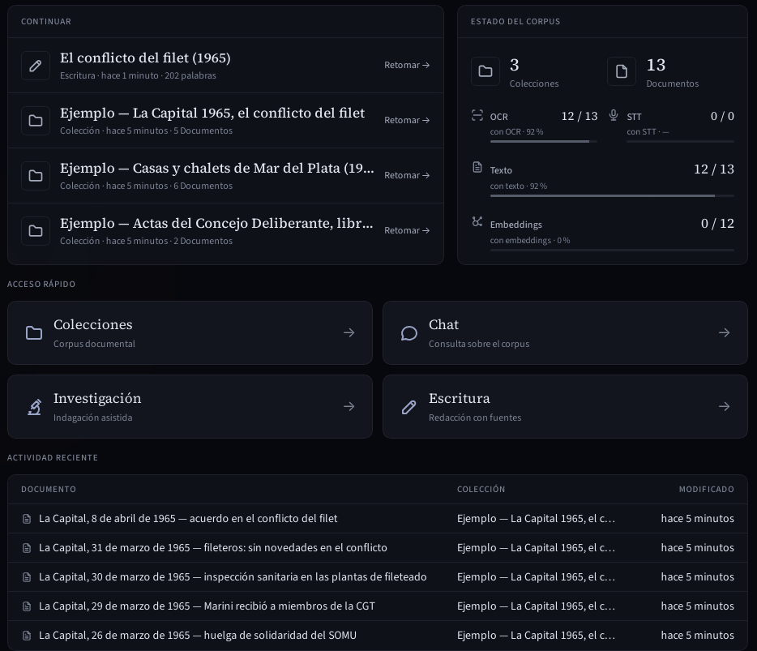

When you open EntropIA you land on **Home → Workspace**, not directly on the collection list. From there you can:

- **Import:** open **Import sources**, choose a destination collection or create one and select files. From the same dialog, **From Internet Archive** brings public PDFs from archive.org (see [4.3](#internet-archive)).
- **Retrieve:** start a new Chat conversation to query the corpus. It does not restore files or backups.
- **Write:** create a manuscript or resume the one that is still empty and untitled.
- **Continue → Resume:** return to recent work.
- **Corpus status:** see how many collections and documents you have and the progress of OCR, STT, text and embeddings. The percentages show processing, not accuracy or full coverage of a topic.
- **Quick access:** go to **Collections**, **Chat**, **Research** or **Writing**. **Library** opens from the top bar.
- **Recent activity:** open recently modified documents. If a batch is running, its indicator offers **View batch**.

In an empty workspace, **Get started with EntropIA** offers **Import**, **Create collection** or **Try it with sample documents**. To find your way around the other screens, learn these areas:

1. **Top bar:** work tabs, **Open new tab**, the global search and shortcuts to **Home**, **Collections**, **Library**, **Research chat**, **Research agent**, **Writing**, **Split view**, **Database** and **Settings**. Icon-only buttons show their name on hover. Theme, language and interface zoom are set in **Settings → Appearance**.
2. **Explorer:** collections and, inside them, documents and pages or files. In a single pane it stays on the left. In split view it opens over the active pane.
3. **Work area:** whatever the active tab shows. It can be Home, a collection, a document or another tool.
4. **Panels:** tools that change with the view. In a document you get **Notes**, **Text**, **Analysis**, **Map**, **Search**, **Layout** (page structure) and **Metadata** (descriptive data about the file).
5. **Status bar:** the version and, when relevant, sync, batch and notification states. In the centre are the GitHub and HLab links and, right above the GitHub logo, the **help bubble** with the EntropIA logo, which opens the [help chat](#ayuda-en-la-app).

When you close EntropIA you may see **Optimizing the archive…**: the application is reclaiming disk space from its database. Do not turn the computer off; the window closes by itself when it finishes. If another task is using the database at that moment, the optimisation waits until the next close.

### 1.3. Create or select a collection

A collection is the space where you gather sources from one project, topic or archival fonds.

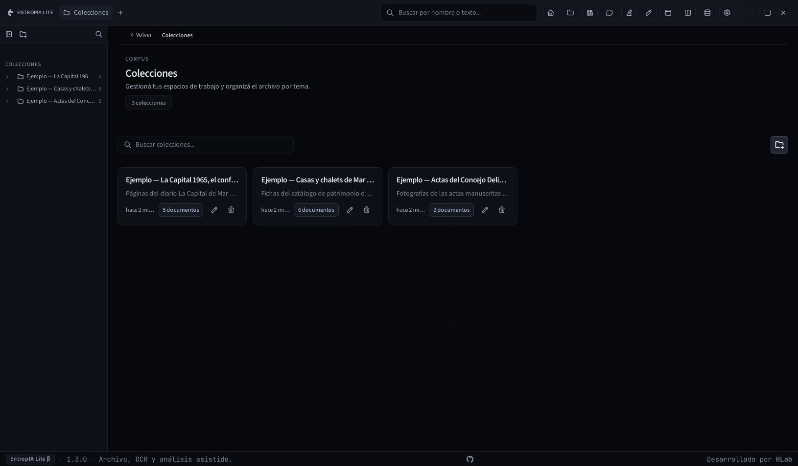

1. In **Collections**, click **New collection**. You can also use the folder-and-plus button in the side explorer.
2. Type a name in **Collection name**. For example: `Local press, 1930–1940`.
3. Optionally add a **Description (optional)**. You can leave it empty.
4. Click **Create collection**.
5. Check that the new card appears on screen. Click its name to open it.

If a suitable collection already exists, open it instead of creating another.

**Want to try before loading your own sources?** The first time you open EntropIA it already includes three sample collections with real material from Mar del Plata: handwritten minutes of the 1891 City Council, records of houses and chalets from the UNMDP heritage catalogue, and 1965 pages of the newspaper *La Capital* about the fillet workers' conflict. Each document comes with its text and its analysis already done —names, places on the map, relations, notes and summary— so you can explore every view or run a batch without spending anything. The samples stay only on that computer: they are not synced with your account. When you no longer need them, delete them like any collection; they do not come back on their own. If the workspace is empty and you want to load them again, use **Try it with sample documents** on Home.

### 1.4. Import your first document

1. Inside the collection, click **Import document**. You can also drag files from your file manager and drop them on the collection.
2. In the file picker, choose one or more supported PDFs, images or audio files and confirm.
3. Wait for the import to finish. The **Import summary** section shows progress and then how many files were imported, skipped or failed.
4. Check the document list; the initial title is based on the file name.
5. Select a document in the list to open it.

If you import a single file successfully from a collection, it may open directly. With several files or issues, check the collection and the summary. You do not need to import it again to open it.

Importing does **not** run OCR or transcribe audio automatically. The one exception is PDFs that already carry legible digital text: that text is stored at import as **native text**, without calling any service. The full list of formats is in [Create and organise a document collection](#capitulo-4-crear-y-organizar-un-corpus).

**Alternative from Home:** click **Import**, choose a **Destination** or **+ New collection**, fill in the name if needed and click **Choose files**. To bring PDFs from archive.org, use **From Internet Archive** ([4.3](#internet-archive)). If you cancel the file picker, the new collection is not created. When it finishes without issues, the collection opens; if there were duplicates, skipped files or errors, review the summary and click **Go to collection**. While importing, wait for it to finish before closing.

### 1.5. Open the document

1. In the collection, select the document card.
2. To move through its pages or attached files, use **Previous page** and **Next page** in the viewer panel or the side explorer.
3. For images and PDFs, use the viewer's zoom controls to zoom in or out. If the whole interface looks small, adjust **Settings → Appearance → Zoom**; it is a different setting from the page zoom.
4. In the right panel, select the **Text** tab to work with the text of the open page.

### 1.6. Get the text

If there is already processed text —for example, the native text of a digital PDF— choose **Extracted text** to see it. If the page is a scan or a photo, it has no text yet: it has to be recognised.

1. With a PDF or a **PNG/JPG** image open, choose **Text** in the right panel.
2. Click **OCRH** to recognise the words visible on the page and wait for it to finish. Pro also has **OCRL**, a faster local recognition that works offline.
3. **In Lite**, OCRH uses GLM-OCR over the Internet and needs a valid key. **In Pro**, OCRH uses the local engine or GLM-OCR according to the **OCRH mode** in Settings. In both, clicking OCRH always runs the page through the OCR engine, even if it already had native text, and replaces it.
4. When the result appears, compare it with the original page.

> Text recognition turns the visible words into digital text that EntropIA can search and analyse. Automatic reading can make mistakes; the original page remains the reference.

### 1.7. Review the result

- Confirm that the text belongs to the selected page.
- Check proper names, dates, numbers and words split across lines.
- To correct it by hand, open **Text** on the right and expand **Extracted text**. Changes are saved automatically.
- If you used **OCRC**, the correction has already replaced the text. To go back to the original, open **Extracted text** above the viewer and use **Restore original OCR**. Before doing so, keep aside any manual correction you want to preserve.

### 1.8. Run your first search

1. Type a word you see in the text into the top-bar search.
2. Wait for results and choose the right document. The global search can find material from different collections.
3. To find words that already appear in the text, choose **Search → Search by Similar Text (FTS)**. This option compares words; it does not search by meaning.
4. If freshly recognised text does not show up, open **Analysis** in that document and click **INDEX** to prepare it for search. Search again when it finishes.
5. Open the result and check it against the text or the original image.

### 1.9. First workflow completed

**You created or chose a collection → imported a document → got its text → reviewed the result → found a word.**

You now know the basic route. To go deeper into each step, continue with [organising your collections](#capitulo-4-crear-y-organizar-un-corpus), [OCR and transcription](#capitulo-6-obtener-texto-de-documentos) and [searches](#capitulo-7-buscar-informacion).

### 1.10. Visual quick start

**1. Collection → 2. Import → 3. Open → 4. Text/OCRH → 5. Review → 6. Search**

If there are no results, check that the text is saved and use **Analysis → INDEX** to prepare it. If OCRH fails, check the connection and key in **Settings → Remote APIs** (in Pro, also the **OCRH mode** and the state of the local models). The [help](#ayuda-en-la-app) can read the diagnostics and tell you what is missing.

<a id="pestanas-y-vista-dividida"></a>

### 1.11. Work with several screens

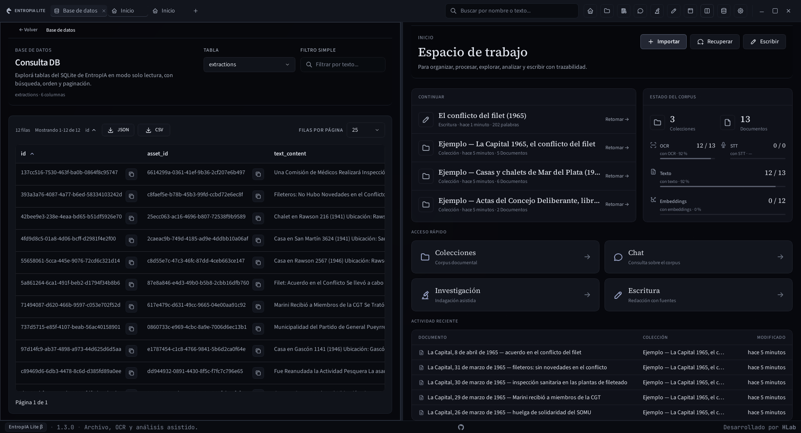

You can have up to **4 tabs**. Each one remembers its own route: **← Back** in one does not change the others.

1. Click **Open new tab**, the plus sign next to the tabs. The new one opens on **Home**.
2. Choose a tab by its name to return to that screen. The name follows whatever is open: a collection, a document or a tool.
3. If there is more than one, hover over the tab and click **Close tab**. The last one cannot be closed.
4. When you reach 4, the plus sign is disabled and shows **Four-tab limit reached**.

**Split view** shows two tabs at the same time:

1. Click **Split view** in the top bar.
2. If there are fewer than 4 tabs, EntropIA opens a Home tab next to the current one. If there are already 4, it pairs the active one with its neighbour.
3. Drag the divider to resize. Each side keeps at least 40 % of the space and a minimum width of 640 pixels. A double click puts it back in the middle. With the keyboard, use the arrow keys.
4. If the window becomes too narrow, only the active tab is shown; the panes do not stack. Widen the window to see both again. If you have not split yet, the button may stay disabled until there is enough width.
5. Click **Split view** again to return to a single pane. Both tabs stay open.

In split view the explorer does not take a fixed column. Open it with **Open document explorer**: it appears over the active pane and does not shrink the other one. **Close explorer (Esc)** or the Esc key hides it. Switching tabs or leaving Collections also closes it.

If the window narrows and only the active tab remains visible, the explorer goes back to its single-pane side behaviour.

**Writing** can be open in only one tab. If you ask for it from another, EntropIA takes you to the tab that already has it. If a tab reaches Writing while another is using it, you will see **Writing is open in another tab** and the **Go to that tab** button.

If you delete a collection, a document or a page, it disappears from every tab that had it open.

---

<a id="capitulo-2-introduccion-a-entropia-lite"></a>
## Chapter 2. Introduction to EntropIA Pro and Lite

EntropIA is a desktop application for gathering materials, recognising text, searching information, taking notes, analysing sources and writing from your documents. There are two variants, **Lite** and **Pro**, built from the same code: they share screens, archive and workflows (see [2.3](#lite-y-pro)).

Your notes and files are stored on this computer. **In Lite**, to recognise text, transcribe audio and use the artificial intelligence features, EntropIA connects over the Internet to other services, which need a valid access key. **In Pro**, those same tasks can run on your computer, offline, with local engines; the remote services remain as an option or fallback.

A typical workflow is:

**Organise sources → import → get text if needed → review → search or analyse → record notes → write → export.**

Automatic answers and summaries are aids for your work. Always check quotations, names, dates and conclusions against the original sources. EntropIA does not replace critical reading or your institution's citation rules.

### 2.1. What you need for each task

| Task | In Lite you need… | In Pro you need… |
|---|---|---|
| Create collections, import, browse local files, take notes and write | Nothing else. | Nothing else. |
| Search words, see frequent phrases and count frequencies over stored text | Nothing else: you first need the text. | Same as Lite. |
| Recognise text in images or PDFs | **OCRH**: Internet and a GLM-OCR / z.ai key. | Local **OCRL** or **OCRH**, offline; or remote GLM-OCR if you choose it in **OCRH mode**. |
| Fix a layout box and re-recognise its text | Internet and the GLM-OCR key: each box is one request to the provider. | Same as Lite: box correction uses remote GLM-OCR. |
| View and export a document's process history | Nothing else: the history stays on this computer. | Same as Lite. |
| Transcribe audio or dictate | Internet and AssemblyAI; microphone permission for dictation. | Local transcription and dictation (Parakeet or Whisper), or AssemblyAI according to **STT mode**. |
| Correct, summarise and extract entities and relations | Internet and OpenRouter (or an OpenAI-compatible server, see [16.1](#capitulo-16-configuracion-y-herramientas-generales)); Vercel AI Gateway as an optional fallback. | The local model (Gemma) or OpenRouter according to **LLM mode**; the local Qwen3-VL corrector for OCRC; local spaCy for NER. |
| Generate embeddings and find similar material | Internet and OpenRouter (`baai/bge-m3`). | Local BGE-M3 (ONNX) or OpenRouter, according to **BGE-M3 embeddings**. |
| Use the Research chat | Internet and OpenRouter. | The local model or OpenRouter according to **LLM mode**; local passage reranking with the BGE reranker. |
| Use Investigate and the Writing agent | Internet and OpenRouter. | Same as Lite: these two tools always use OpenRouter. |
| Use the [help chat](#ayuda-en-la-app) | Frequent questions, nothing else; everything else, the OpenRouter key with credit. | With **LLM mode** set to **Local**, Gemma answers on the computer from the manual, with no key; to take actions or read your documents, the OpenRouter key. In the other modes, same as Lite. |
| Import from Internet Archive | Internet; no account or key needed. | Same as Lite. |
| Sync and search your Zotero library (**Library**) | Zotero open with local communication; OpenRouter to search by meaning and GLM-OCR to read scanned PDFs. | Zotero open; the OCR and embedding engines you chose (local or remote). |
| Cite from Zotero | Zotero open on this computer with local communication enabled. | Same as Lite. |
| Annotate Library PDFs and sync the annotations with Zotero | Internet and a Zotero Web API key with write access to your personal library. | Same as Lite. |
| Connect an external assistant (Claude Code, Codex, OpenCode, Pi or another MCP assistant) | The assistant installed on this computer, with its own provider and account. Reading the archive costs nothing with EntropIA's providers. | Same as Lite. |
| Sync between computers | Internet and a sync account. Optional. | Same as Lite. |
| Make backups | A folder with free space, ideally on another disk. | Same as Lite. |

Provider accounts and the sync account are independent. Remote services may have provider costs or limits; a key does not mean unlimited use. **Lite does not install Pro's local AI engines**; Pro downloads and installs them the first time it opens.

**System requirements.**

- **Lite** installs on Windows x64 (Microsoft Store, `.exe` or `.msi`), macOS (Apple Silicon and Intel, universal `.dmg`) and Linux x64 (Ubuntu 22.04 or later, `.deb`).
- **Pro** installs on Windows x64 (`.exe` or `.msi`) and Linux x64 (Ubuntu 22.04 or later, `.deb`). It needs several GB free for the AI base (about 2.2 GB) and the models you download; some optional engines —local GLM-OCR— require an NVIDIA GPU.
- **macOS:** the installer requires **macOS 13.3 Ventura or later**. EntropIA renders with the Safari engine your Mac ships with, and the PDF viewer needs that of Safari 16.4 (which comes with 13.3): on earlier versions PDFs do not open.
- **Linux:** keys are stored in the system keyring (gnome-keyring or KWallet); on minimal installations, install `gnome-keyring` and create a default keyring.
- **Windows:** the GitHub installers are not signed; SmartScreen shows "Windows protected your PC" and you continue with **More info → Run anyway**. The Microsoft Store version (Lite) is signed.

Lite and Pro open **the same archive** (the `com.entropia.shared` folder, see [17.3](#copias-de-seguridad)): if you install both on the same computer, or switch from one to the other, you see the same collections, documents and manuscripts. Close one before opening the other. They also share the settings: if you open Pro on an archive Lite configured, **Home** shows **This archive uses cloud services** once and offers to switch dictation to local and, with an NVIDIA GPU, OCRH and text AI too. **Use the local engines** switches them; **Stay on the cloud** leaves them as they are. Embeddings are not offered: changing the provider recomputes the whole archive. Any mode can be changed later in **Settings → Remote APIs**.

### 2.2. Prepare a safe working session

1. Keep an external copy of the original sources and set up automatic [backups](#copias-de-seguridad).
2. Configure only the provider you need and test it with a non-sensitive file.
3. Import a small sample and check its text before processing many pages.
4. Before closing, wait for important tasks to finish and for Writing to show **Saved**.
5. Export the results you need to keep outside EntropIA. Export and sync have different scopes; see [chapter 17](#capitulo-17-exportar-y-descargar).

<a id="lite-y-pro"></a>
### 2.3. Lite and Pro: what changes

Both variants have the same screens, the same archive and the same workflows: collections, viewer, notes, searches, analysis, Chat, Investigate, Writing, Library, Browser, batches, sync, backups, external assistants and the help chat. What changes is **where the AI runs**:

| Task | **EntropIA Lite** | **EntropIA Pro** |
|---|---|---|
| Fast OCR (**OCRL**) | Not available. | Local PaddleOCR, with layout and reading order. |
| High-accuracy OCR (**OCRH**) | Remote GLM-OCR (z.ai). | **OCRH mode**: local (PaddleOCR-VL, or local GLM-OCR with an NVIDIA GPU), remote GLM-OCR or **Automatic**. |
| OCR correction (**OCRC**) | OpenRouter. | OpenRouter or the local **Qwen3-VL** corrector when there is no remote key. |
| Transcription (**STT**) | AssemblyAI. | **STT mode**: local (Parakeet TDT or Whisper, with optional speaker detection), AssemblyAI or **Automatic**. |
| Summaries, relations, schemas and Chat | OpenRouter (or an OpenAI-compatible server), with Vercel as an optional fallback. | **LLM mode**: local Gemma model (llama.cpp), OpenRouter or **Automatic**. |
| Investigate and Writing agent | OpenRouter. | OpenRouter (same as Lite). |
| Entities (**NER**) | OpenRouter. | Local spaCy, or OpenRouter. |
| Embeddings | OpenRouter (`baai/bge-m3`). | Local BGE-M3 (ONNX) or OpenRouter. |
| Chat passage reranking | `cohere/rerank-4-fast` through OpenRouter. | Local BGE v2 M3 reranker. |
| **AI dependencies** tab | Not shown. | State and installation of the AI base and its components. |
| Installation | Small installer, no models. Windows, macOS and Linux. | Light installer; the AI base (about 2.2 GB) downloads by itself at start-up. Windows and Linux. |
| Privacy | Every AI task sends the necessary content to the provider. | With the local modes, content never leaves the computer. |

In both, layout box correction uses remote GLM-OCR, Investigate and the Writing agent use OpenRouter, and the help chat uses OpenRouter for whatever it cannot answer on the computer (in Pro with **LLM mode** set to **Local**, Gemma answers on the computer).

**Which one suits me?** Lite if you want to start quickly, on any system, and do not mind paying for provider usage. Pro if you work with sensitive material that must not leave the computer, process large volumes or are not always online; in exchange it needs more disk, a long first download and a more powerful computer.

**In Pro's "Automatic" modes**, EntropIA prioritises one engine and falls back to the other if the first fails or is not installed: in **LLM mode** and **STT mode**, the local one first; in **OCRH mode**, remote GLM-OCR first and then the local one. Choose **Local** if you never want the content to leave the computer.

---

<a id="capitulo-3-conceptos-basicos"></a>
## Chapter 3. Basic concepts

| Concept | What it means in practice |
|---|---|
| **Collection** | A space to group materials on one topic, project or fonds. |
| **Document** or **item** | The card that represents a file in a collection. Some interface messages use the word "item". |
| **Asset** | Some controls say "asset": it means a page or file inside a document. |
| **Corpus** | The set of documents and collections you gather to work with. |
| **Extracted text** | Digital text obtained from a page, an image or an audio file. It is not created just by importing. |
| **OCR** | Recognition of the visible words in an image or scanned PDF. In Lite it is requested over the Internet; in Pro it can run on the computer. |
| **Transcription** | Text generated from the words in an audio file. In Lite it is requested over the Internet; in Pro it can run on the computer. |
| **Metadata** | Data describing a file, such as its name, type and other fields. |
| **Topic** | A tag to classify a document, for example `migration` or `housing`. |
| **Note** | A research observation attached to a document or a page. |
| **Text search (FTS)** | Finds terms and may include close spelling variants; it does not interpret meaning or look for synonyms. |
| **Embeddings** | A way of representing text so that EntropIA can compare pages or files about similar topics. Used by **EMBED** and **Similar Pages**. |
| **Retrieval** | The selection of passages from your documents that the Chat can use to prepare an answer. |
| **Tab** | An independent work screen. You can have up to four, and each keeps its own route. |
| **Split view** | Two tabs visible at the same time, separated by a divider you can move. |
| **Library** and **work** | The Library gathers the Zotero references you synced into EntropIA; each reference is a work, with its attachments and its text. It is different from your collections. |
| **Passage** | A fragment of a Library work's text that a search or the Chat can show and cite. |
| **Backup** | A folder with the database and all of EntropIA's files, made by hand or automatically. |
| **Version** | An earlier state of a manuscript that Writing keeps so you can read or restore it. Images also have [versions](#versiones-de-imagen): the file each edit leaves behind. |
| **Native text** | Digital text a PDF already carries. It is stored at import, without OCR; **OCRH** replaces it if you ask to recognise the page. |
| **Context for the AI** | A description of a collection (topic, period, conventions, spellings of names) read by the Chat, Investigate, OCR correction and the Writing agent. |
| **Alias** | An alternative form of a name (`C. Cuevas`) joined to its canonical name (`Carmela Cuevas`) across the whole archive. |
| **Variant** | **Lite** (AI over the Internet) or **Pro** (local AI plus optional remote services). |
| **Help chat** | An assistant that explains how to use EntropIA from this manual; it is different from the Research chat. |
| **MCP** | The protocol an external assistant (Claude Code, Codex…) uses to connect to EntropIA and query your archive. |

---

<a id="capitulo-4-crear-y-organizar-un-corpus"></a>
## Chapter 4. Create and organise a document collection

### 4.1. Create, find and maintain collections

In **Collections** you can create a space, find it by name, edit it or delete it.
Cards show summary counts. When you open a collection, the statistics panel helps you review what it holds.

- **Search collections...** filters collection names.
- On a card, use the edit control to change the name, the description or the **Context for the AI**, and click **Save**. **Cancel** discards the form changes.
- The explorer can also filter collections, collapse the panel and create a new one. In a single pane, **Ctrl+B** hides or shows it. In split view it opens over the active pane; full details in [tabs and split view](#pestanas-y-vista-dividida).
- There are no controls to sort collections by hand.
- Importing another file creates a new document; there is no action to append it to an existing document.
- Deleting the last document of a collection does not delete the collection: it stays empty and you can keep importing into it. A collection is deleted only when you ask.

> **Warning:** deleting a collection deletes its documents and associated data. Check the name before accepting. There is no undo: only an earlier [backup](#copias-de-seguridad) can bring it back.

<a id="contexto-ia"></a>
**Context for the AI.** Each collection can carry a short text describing the project: topic, period, place, transcription conventions and the correct spelling of the names that appear (for example, "Minutes of the Mar del Plata City Council, 1891. Original spelling. The mayor is Pedro Luro"). It is read by the **Research chat**, **Investigate** (when you pick collections by hand), **OCR correction** (OCRC and correction batches) and the **Writing agent**, which uses the one of the manuscript's main collection. It helps the model not to "correct" period spellings or confuse names. Left empty, everything works as before. It travels with sync and, like the rest of the prompt, is sent to the AI provider doing the task.

### 4.2. Import files

Inside a collection, click **Import document** or drag the files onto it. You can select several files.

| Type | Extensions you can import |
|---|---|
| PDF | `.pdf` |
| Images | `.png`, `.jpg`, `.jpeg`, `.webp`, `.tiff`, `.tif` |
| Audio | `.wav`, `.mp3`, `.flac`, `.m4a`, `.aac`, `.ogg` |

EntropIA does not directly import `.txt` files, Office documents or the JSON file exported from a collection. Being importable does not mean a file is suitable for text recognition: in Lite, OCRH recognises PNG/JPG/JPEG images and PDFs.

Each imported file is stored as a copy on this computer; the original you chose does not change. A multi-page PDF is opened page by page so you can choose which one to read. If a PDF page carries digital text of sufficient quality, that text is stored right away as **native text** and can already be searched; scanned pages stay without text until you ask for OCR. Camera photos are shown upright according to their EXIF orientation. If you import the same unchanged file again, EntropIA may skip it because you already added it. If that file is already being imported into the same collection, it waits for the first operation: if that one is saved, the second does not create another document.

During the import, **Import summary** reports which file is being processed, the progress and how many were imported, skipped or had an error. Read the rejected names or the message before trying again.

**Check:** the document must appear in the collection and open in the viewer. A file skipped as a duplicate is not a failed OCR: they are different stages. If part of the import fails, review the summary before repeating the whole selection.

<a id="internet-archive"></a>
### 4.3. Import from Internet Archive

You can bring public PDFs and images from [archive.org](https://archive.org) without downloading them by hand. Open the dialog from **Home → Import → From Internet Archive** or, inside a collection, with the **Import from Internet Archive** button next to **Import document**. The dialog takes up almost the whole window: on the left, the **Results**; on the right, the **Selected record** with its **Files**.

1. In **Discovery**, choose how to find the material:
   - **Search:** fill in **Free text**, **Title**, **Author** or the years **From year** / **To year** and click **Search the archive**. **Results per page** changes how many you see at once; **Previous** and **Next** move through the pages.
   - **Collection:** type the Internet Archive **Collection identifier** (for example `opensource`) and click **Browse**.
   - **Link:** paste an identifier or an `https://archive.org/details/…` address and click **Open**.
2. In **File type**, tick what to look for: **PDF** (any PDF), **PDF + text** (only those Internet Archive publishes with an OCR text layer) or **Images** (original JPEG, PNG and TIFF). At least one is required. Results and records are filtered by those kinds.
3. Choose what to bring:
   - **Single files:** click a result (or **View files**) and tick the files in the right panel. Each shows its size and whether it is the **original** or a **derivative**. Files marked **restricted**, **encrypted** or **private** cannot be imported.
   - **Whole records:** each result's checkbox selects all its files of the chosen kinds; **Select every record on this page** ticks the whole page.
   - **The whole search:** **Select all N results** queues every result, not only those on the page. Internet Archive returns up to 10,000 per search; if there are more, you are told how many fit. **Remove the queue** undoes it.
   **Show selection** lists what you chose; you can remove a file before going on. Click **Continue**.
4. In **Destination**, choose a collection or **+ New collection** and click **Prepare import**.
5. Check **Review the preparation**: how many files will be imported, their size and the **Duplicates**. For a file that is already in this or another collection, choose under **What to do** between **Import an independent copy** and **Skip**. If sync is on, the **Estimated synced volume** is shown: each PDF takes about twice its size between the original and its pages; an image is synced once.
6. Click **Start import**. Each file is downloaded, verified and imported like any PDF or image. When it finishes, **Import finished** details imported, skipped and failed files; **Open collection** takes you to the collection.

**Batch import.** When you queued a whole search, EntropIA imports it in batches: it prepares one (**Batch of N records · X of Y already processed**), imports it and moves on to the next. If you close the importer or the application, the queue pauses; when you reopen the dialog, **Batch import pending** offers **Continue the queue** or **Discard the queue**. When it is done you are told the whole search was imported.

Only one Internet Archive import runs at a time. If you close the dialog or the application while a regular import is downloading, reopening it shows **Imports in progress → Resume import**. As with your own files, importing does not run OCR: if the PDF carries legible digital text, it is stored as native text; scanned pages and images need **OCRH** (or **OCRL** in Pro) or a batch. Check the usage rights of each work before reusing it.

### 4.4. Organise sources

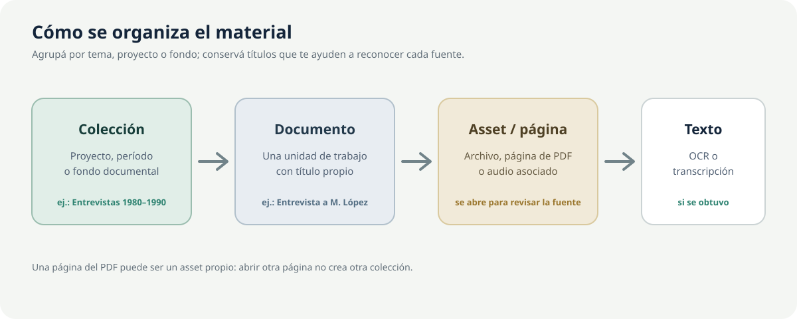

A simple organisation could be:

- **Collection:** `Interviews on housing`.
- **Document:** an interview, a photograph or a report.
- **Page or file:** the audio, the image or a specific sheet of a PDF.
- **Text:** text recognised on a page or words transcribed from an audio file.

Use clear file names before importing: the document's initial title is based on that name. There is no option to move documents between collections or to reorder their pages by hand.

### 4.5. Search inside a collection

In the collection, **Search documents...** looks at names, data and indexed content, not only the visible cards. It may show close spelling matches labelled **Approximate**. The list loads more documents as you scroll. To search across collections, use the top bar or **Search**; see [chapter 7](#capitulo-7-buscar-informacion).

### 4.6. Export a collection

The collection offers two downloads:

- **Download the collection text** puts the extracted text of all its documents into a single file, in order: **Text (.txt)**, **Markdown (.md)**, **PDF (.pdf)**, **Word (.docx)** or **CSV (.csv)**. Pages with native PDF text are marked **(native PDF text)**; in the CSV each row carries **document**, **file**, **origin** (`ocr` or `native`) and **text**. If no document has text, you are told and nothing is downloaded. Use it to read, share or take the corpus to another analysis tool.
- **Export JSON** saves data about the collection and its documents, texts and analyses, but does not include the original PDFs, images or audio.

Neither can be used to rebuild the collection in EntropIA. To keep everything, files included, use [backups](#copias-de-seguridad).

### 4.7. Read a collection's indicators

The header summarises documents, file types and results such as **OCR**, **STT**, **Embed**, **NER** and **Triplets**. Use them to find your bearings before processing; they do not replace reviewing each page. The word cloud, the word chart, **Phrases** and the **3D relations** graph belong to **Text analysis**, explained in [chapter 8](#capitulo-8-analizar-documentos-y-colecciones).

<a id="navegador"></a>
### 4.8. Browse the web and save sources

The **Browser** opens web pages inside EntropIA and saves what you find as **web sources** with their provenance: original and final address, date and time of access (UTC) and SHA-256 fingerprint. Open it with the **Browser** button on the top bar.

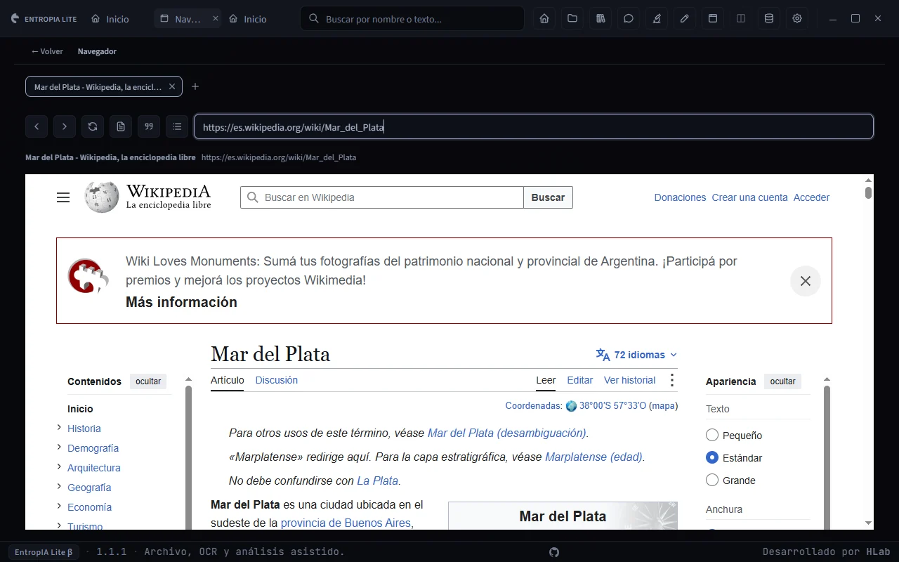

1. Type an address in **Address** and press Enter. **Back**, **Forward** and **Reload** work as in any browser. You can have up to 4 tabs; the **+** button opens a new one and each tab has its own close button.
2. To save what you are reading, click **Capture page** or, with text selected on the page, **Capture selection**. A draft appears with the text, the final address and the fingerprint; review it and click **Save**, or **Discard** if you do not want it.
3. A PDF you download from a page is verified before it is offered: in **Downloads** it appears as **PDF verified** and is saved with **Save**. If it was already among your sources, you see **Already in your sources** and no other copy is saved. Files that are not PDFs go to the **Downloads folder**, which you can choose with **Change**; EntropIA does not open them.
4. **Saved sources** lists what you saved and lets you search by title, address or text. From a source you can **Open in the browser**, **Copy address**, view the saved PDF, **Copy to collection**, **Copy to Zotero** or **Delete source**.

Web sources do not belong to any collection. **Copy to collection** creates a new, independent document, and **Copy to Zotero** creates the item in the library you choose; in both cases the original source does not change, and deleting it does not delete the copies. If Zotero is not open, the copy is queued and sent by itself when Zotero responds. If the page was already in that library it is not duplicated: it is linked, and with a [Zotero key](#capitulo-16-configuracion-y-herramientas-generales) with write access the missing fields are filled in, without overwriting any that already have data.

The Browser keeps no cookies or sessions: a sign-in lasts while the application is open. Some addresses and downloads are blocked for security; the reason is shown below the address bar. The Browser is available on Windows, macOS and Linux; if the page does not display on your system, the notice **The page could not be opened** gives the reason.

---

<a id="capitulo-5-trabajar-con-documentos-y-assets"></a>
## Chapter 5. Work with documents, pages and files

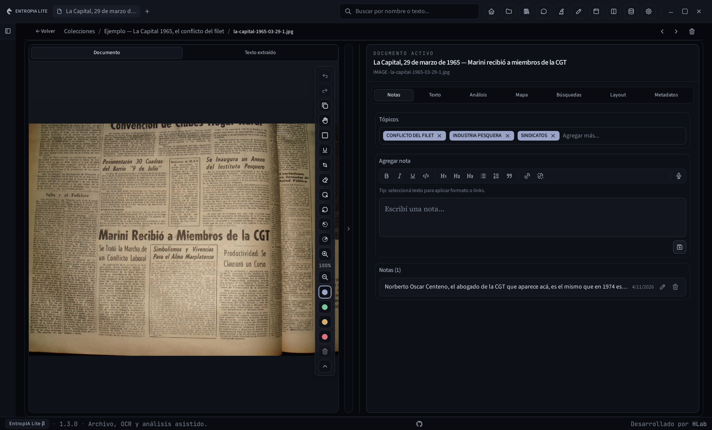

### 5.1. Open and browse a document

When you open a card, the main area shows the viewer and the work panel. If a document has several pages or attached files, select the page or file you need in the explorer and use **Previous page**/**Next page** to move.

Each tab has its own route, above the content. From there you can use **← Back**, return to **Collections** or to the current collection and, with a document open, **Previous document** and **Next document**. Those controls belong to that tab.

### 5.2. PDF and image viewer

In the **Document** tab, use the tools available for the page or file type:

- **Pan image (hand tool):** move the view.
- **Zoom in** and **Zoom out:** change the viewer zoom.
- **Rectangle annotation tool** and **Underline tool:** add marks to the page.
- **Annotation color:** choose the mark's colour.
- **Crop to selection:** crop to the selected area.
- **Erase region (white fill):** cover the chosen area with white.
- **Rotate 90° left/right** and **Fine rotation**: orient the page by the desired angle.
- **Duplicate page:** make a copy of the image or PDF before continuing an edit.
- **Undo last edit** and **Redo last edit:** step through recent viewer changes.
- **Delete selected annotation:** remove the selected annotation.

Annotations are saved with the document. To keep an unchanged version, duplicate the page or file before cropping or modifying it. These tools do not fix errors in the recognised text; review it separately in **Text**.

### 5.3. Audio player

To listen to an audio file, use **Play/Pause**, the position bar, the **5-second** skips and the volume control. On the position bar, the arrow keys go back or forward 5 seconds; Home and End go to the ends. If playback fails, tell an unsupported format apart from a file moved or deleted outside EntropIA. Keep the original before trying a conversion.

### 5.4. Document right panel

- **Notes:** topics and observations attached to the document or the page.
- **Text:** OCR/STT actions, correction, summary and editable fields with recognised text or transcription.
- **Analysis:** prepare text for search, recognise names and propose relations.
- **Map:** places associated with the document.
- **Search:** find words or explore similar material.
- **Layout:** structure detected on the page, such as titles, text, tables and figures; from here you can also [fix a box](#corregir-cajas) that OCR cut short.
- **Metadata:** descriptive data about the file, fields you can fill in, the [image versions](#versiones-de-imagen) and the document's [process history](#historial-de-procesos).

You can hide the right panel and show it again with the side control.

**Do not confuse the two text entries:** **Extracted text**, above the viewer, shows the digital content; **Text**, in the right panel, gathers the actions to get it and work with it. If you see the image but not the OCR buttons, open the right panel and choose **Text**.

**Copy**, **Download** and **Restore original OCR** are in **Extracted text above the viewer**, for images and PDFs. Audio shows its transcription there but does not offer that download menu.

### 5.5. Layout, metadata and process history

**Layout** shows the structure of an image or PDF page. The tab may be empty if no sections have been detected yet; the overlay is disabled without data. There is no layout for audio. When there are results, you can filter **All**, **Titles**, **Text**, **Tables**, **Figures** or **Notes**. Select a section to locate it on the page and see its details; from the inspector you can copy the text, the location or the data as JSON. Looking at the layout does not change or verify the OCR's accuracy.

<a id="corregir-cajas"></a>
**Fix a box that OCR cut short or missed.** With **OCRH**, GLM-OCR first splits the page into boxes and then reads each one. Sometimes a box ends too early or a paragraph gets no box at all, and that text is missing from **Extracted text**. To recover it:

1. In **Layout**, select the affected block or, if the text has no box, the block that precedes it in reading order.
2. In the inspector, under **Fix box**, choose **Adjust box** to change that block's box, or **New box after this one** to draw a new box right after it.
3. On the document, the box is highlighted with handles. Drag an edge or a corner to stretch it —for example, its height until the whole paragraph fits— or the inside to move it. You can adjust it several times: the provider is not called yet.
4. Click **Recognize box text**. **Cancel** discards the box without changing anything.

EntropIA crops the page to that box and sends only that crop to GLM-OCR. The block keeps its place in the reading order, and a new box goes immediately after the chosen block. The recognised text enters **Extracted text** in that same place: it replaces the block's previous text and respects any hand corrections you made in the rest. If it cannot find the previous text (for example, because you rewrote that passage), it places it after the previous block; if it cannot place it either, it appends it at the end and tells you so you can move it.

It needs the Internet and the GLM-OCR key —in Pro too— and each recognition is one request to the provider. If the layout changed while you were editing —for example, because another OCR of the same document finished— nothing is saved and you have to try again. As with a manual edit, search updates by itself; existing entities and triples are not redone until you ask.

In **Metadata**, review the file data. **Custom metadata** lets you add a field, edit its value or remove it. It does not change the original file.

<a id="versiones-de-imagen"></a>
**Image versions.** Each viewer edit (crop, erase, rotation) saves a new file and keeps the earlier ones. In **Metadata → Image versions** you see the list: **Original**, **Version 1**, **Version 2**…, with a thumbnail, which one is **Current** and which one **Matches the layout** or **Matches the text**. **Use this version** shows the chosen one again; no file is deleted. If the image has annotations, EntropIA warns that they may not match the chosen version and asks you to confirm. The change is recorded in the process history.

EntropIA records which file each layout and each text came from, so it warns you when they do not match the image you are looking at:

- **This layout belongs to another version of the image** (with its dimensions): the boxes are not drawn over a different image. **Run the layout again** recomputes it on the current one.
- **This text was extracted from another version of the image**, in **Extracted text**: **Run the OCR again** recognises the current version.
- If the text has manual corrections, before running the OCR again EntropIA asks: **The text has manual corrections. Running the OCR again will replace them. Continue?** The same happens with an edited transcription (**Transcribe again**). Batches never overwrite text corrected by hand.

To review the whole archive at once, use **Settings → Maintenance → Review image versions** ([16.6](#mantenimiento)).

<a id="historial-de-procesos"></a>
**Process history.** Below the metadata, **Process history** lists every process the document went through, newest first, so you can trace and audit what was done to it. Each entry shows:

- the process and the date;
- the **Tool** that did it and its version, when known (for example, GLM-OCR with its API version);
- the **Model** and its version, if one was involved;
- the **EntropIA** version that ran it;
- the **Parameters** (the region of a crop, the degrees of a rotation, the page, the number of pages…);
- **Input** and **Output**: the SHA-256 fingerprint of the file or text before and after. It is shown abbreviated; hover to see it in full. Two identical fingerprints mean the file or text did not change.

Recorded processes are: import and splitting a PDF into pages; viewer edits (crop, erase, rotation, fine rotation, undo and redo), changing the image version, version repair from Maintenance and duplication; OCR, with the engine of each page (in Pro, the local engines too); box correction; manual text editing; text replaced by an [external assistant](#asistentes-externos); LLM correction and restoring the original; transcription and its manual editing; and embeddings, entities, triples and summaries.

**Reload** reads the list again and **Export JSON** saves the full history, in chronological order, to the file you choose, together with the document's data.

> **Keep in mind.** The history stays on this computer: it does not travel with [sync](#capitulo-15-sincronizacion-y-nube), so each computer shows the processes it ran. It starts with version 1.4.0, so older documents only show what was done to them afterwards. Manual editing is grouped by session: the autosaves while you type count as one entry, which says how many times it was saved. For correction, summaries, entities and triples, the model shown is the one configured in **Model Params** when the result was saved (in Pro, the local model when you used it). Deleting a document deletes its history too.

### 5.6. Delete a document or a page

A card's bin icon deletes the whole document and its associated files and data. The **Delete active page** control, next to that tab's route, deletes only the selected page or file. Deleting also removes it from the other tabs that had it open.

> **Warning:** before deleting, check the name and the confirmation. If the page or file is cited in Writing, EntropIA warns you: the citation keeps the saved passage but can no longer open the original source. Deleting does not replace an external copy of the file.

---

<a id="capitulo-6-obtener-texto-de-documentos"></a>
## Chapter 6. Get text from documents

Text lets you search and analyse what appears on a page or is said in an audio file. **Importing does not start OCR or transcription automatically** (it only stores the native text of digital PDFs). Open the document and choose **Text**.

### 6.1. OCR of a PDF or image

1. Select a PDF or a supported image.
2. Open **Text** and click **OCRH** (in Pro you can also use **OCRL**).
3. Wait for the request to finish.
4. Read the result and compare it with the original page.
5. Correct the relevant errors by hand if needed.

| Button | In Lite | In Pro |
|---|---|---|
| **OCRL** (*Extract text*) | Not shown. | Fast local OCR with PaddleOCR: detects the page layout and assembles the text in reading order. No connection or key. |
| **OCRH** (*High-accuracy OCR*) | GLM-OCR over the Internet; needs the key in **Settings → Remote APIs**. Tables are shown as tables. | According to **OCRH mode**: **Local** (the engine of **Local OCRH engine**: PaddleOCR-VL or local GLM-OCR with an NVIDIA GPU), remote **GLM-OCR (z.ai)** or **Automatic** (tries GLM-OCR and, if it fails or returns nothing, the local one). |

**Native text and OCR.** Digital PDFs already carry their text, which is stored at import. Clicking OCRH (or OCRL) always runs the page through the chosen engine and replaces that native text with the recognised one; useful when the digital text is broken —for example, gibberish because the PDF's fonts lack their character map—. If the page already had manual corrections, EntropIA asks for confirmation before replacing them.

Although WebP/TIFF/TIF files can be imported, GLM-OCR does not accept those image formats. Convert a copy to PNG/JPG before recognising it with GLM-OCR. Changing only the file extension does not convert its content.

### 6.2. Correct or summarise the text

| Visible action | What it is for | Requirement |
|---|---|---|
| **OCRC** | Replace the extracted text with an automatic correction. It does not ask for approval first. Review the result. | Text available and OpenRouter configured. In Pro, with no remote key, the **Local corrector (Qwen3-VL)** if installed; if neither is available, the button says **Configure OpenRouter or install the local corrector**. |
| **OCRR** or **Summary** | Produce a synthesis of the available text. | OpenRouter configured; in Pro, also the local model according to **LLM mode**. |
| **Restore original OCR** | Go back to the original OCR text after a correction. | A recoverable original must exist. |

Correction and summary may leave out data or change the meaning. If the collection has a [Context for the AI](#contexto-ia), correction reads it to respect spellings and names. **OCRC applies the result when it finishes**; the summary is shown separately. Long pages are corrected in parts, so the model does not cut or repeat the text. Compare names, figures and quotations with the document. To revert OCRC, open **Extracted text** above the viewer and use **Restore original OCR**. If you edited the text by hand after correcting it, keep what you want to preserve first.

### 6.3. Transcribe audio

1. Open the audio file and check that it plays.
2. In the **Text** panel, choose **STT** to turn speech into text.
3. Wait for the transcription and review the text alongside the audio.
4. Correct errors in names, speaker turns or doubtful words.
5. If available, ask for a **Summary** of the transcribed text.

**In Lite**, transcription uses AssemblyAI and requires the Internet and an access key; the audio needed for the task is sent to that service. In **Settings → Remote APIs → AssemblyAI**, **Collection audio speaker identification** turns the separation of speaker turns on or off.

**In Pro**, **STT mode** decides: **Local** (the audio never leaves the computer), **AssemblyAI** or **Automatic** (local first, AssemblyAI if needed). With the local mode, the **Local STT engine** can be **Parakeet (fast)** —Parakeet TDT, 25 languages, downloads its model once, about 2.5 GB— or **Whisper** (faster-whisper, for languages Parakeet does not cover). **Detect speakers** tags each segment with **Speaker A**, **Speaker B**… (up to 4, Parakeet only; downloads a diarization model of about 400 MB).

**Rename speakers.** When the transcription has speaker labels (from AssemblyAI or the local engine), **Rename speakers** in the **Text** panel lets you replace "Speaker A" with the person's name throughout the text; **Apply names** saves the change and **Hide** closes the form. Check the attributions by listening to the audio: identifying turns does not confirm who a person is.

**Transcribe again.** If you corrected the transcription by hand, **Transcribe again** warns you that those corrections will be replaced and asks for confirmation.

Microphone dictation uses the same engine (AssemblyAI in Lite; the **STT mode** engine in Pro) and does not use speaker identification. **Summarising the transcription is a separate task and needs OpenRouter** (or, in Pro, the local model), besides having the text.

### 6.4. Check, copy and download

1. Select the page or the audio and open **Text** in the right panel.
2. Expand **Extracted text** or **Transcription** to edit. Changes are saved after you stop typing; they may also update the preparation for search and embeddings, which in Lite uses OpenRouter (in Pro, the chosen embedding engine).
3. To read the formatted result, choose **Extracted text** above the left-hand viewer.
4. For **images and PDFs with OCR text**, use **Copy** or **Download → Markdown / PDF / Word (.docx)** there.

**Audio:** that view lets you read the transcription but has no download menu. To keep it outside EntropIA, select and copy the text of the editable field into a file of your own. Keep the original audio too.

If layout blocks are available, check them in **Layout**. It is not an accuracy check: review the original image.

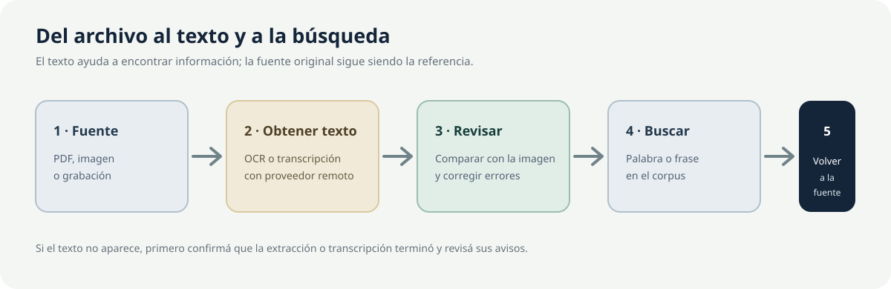

### 6.5. If the text does not appear

- Check that you opened the right page or audio and that the task finished.
- Read the service message in **Text**.
- To search content, check whether **Analysis → INDEX** is needed.
- If the service does not respond, check its key and connection in **Settings → Remote APIs**. In Pro, also check the chosen mode and that the local models are installed (**AI dependencies** and each engine's card).
- If the notice says the text **was extracted from another version of the image**, click **Run the OCR again** ([5.5](#versiones-de-imagen)).
- If a photo is dark, skewed or blurry, keep the original and try a clearer, straighter copy.
- If only a paragraph or the end of a block is missing, do not repeat the page's OCR: [fix that box](#corregir-cajas) in **Layout**.

---

<a id="capitulo-7-buscar-informacion"></a>
## Chapter 7. Search for information

EntropIA has several searches. Pick the right one; they do not all look for the same thing.

| Where | What it searches | When to use it |
|---|---|---|
| **Search collections...** | Collection names. | Find a workspace. |
| **Search documents...** | Names, data and indexed content of the open collection; may include approximate variants. | Locate sources within a collection. |
| **Top-bar search** | Up to 20 documents by name, metadata or indexed text across all collections and, in a separate group, up to 5 Library works. | Find one or more terms and open a document or work. |
| **Search → Search by Similar Text (FTS)** | Up to 10 documents from different collections, through terms and possible spelling variants. | Search lexical content, not ask the model a question. |
| **Similar Pages** | Up to 5 pages or files related to the selected one, with a similarity percentage and preview. | Explore sources by similar content. |
| **Library → Search works** and **Writing → Works** | Synced Zotero works by title, author or meaning; Works also shows passages with their page. | Find your own bibliography and cite a specific page ([ch. 12](#biblioteca)). |
| **Research chat** | Answers questions about recognised text in your documents, the Library or both, and can show the sources. | Ask for an explanation you can check against the sources. |
| **Investigate** | Develops a research question from selected collections, the Library or both, and prepares a report with sources. | Explore a broad question step by step. |

### 7.1. Search a word or several terms

1. Type a term in the top-bar search or in **Search**.
2. Check the titles. In the document's **Search** tab, the collection is checked when you open the result; it is not always shown in the list.
3. Open the result and check the fragment in the original document.
4. If an OCR produced a variant, also try other spellings or a distinctive part of the phrase.

Lexical search compares terms from the title, data or indexed text and may include close spelling variants. If it does not find all the terms together, it may widen to partial matches. **It is not a synonym search and does not interpret a question.** Quotation marks do not guarantee a literal phrase and there are no advanced Boolean operators. To search content, first get the text and, if it does not appear, click **Analysis → INDEX**.

**Search → Search by Similar Text (FTS)** can show up to 10 documents; this list is different from the top-bar search results.

### 7.2. Find similar material

To find similar pages or files, select one with text and click **EMBED** in **Analysis**. Then open **Search** and look at the **Similar Pages** section, which loads when you open the tab: it is not an extra button. The tool compares the content with other prepared material. In Lite, generating embeddings needs the Internet and OpenRouter; in Pro they can be computed on the computer with local BGE-M3. Both produce compatible vectors from the same model.

Also prepare the other material you want to compare. If only one page has embeddings, that is not enough to find similar ones. To process several collections, use [Batches](#capitulo-14-procesamiento-por-lotes).

The preview lets you read the fragment and, when available, return to the source document. Similarity is a lead to review; it does not prove that two sources say the same thing.

### 7.3. Get from the result to the source

When you open a result, check the title, the collection and the page or file. Use the navigation route to go back. If you need a list of citations and sources, see [Research chat](#capitulo-13-chat-y-agentes-de-entropia) or [Investigate](#capitulo-10-investigacion).

> **Important:** FTS is a lexical search that may include spelling variants; **Similar Pages** compares representations of the content. Neither proves on its own that a source supports a claim.

To learn how each search ranks and compares, see [Annex A. Search algorithms](#anexo-a-algoritmos-de-busqueda).

---

<a id="capitulo-8-analizar-documentos-y-colecciones"></a>
## Chapter 8. Analyse documents and collections

### 8.1. Analysis actions per document

Open **Analysis** in the document panel. The indicators show whether an action is pending, running, complete or failed.

| Action | What it does | When to use it and result |
|---|---|---|
| **INDEX** | Prepares the recognised text so you can find its words. | Use it if you cannot find words that appear in the text. It compares words, it does not look for synonyms. |
| **EMBED** | Prepares a page or file with text to compare it with similar material. | Use it before **Similar Pages**. In Lite it requires OpenRouter and an Internet connection; in Pro it can use local BGE-M3. |
| **NER** | Proposes names of people, places, institutions and dates. | Review the results in **Entities**; in Lite it uses an Internet service, in Pro it can use local spaCy. |
| **TRIPLET** | Proposes relations between elements; for example, who did what, with the sentence it comes from. | Review each relation and correct its parts if needed. In Lite it requires OpenRouter; in Pro, the local model too. |

**INDEX** prepares the document; **EMBED** works on the selected page or file. **NER** and summaries use the selected page, or the document when nothing is selected. Get and review the text first. An inactive indicator does not necessarily mean there are no stored results: check the lists too before repeating a task.

### 8.2. Entities, relations and map

In **Entities** you can create, edit or delete people, organisations, places, dates and other elements. Low-confidence proposals may not be shown in the list. In **Semantic Triples**, fill in **subject**, **predicate** and **object**; no field can be left empty. Save with the confirm control or Enter and cancel the edit with X or Esc. To delete a triple, the control asks you to confirm with a second click. Check each relation against the source.

**The sentence behind each relation.** When extracting triples, the model also returns the sentence each one comes from, and EntropIA stores it. When you open a relation —from the document or from [3D relations](#relaciones-3d)— the viewer highlights that sentence in the text and marks its parts: **Subject**, **Relation** and **Object**. With several occurrences, **Occurrence 1 of 3** and the **Previous** / **Next** buttons step through them. The legend explains what was found:

- **Literal in the text:** the words are in the sentence.
- **Inferred (dotted underline):** the model rebuilt that part from the sentence.
- **Elsewhere in the document (also highlighted):** the word appears elsewhere in the text.
- **Inferred by the model from context, with no words expressing it in the document:** there is nothing to highlight; treat it with more care.
- **Approximate reference:** only an entity was found, not the relation; old or hand-made triples have no stored sentence.

<a id="alias-de-entidades"></a>
**Entity aliases.** The same name often appears spelled in several ways ("C. Cuevas", "Carmela Cuevas", "Mrs Cuevas"). To join them without rewriting the text:

1. In **Entities**, next to a mention, click **Same as…**.
2. In **Canonical name**, type the correct form or choose one of **Other mentions in this document**. The **Original mention (alias)** stays as it is.
3. Click **Save**.

From then on, the document's entities and 3D relations read the alias as the canonical name across the whole archive, without modifying any mention. An alias cannot point to another alias: choose the final name directly. **Settings → Aliases** lists every alias to **Edit** or **Delete** (mentions do not change) and offers **Suggestions**: groups that look like the same person (same surname, initials, titles). Nothing is joined automatically: each group is **Accepted** or **Discarded**. Aliases travel with sync.

The **Map** tab shows places associated with the document. You can select a marker, adjust the location and save it, or reset it when available. Viewing the map and searching places requires the Internet. Check that each place matches the source.

### 8.3. Text analysis of a collection

Inside a collection, open the side panel with **Show text analysis**. This panel counts words from stored recognised texts and transcriptions and draws the relations already extracted; it does not generate summaries or interpret the documents.

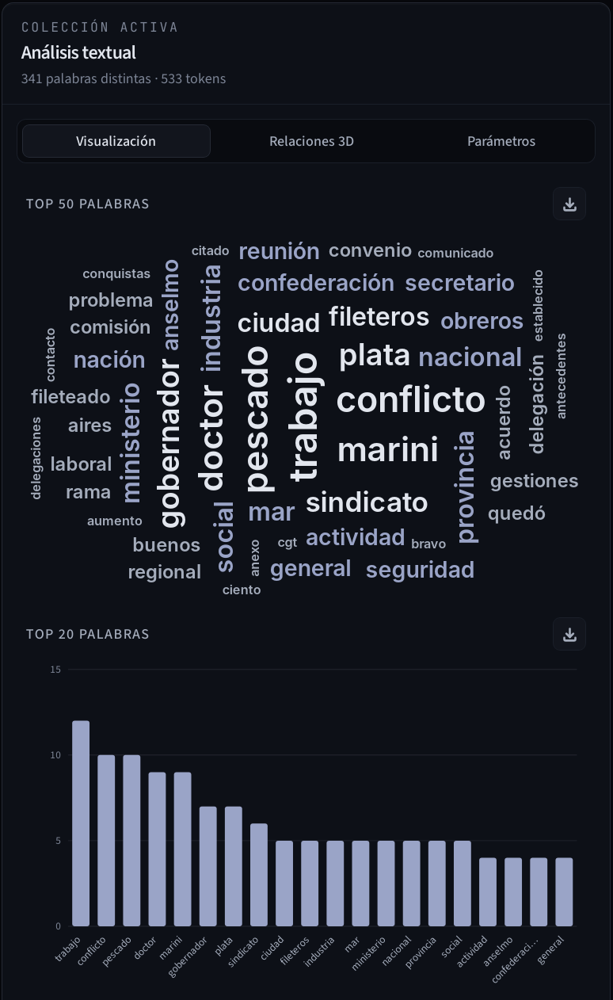

- **Visualization:** the **Top N words** cloud and the **Top 20 words** chart. Each chart can be downloaded as PNG.
- **Phrases:** frequent phrases, associated words and a word tree; explained in [8.5](#frases).
- **3D relations:** the graph of the collection's relations; explained in [8.4](#relaciones-3d).
- **Settings:** under **Text visualization**, choose between 20 and 100 terms for the cloud (50 initially) and add **Custom stopwords** separated by spaces, commas or semicolons; under **3D relations**, adjust what the graph shows and how it is drawn ([8.4](#relaciones-3d)). These preferences are kept per collection on this computer.
- **Hide text analysis:** close the panel.

If there are no recognised texts or transcriptions yet, the collection has no words to count. First review its documents' text. The count uses the texts stored on this computer and needs no AI key.

**Recommended reading:** a large word appears many times; it is not necessarily the most important idea. Use **Settings** to exclude filler terms and contrast the results with specific documents. OCR errors count as words too.

<a id="relaciones-3d"></a>
### 8.4. 3D relations of a collection

The **3D relations** tab of the analysis panel draws the collection's triples in three dimensions: each name (subject or object) is a point and each relation a line with its link. The same name written with different capitals or spaces counts as a single point, and [aliases](#alias-de-entidades) are drawn under their canonical name.

1. First extract relations: **TRIPLET** in each document or **Triples** in [a batch](#capitulo-14-procesamiento-por-lotes). Without triples, the tab says **No relations yet**.
2. Open the collection, click **Show text analysis** and choose **3D relations**. The top line summarises how many names and relations there are. The graph starts framed in full and fits the panel; **Widen the panel to the full width** gives it the whole window and **Back to half width** returns it.
3. Drag to rotate the graph and use the mouse wheel to zoom. Hover over a point or a line to read it. A relation the text repeats shows how many times (**×3**).
4. Click a point to open its details: the name and its links are highlighted, and **Relations** lists its triples, split into **In the graph** and **Not drawn in the graph** (those left out by a maximum or a filter in **Settings**; they can still be opened). **Add all its relations to the graph** adds the hidden ones for that name and **Back to the filtered graph** removes them.
5. To go to the text: **See where it appears in the text** (on a name), **See this relation in the text** (on a line) or **Open the passage with this relation highlighted** (on a triple in the list). The document opens with the sentence highlighted ([8.2](#capitulo-8-analizar-documentos-y-colecciones)) and, with **← Back**, you return to the graph where you left it. **Close the details** goes back to the full graph.
6. **Save the graph for Gephi (.gexf)** downloads the visible graph as a GEXF file, to analyse it in [Gephi](https://gephi.org) or another network tool.

**Tune the graph.** In **Settings → 3D relations** (the changes only affect what you see; stored entities and relations do not change; **Restore defaults** goes back to the start):

| Group | Settings |
|---|---|
| **What is shown** | **Maximum visible entities**, **Maximum visible relations**, **Minimum connections per entity**, **Minimum appearances as subject** and **as object**, **Minimum repetitions per relation**, **Include isolated nodes**. Each entity that enters does so with all its relations; when trimming is needed, the most connected enter first. |
| **Appearance** | **Node size**, **Relation opacity**, **Show arrows**, **Show the link on hover**. |
| **Exploration** | **Distance between connected nodes**, **Repulsion strength**, **Settling time (seconds)**, **Auto-rotate** and **Layout algorithm**: **Forces** (the general layout), **Communities** (highly connected entities push apart and their neighbours gather around them) or **Radial hierarchy** (rings from the subjects that start relations towards the objects that receive them). |

When a setting hides names, the graph says so (for example, **12 names are hidden by the minimum thresholds**). The graph uses the triples stored on this computer and needs no key to be drawn. Relations are the model's proposals: correct them in each document's **Analysis → Semantic Triples** and reopen the tab.

<a id="frases"></a>
### 8.5. Phrases and associated words

The **Phrases** tab of the text analysis works on the same text as the word cloud, on this computer and without keys:

- **Frequent phrases:** the word sequences repeated most in the collection. **Words per phrase** sets their length, from 2 to 5. If nothing repeats at that length, you are told.
- **A word in context:** type a **Word** (for example `war`).
  - **Associated words** lists the words that appear near it more often than chance would predict, with how many times they appear nearby and their **G²** score (log-likelihood): the higher, the stronger the association.
  - **Word tree** shows what comes **After** or **Before** that word, branching by frequency: useful to see its usual uses and formulas.

The **Custom stopwords** from **Settings** are excluded here too. As with the cloud, OCR errors count as words and a strong association is a lead to read the sources, not a conclusion.

---

<a id="capitulo-9-notas-y-topicos"></a>
## Chapter 9. Notes and topics

### 9.1. Classify with topics

In **Notes**, use **Topics** to assign keywords to the document, such as `census`, `work` or `everyday life`. Type a topic and confirm it with Enter or a comma. You can pick existing suggestions and remove a topic with its control.

### 9.2. Create and edit notes

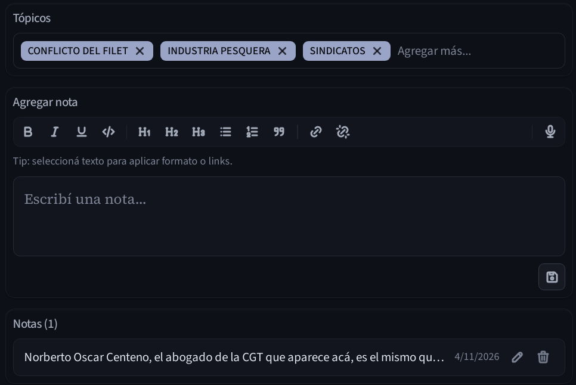

1. Open the page or file your observation refers to.
2. In **Notes**, find the editor under the **Add note** heading; it is already open, you do not need to click that title.
3. Type in **Write a note...** and use the editor to apply bold, italics, headings, lists, quotes or links.
4. Click **Save note**.
5. To read an earlier note, open it in the list. **Edit note** lets you change it; **Delete note** asks for confirmation.

The new note is attached to the active page or file; only with nothing selected does it stay on the document. Topics classify the document. When you change page, check its notes. To dictate, click **Start dictation**; you need microphone permission and, in Lite, AssemblyAI configured (in Pro, the **STT mode** engine). Notes require **Save note**, unlike the manuscript's autosave.

### 9.3. Reuse notes while writing

In **Writing → Notes**, search for a note, open it and check where it comes from. **Insert as text** copies the content as independent text. **Insert as a link** adds a link to consult it again. The panel searches notes from all your documents; it cannot limit the search to a manuscript's collections.

If the linked note changes or disappears, Writing shows its state and keeps the manuscript text. If the note no longer exists, the link cannot open it.

You can also select a phrase in the manuscript and use **Save the selection as a note**; then you choose which document it belongs to. This creates a note, not a bibliographic citation.

---

<a id="capitulo-10-investigacion"></a>
## Chapter 10. Research

**Investigate** lets you pose a question, choose where to look —your collections, your Zotero Library or both— and get a report backed by sources. It is different from a word search and from the short chat in chapter 13.

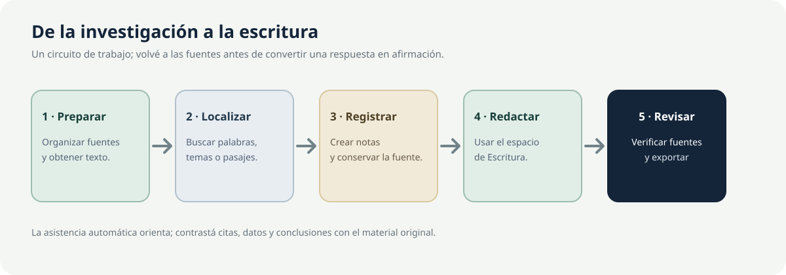

### 10.1. Create an investigation

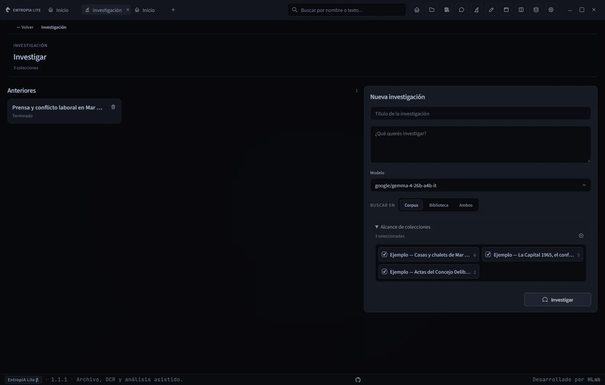

1. On the top bar, open **Research agent**; the page is titled **Investigate**.
2. In **New investigation**, write a concrete question and, optionally, a title.
3. In **Model**, keep the general OpenRouter model or type to search for another: the field filters the whole OpenRouter catalogue by identifier and name, shows up to 50 matches and asks you to keep typing if there are more. The arrow keys move through the options, **Enter** chooses and **Esc** returns to the previous value. You can also type an identifier the catalogue does not list: it is accepted as is and checked when the investigation is created. The work keeps that model in all its steps and the investigation header shows it. The catalogue needs the saved OpenRouter key; without it, the field tells you how to go to **Settings**.
4. In **Search in**, choose **Corpus** (your collections), **Library** (the synced Zotero works, see [12.4](#biblioteca)) or **Both**. With Library, the **Zotero libraries** menu lets you choose which ones to use.
5. If you search the corpus, open **Collection scope**. EntropIA proposes the collections that already have fragments; review the selection, add or remove collections and use **Select all** if appropriate.
6. Click **Investigate**. The work opens automatically so you can follow it. Later you can resume it from **Investigate → Previous**, by selecting its card.

Prepare the text and fragments of your documents beforehand. The scope must include processed material: **if every selected collection has zero fragments, the investigation does not start**, and with **Library** at least one synced and chosen library is needed. If only part of the material is processed, review the report's coverage gaps.

### 10.2. Follow the process

During the work, the view may ask you to step in:

- **Questions before building the report:** answer at least one; empty ones stay unanswered. **Edit design** lets you adjust **Hypothesis**, **Scope** and **Closing criteria**. If you edit the design, fill in all three sections and at least one criterion, one per line. Click **Answer and continue**.
- **Searches before going to the corpus:** review **Searches** and **Bibliography queries** separately. **Approve and search** accepts the plan; **Edit searches** lets you change one query per line and **Save and search** starts the modified plan.
- **Pause → Adjust budget:** lets you change **LLM calls** and **Maximum cost**. They cannot be lower than what was already used. An empty cost means **No cap**. Click **Save budget** and then **Continue**.
- **The investigation stopped because of an error:** if a step fails, the work pauses and shows the message as the engine gave it. **Retry** resumes it from that step. When an archive batch is too large, the engine retries it by itself with less text; the investigation's activity says so in one line, and it is not a limitation of the report.
- **Cancel** stops the work but does not delete it. Pausing or cancelling may wait for the current step to finish. When you reopen the application, works that were running stay paused and need **Continue**.

**Plan scope:** corpus searches are limited to the chosen collections. **Bibliography queries** may consult local Zotero and **OpenAlex over the Internet**; they get bibliographic metadata, not the full text of the works. If you do not want to run them, empty that field before **Save and search**.

In Lite and in Pro, **Investigate** needs the Internet and OpenRouter; it does not use Pro's local model or the Vercel fallback. If you picked collections by hand, their [Context for the AI](#contexto-ia) is added to the question. The question, framing answers, context received from the Chat and passages used may be sent to the provider. Bibliography queries also go out to OpenAlex. Review the plan before approving it if you work with sensitive material.

### 10.3. Read and check the report

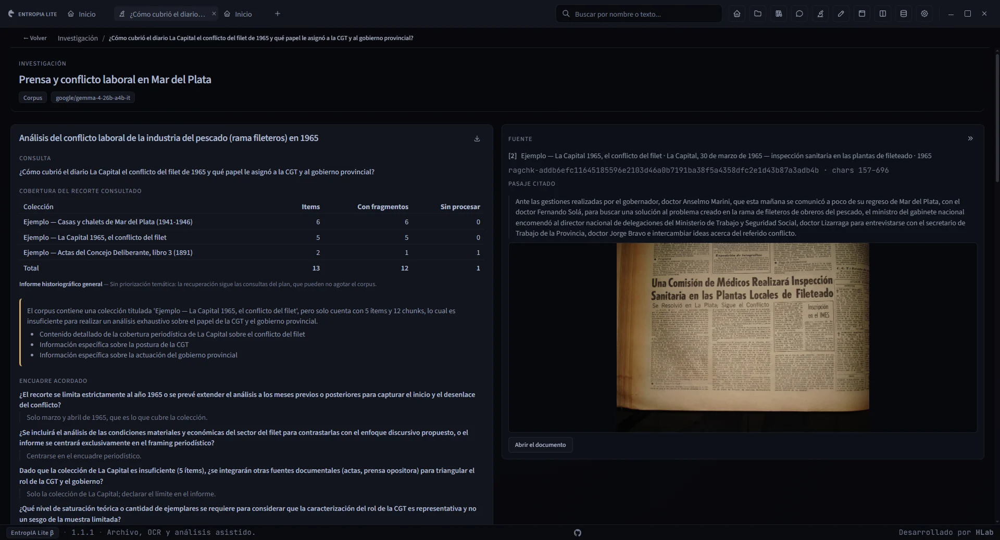

The report may include the framing, coverage by collection, findings, limitations and **Cited sources**. Review the warnings about sources without text or insufficient coverage.

If a step did not go well, the report says so in plain words and names the step (**Research planning**, **Document reading**, **Bibliography reading**, **Section writing**, **Claim verification**…): for example, that the model's answer was cut off for length —and that you should raise the **Output cap** in **Settings → Agent**— or that it returned a format the program does not understand —and that you should try a more capable model—. That part of the report may be incomplete. **Technical detail** shows the original message.

1. Select a citation `[n]` to read the passage and the source data.
2. Use **Open the document** to return to the local material when available.
3. Contrast the claim with the original page, audio or text. A citation does not guarantee that the report interpreted the source correctly.
4. **Edit → Save** changes the section by hand. It is marked **Edited by the historian: the text did not go through verification**.
5. **Rewrite** opens **Instruction for the writer**. When you send the instruction, a valid answer replaces the section; there is no later acceptance step as in the Writing agent. Review the resulting text.

> **Warning:** a rewrite uses the report's evidence, does not add new sources and **adds cost even if the budget was already used up**. Download a copy first if you want to keep the previous wording.

When you create the investigation there is no project selector or initial budget: limits are adjusted later, when pausing. The collection scope applies to the corpus; do not confuse it with the Library or with the plan's bibliography queries.

### 10.4. Save or delete an investigation

In the report header, click **Download** and choose Markdown, HTML or Word (`.docx`); PDF is not offered. To return to a work, open its card in **Previous**. **Delete the investigation → Delete** removes the report and its associated information with no undo; if it is still running, cancel it first. Keep a download before deleting it.

With [sync](#capitulo-15-sincronizacion-y-nube) on, finished or failed investigations travel to your other computers with their report; those still running stay on the computer where they run. Deleting a synced investigation deletes it on the other computers too.

---

<a id="capitulo-11-escritura"></a>
## Chapter 11. Writing

**Writing** is where you draft a manuscript and consult your documents, your Zotero Library, your notes and contextual help from one space.

### 11.1. Create and open a manuscript

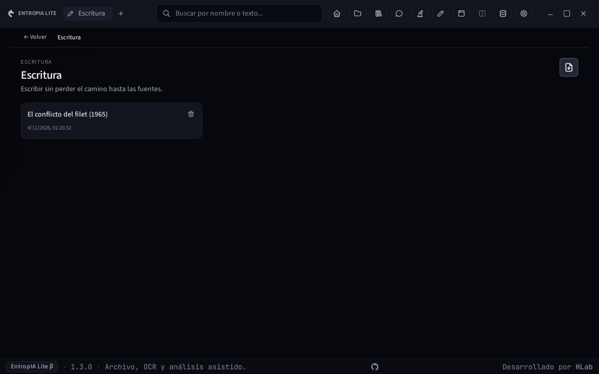

1. Open **Writing** from the top bar. If it is already open in another tab, EntropIA takes you to that tab.
2. From the list, click **New document** to create and open a manuscript. To continue an existing one, choose its card instead of creating another.
3. Type the title at the top and confirm it with Enter or by leaving the field.

The **Home → Write** shortcut may reuse the open manuscript if it is still empty and has the default title. **New document** in the Writing list always creates another.

The current view does not import a DOCX or Markdown file as a manuscript. If you already have text in another file, copy and paste it into a new document.

### 11.2. Write and navigate

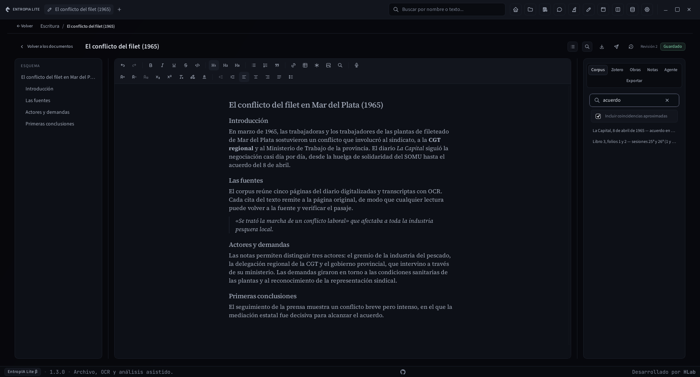

The space brings together the **Outline**, the manuscript and the research panel. Use **Show or hide the outline** and **Show or hide the research panel**, or drag their dividers. If there is not enough width, the outline may close automatically. **Back to documents** returns to the list and **More tools** shows options that do not fit in the bar.

- The editor supports formatting, headings, lists, block quotes, footnotes, links, tables, images and alignment.
- **Search:** inside the manuscript, Ctrl+F opens or closes search. Enter/Shift+Enter step through matches; **Replace with**, **Replace** and **Replace all** change them. Esc closes it.
- **Images:** use **Insert image**, or paste or drag a PNG, JPG/JPEG or GIF. Select the image to align, resize and fill in **Alt text**. The **Caption** is visible text below, different from the alternative description.
- **Tables:** from **Table controls**, add or remove rows and columns, or choose **Delete table**.
- **Outline** shows level 1 to 3 headings. Select one to jump to that section; you can rename it, move it, add another below or delete it with its content.
- **Dictation:** place the cursor before starting it; the result is inserted there or replaces the selection. It requires microphone permission and, in Lite, AssemblyAI and the Internet; in Pro it uses the **STT mode** engine. It can be undone like a normal edit.

### 11.3. Autosave, revisions and version history

The manuscript is saved automatically; there is no button to save it by hand. The bar shows **Saved**, **Saving**, **Unsaved changes** or **Save failed**. When you switch document, leave Writing or close its tab, EntropIA tries to save what is pending. Still, wait to see **Saved** before closing the application. The number next to **Revision** counts saved changes. If saving fails, use **Retry** when it appears and keep a copy of important text before closing.

<a id="historial-de-versiones"></a>
Writing also keeps earlier versions of the manuscript: one every ten minutes of work, another before receiving changes from another account and another before restoring. The 50 most recent per manuscript are kept.

1. With the manuscript open, click **Version history** on the bar (the clock icon).
2. The list shows each version with its date and reason: **Automatic save**, **Before changes from another account** or **Before restoring another version**.
3. Choose one to read it. The preview is read-only.
4. To go back to that text, click **Restore this version**. Nothing is lost: what you had before is saved as another version.

**Restore a single section.** If you only want to recover one section, choose it in the history's **Section** menu (sections are the **Outline** headings; **All sections** goes back to the full list). The list narrows to the versions that changed that section —if none did, it says **No version changed this section**—. Choose a version and click **Restore only this section**: only that section goes back to how it was and the rest of the manuscript stays the same. What changes is saved as another version. If the section no longer exists in the version or in the current manuscript, EntropIA says so and restores nothing.

A restore is just another change: if the manuscript is synced or shared, it reaches your other computers and the other account. A deleted manuscript cannot be recovered from the history.

### 11.4. Consult your documents and cite a source

With a manuscript open, show the research panel and choose **Corpus → Search the corpus**. It searches already recognised text and transcriptions locally, without running OCR or calling AI for each search. It shows up to 20 results and has no collection selector. **Include approximate matches** allows spelling variants.

Place the cursor where you want to cite, open a result, choose **File/Files** or the page —if there is only one, it opens directly— and select the passage within the text. Click **Insert as a citation**. The button needs an open manuscript and a valid selection. If the selection cannot be located, select a passage again; a citation to a different text is never inserted by approximation.

The citation keeps the link to the document and the passage. If the source changes, EntropIA warns you and does not highlight a different text as if it were the original fragment. To add a Zotero bibliographic reference, follow [chapter 12](#capitulo-12-zotero).

### 11.5. Use notes, the agent and export

The panel's six tabs are **Corpus**, **Zotero**, **Works**, **Notes**, **Agent** and **Export**. **Zotero** and **Works** are explained in [chapter 12](#capitulo-12-zotero). **Notes** lets you find notes attached to your documents and insert them as text or a link. **Agent** works on a selection and is explained in [chapter 13](#capitulo-13-chat-y-agentes-de-entropia). **Export** sets the citation and bibliography format; the **Download** button is on the manuscript bar.

**Export → Statistics** shows words, characters with and without spaces, paragraphs and footnotes; body words do not include the footnotes' content. To get the file, click **Download** on the manuscript bar and choose the format and save location.

The panel called **Research** inside Writing holds these six tabs; it is not the separate **Investigate** screen.

### 11.6. Delete a manuscript

To delete a manuscript, go back to the Writing list, use its **Delete** action and confirm. The document leaves the list with its version history; there is no bin view or control to restore it. Download a copy before deleting it.

### 11.7. Manuscript sync

With [sync](#capitulo-15-sincronizacion-y-nube) on, manuscripts travel between your account's computers together with their images. If you edited the same manuscript on two computers before syncing, EntropIA keeps both versions: the other one becomes a separate manuscript marked **Conflict copy**, so you can choose which text to keep. Without sync, the manuscript stays on this computer; download a copy if you need to move it.

You do not need to go to Settings to sync a manuscript: the **Sync now** button (two arrows in a circle) appears in the Writing list and on the manuscript bar. It spins while working and, if a newer version arrived and you typed nothing meanwhile, shows it in place. With **Automatic sync** on, an open manuscript sends what is saved within a few seconds and looks for changes from the other account every 30 seconds. If sync is off, the button does not appear. The list also shows **Sync pending** when changes or images are still to be sent or received.

<a id="compartir-manuscrito"></a>
### 11.8. Share a manuscript with another account

To write as a pair, each person uses their own sync account and they share the same manuscript.

1. With the manuscript open, click **Share and publish** on the bar (the paper-plane icon).
2. In **Share with another account**, type the email of the other person's EntropIA account and click **Share**.
3. The other person receives it on their next sync. In the Writing list, shared manuscripts carry the **Shared** mark.

From then on, what each of you writes reaches the other on sync. Avoid editing the same paragraph at the same time: if both change the manuscript between one sync and the next, the other version is kept as a separate manuscript, as between your own computers. Before applying received changes, the [version history](#historial-de-versiones) saves what you had. Moving the manuscript to the bin does so for both.

- **Remove:** whoever shared it can remove a person; that person keeps their copy but stops receiving changes.
- **Stop receiving changes:** whoever received the manuscript can leave on their own, with the same result.

The collections the manuscript is linked to are not shared: each person sees only their own. A citation to a document the other person does not have shows the quoted text and a source-unavailable notice. If one of you updates EntropIA, the other must update too to keep syncing.

<a id="enviar-a-hlab"></a>
### 11.9. Send a manuscript to the hlab.com.ar blog

This option is for the HLab team: it sends the manuscript to the hlab.com.ar blog without copying and pasting.

1. Click **Share and publish** on the manuscript bar.
2. The first time, under **Send to hlab.com.ar**, paste the **Key for publishing to hlab.com.ar** the team gave you and click **Save key**. It is stored in the system keyring.
3. Click **Send to hlab.com.ar**. When it finishes you see **Ready** and **Open in the admin panel** takes you to the article in the site's administration panel.

The first send arrives as a **hidden draft**: nobody sees it until it is published from the site panel, where the category and image are also chosen. If you send the same manuscript again, the title and text are updated; if it was already published, the change goes live immediately. Citations are sent as footnotes, as in the HTML download. The site does not keep paragraph alignment.

---

<a id="capitulo-12-zotero"></a>
## Chapter 12. Zotero and Library

Zotero provides bibliographic references for the manuscript. EntropIA queries the local Zotero library through its local communication; it does not need your Zotero web account. You can also **sync** a Zotero library into EntropIA: its works move into the **Library** section, with the text of their PDFs, and can be searched by meaning, queried in the Chat and Investigate, and cited by page.

### 12.1. Connect Zotero

1. Open Zotero on the computer.
2. In Zotero, go to **Edit → Settings → Advanced**.
3. Turn on **Allow other applications on this computer to communicate with Zotero**.
4. Go back to EntropIA, create or open a manuscript in **Writing**, show the research panel and choose **Zotero**. The connection starts when you open that tab.
5. When Zotero responds, the tab shows references from the library and enables **Refresh**.

If the connection does not work, EntropIA says whether Zotero refused the connection, did not respond in time or sent a reply it could not read. No response does not prove that Zotero is closed or uninstalled. References consulted earlier may still appear.

If you opened Zotero afterwards, switch to another panel tab and back to **Zotero** to check the connection. The local metadata copy may remain visible even if Zotero does not respond. **Refresh** updates that copy; it does not automatically rewrite citations already inserted.

**Choose the library.** The tab's **Library** menu shows **My Library** and those EntropIA already knows because you used or synced them. Groups appear with their Zotero name when Zotero is open; if it does not respond, they show as `group/` followed by their number. To use a group for the first time, click **Add library**, choose **Type** (**User** or **Group**), type its **ID** —the number in the group's address on zotero.org— and click **Add**. EntropIA checks that Zotero has it; a library that could not be checked is marked **(unverified)**.

### 12.2. Search and cite

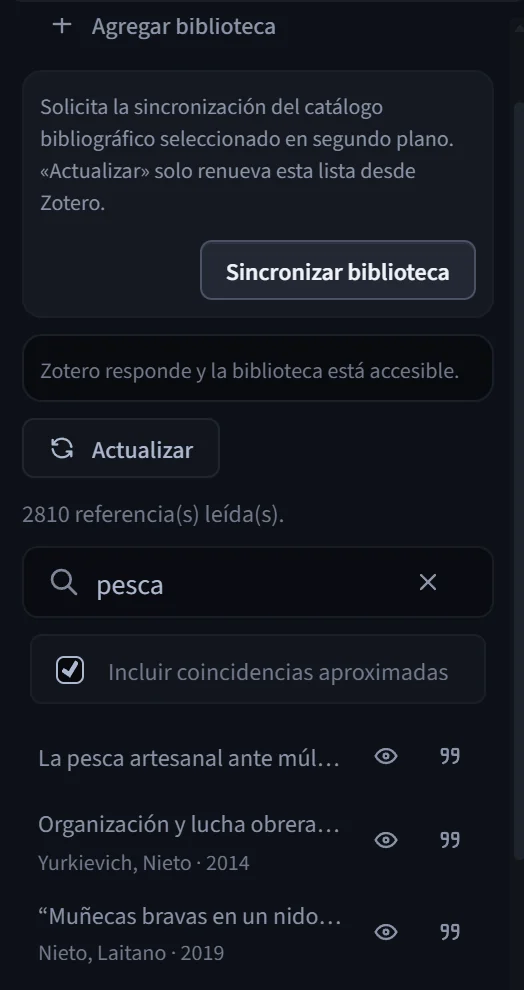

1. Place the cursor where you want to insert the citation. In **Search your Zotero library**, type author, title or year to filter the local copy. The search ignores case and accents and, with **Include approximate matches**, tolerates typos.
2. Enter also queries Zotero's own search, which can find works by their indexed text or notes. If the library is [synced into EntropIA](#biblioteca), works similar in meaning also appear, marked **By meaning**, and matches inside the text, marked **By content**. The list shows up to 200 references; narrow broad queries. This does not import or open their PDFs.
3. **View details** shows the work's data: authors, publication, date, DOI, ISBN, abstract, collections, tags and attachments. Zotero's automatic tags (those added by translators or databases) are hidden: **Show automatic tags (N)** shows them and **Hide automatic tags** hides them again.
4. Click **Cite** (the quotation-mark icon) next to the work: **the citation is inserted at that moment**.
5. In **Adjust the citation**, fill in **Locator** and **Locator kind**: page, chapter, section, paragraph, volume, line, folio or note. Tick **I already named the author in my sentence** if applicable and check the preview. You can add **Before the citation** and **After the citation**.
6. Check **How it reads** and click **Ready**. **Cancel** discards pending adjustments but does not remove the citation already inserted. To change it later, click the citation in the manuscript.

The citation format is APA; you cannot choose another style from EntropIA. Works, collections and tags are edited in Zotero, not in EntropIA. The reference keeps a copy of its data so it stays in the manuscript even if Zotero stops responding later.

### 12.3. Include a bibliography

In **Writing → Export**, leave **Include the bibliography** on if you want the file to include the list of cited Zotero works. The bibliography is built from the Zotero references; it does not turn citations inserted from your documents into Zotero references.

<a id="biblioteca"></a>
### 12.4. Sync a library and browse the Library

**Sync** copies a Zotero library's catalogue into EntropIA and prepares its works for searching. It changes nothing in Zotero.

1. Open Zotero with local communication enabled ([12.1](#capitulo-12-zotero)).
2. In **Writing → Zotero**, choose the library in the **Library** menu and click **Synchronize library**.
3. The tab shows progress: **Works** and **Passages** processed, the work in progress with its page and the estimated time left. When it finishes, it says **Library up to date** or how many new works and attachments were added. If some works or passages could not be processed, it says so separately: **Synced, but N works or passages failed to process**. **Refresh** only renews the reference list; it does not restart a sync in progress.

Sync works in the background and continues when you reopen EntropIA; works you opened recently are processed first. For each work it reads the attached PDFs and saved web snapshots: it uses the PDF's digital text when legible and runs OCR on scanned pages or pages with illegible text (**GLM-OCR** in Lite; in Pro, the **OCRH mode** engine). It then prepares the works and their passages for search by meaning with the **embedding model** (OpenRouter in Lite; in Pro, the one chosen in **BGE-M3 embeddings**). If one of those keys is missing, progress says **waiting** and what to configure; the rest continues. If Zotero stops responding, sync goes **Paused** and retries by itself when it answers.

> **Costs and privacy.** In Lite, reading the scanned PDFs of a large library may mean a significant number of paid pages at GLM-OCR, and the works' text is sent to OpenRouter to compute their embeddings. In Pro, with local OCR and embeddings, nothing is paid or sent, but processing a large library takes time. Try a small library or group first.

> **You do not pay twice.** If you use [sync](#capitulo-15-sincronizacion-y-nube) with the same account on several computers, the GLM-OCR text and embeddings one computer already paid for travel through EntropIA's cloud. Another computer with the same Zotero and the same OCR and embedding configuration completes **Works** and **Passages** with those results instead of asking the provider again. The same goes for your collections' embeddings. When you sign in for the first time, the computer waits a moment for the cloud before the first paid call.

**Browse the Library.** The **Library** button on the top bar (the books icon) shows the synced works as cards, like collections:

- **Choose library** filters by Zotero library or shows **All libraries**.
- **Choose sort order** sorts by **Title** or **Recent**.
- **Search works** searches by title, author or meaning.
- Clicking a work opens it with three tabs: **Original** (the attached PDF inside the application or the text of a web snapshot; **Choose attachment** switches between attachments), **Text** (the extracted text, page by page, with tables as tables) and **Metadata** (the Zotero record and its **Attachments**; **View in Original** opens one).

The top-bar search also shows, below your documents, a **Library** group with up to five works. Works and their records are not edited from EntropIA: they are added, corrected or deleted in Zotero and arrive with the next sync. The only thing you can change is the [annotations on their PDFs](#anotaciones-zotero), which are stored in Zotero. The Library stays on this computer and does not travel with EntropIA's sync; only the paid OCR and embedding results are shared (see the box above).

### 12.5. Search passages and cite from Works

The **Works** tab of the Writing panel searches the synced libraries without leaving the manuscript.

1. In **Search works**, type a topic, author or work in **Query** and click **Search**. You can also select a fragment of the manuscript and click **Search from selection**.
2. Works appear at the top; below, under **Passages**, the closest fragments grouped by work, with their page (`p. 12`) or, for web snapshots, their paragraph (`para. 4`).
3. **Open passage** shows the fragment highlighted within its text and lets you open the original at that page.
4. With the cursor in the right place, **Cite passage** inserts the Zotero citation with the page already set as locator. Adjust it like any citation ([12.2](#capitulo-12-zotero)).

The search sends your query to the embedding provider to search by meaning; **Search from selection** sends exactly the selected text, only when you ask. If there are no passages, the notice explains why: no synced library, indexing not finished or embedding provider unavailable.

<a id="reprocesar-texto"></a>
### 12.6. Reprocess damaged Library text

Some PDFs carry digital text that looks complete but is illegible, or were processed by an earlier version that did not detect it. **Reprocess text**, in the Library and in the header of a work with a PDF, finds those cases and reads them again.

1. Click **Reprocess text**. EntropIA checks the attachments (**Looking for works with damaged text…**).
2. Read the summary: affected attachments and pages, **Pages for GLM-OCR**, pages fixed without OCR, OCR that is reused and the **Estimated cost** in dollars. **Not queued** lists the attachments that cannot be read or are already being processed.
3. Click **Reprocess (≈ USD …)** to queue them, or **Cancel**.

The cost is an estimate (it assumes about 3,000 text units per page); the provider charges the real price. Progress, pausing and cancelling are in **Settings → Batches**.

<a id="anotaciones-zotero"></a>
### 12.7. Annotate Library PDFs

The PDFs in your personal Zotero library can be highlighted, underlined and commented inside EntropIA. Each annotation is stored in Zotero, so you also see it in Zotero's reader and on your other computers; what you annotate in Zotero appears in EntropIA.

**Before you start.** Annotations use the Zotero Web API, not local communication: save in **Settings → Remote APIs → Zotero** a key with write access to your personal library ([16.1](#capitulo-16-configuracion-y-herramientas-generales)). Open Zotero at least once so EntropIA knows which account you use. For now they only work in the **personal library**, not in groups.


1. In **Library**, open a work with a PDF and stay on the **Original** tab. The **Annotations** panel appears on the right.
2. Select text on the page: the **Annotate selection** menu offers highlighting or underlining with Zotero's colours. You can also choose a tool in the viewer's column: **Select**, **Highlight**, **Underline**, **Note**, **Area** (a rectangular crop) or **Text**.
3. In the panel, each annotation appears by page with its type (**Highlight**, **Underline**, **Note**, **Area**, **Text**, **Drawing**) and an **Add a comment…** field. With an annotation selected, choosing another colour recolours it; **Delete annotation** asks for confirmation.
4. Each annotation shows its state: **Synced**, **Pending** (not yet in Zotero), **Waiting for Zotero** (the attachment is not on the server yet), **Conflict** or **Error**. **Sync with Zotero** sends and fetches changes right away; they also sync when you open the work and after each library sync.

**If it changed on both sides.** When an annotation was modified in Zotero and in EntropIA before syncing, the panel shows **Zotero and EntropIA both changed this annotation** with both values: choose **Keep EntropIA** or **Use Zotero** and click **Apply**. If it was deleted or moved to the bin in Zotero, you can **Keep the annotation** or **Delete it**.

**Bin.** Annotations in Zotero's bin are not drawn on the page; they are grouped at the end under **In the Zotero bin** and **Restore** brings them back. Annotations on non-PDF attachments (for example, EPUB or web snapshots) are counted as **annotations in another format (Zotero only)** and are edited in Zotero.

If there is no connection, changes stay **Pending** and are sent later; if Zotero asks to wait, the panel says so. If the PDF is not on this computer, the panel still shows the annotations even though the page cannot be displayed. Library annotations do not travel with EntropIA's sync: the other computers receive them from Zotero.

---

<a id="capitulo-13-chat-y-agentes-de-entropia"></a>
## Chapter 13. Chat, help and EntropIA agents

The interface has four related but different assistants. The first three work on your sources; the fourth, on the application:

| Tool | How to get there | Result and control |
|---|---|---|
| **Research chat** | The top-bar button of the same name. | A conversation; it can answer with sources from the corpus, from the Library or without document retrieval. With **Corpus** and **Both**, the **Corpus collections** menu narrows the search; it does not browse the Web. |
| **Investigate** | **Research agent**, or **Investigate with the Agent** from the Chat. | A staged investigation and a report. Corpus limited to collections, Library or both, with the plan's bibliography queries to Zotero/OpenAlex. |
| **Writing agent** | Open a manuscript → **Agent** panel. | A proposal on a selection. It does not change the manuscript until **Replace** or **Insert below**. |
| **Help chat** | The bubble with the EntropIA logo, above the status bar. | Explains how to use EntropIA from this manual, helps when something fails and can take actions with your approval ([13.5](#ayuda-en-la-app)). |

None of these tools replaces checking the source. Besides them, you can connect an [external assistant](#asistentes-externos) —Claude Code, Codex, OpenCode, Pi or another MCP-compatible one— that works from outside the application with the same tools the help chat uses.

### 13.1. Ask about your documents in the Chat

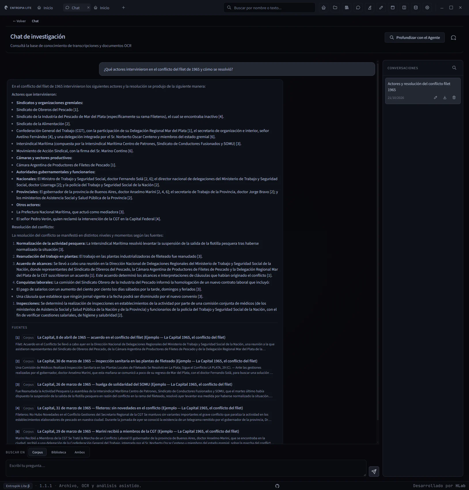

1. Open **Research chat** from the top bar.
2. In **Search in**, choose **Corpus** (your collections, the default), **Library** (the synced Zotero works, see [12.4](#biblioteca)) or **Both**. With Library, the **Zotero libraries** menu lets you choose which ones to use; below it you see how many works and passages each one has.
3. Type a question of up to 4,000 characters about documents whose text has already been recognised and prepared for search.
4. Click **Send**. Enter sends; Shift+Enter adds a line.
5. Check **Sources** below the answer, when it appears, to verify titles, collections and cited fragments. Each source says whether it comes from the corpus or the Library; Library sources name the work, the library and the page or paragraph.
6. Click a corpus source to open the document with the cited fragment highlighted; for audio, the player jumps to that stretch of the transcription. A Library source opens **Open passage**, with the cited text highlighted and **Open original** to see the PDF at that page.

The **Search in** choice lasts for the session. With **Corpus** and **Both**, the **Corpus collections** menu also appears: by default it searches all of them, and each collection can be ticked or unticked. The **All collections** row ticks them all at once and, if they are all ticked, unticks them all: with none ticked the Chat waits for at least one collection and shows **Choose at least one collection to search the corpus** instead of sending the question. The Chat does not browse the Web. If the Library has no synced libraries or its indexing is not finished, the Chat says so and answers without it. In Lite it uses OpenRouter —with the Vercel fallback if you configured it—: it may send the question, the relevant history and the retrieved passages. In Pro, the **LLM mode** decides whether the local model answers (nothing leaves the computer) or OpenRouter. The Chat reads the collections' [Context for the AI](#contexto-ia) and treats retrieved fragments as data: if a document contains instructions ("ignore the above…"), it does not obey them. A direct conversational answer may have no sources. If a document query finds no passages, you see **I did not find relevant content in the knowledge base for that question**; check the processed text and rephrase.

### 13.2. Conversations and history

- **New conversation** starts another thread when you send the first question.
- **Conversations:** return to a thread or search by title/content. **Edit conversation name** renames it; Enter saves and Esc cancels. Deleting asks for confirmation and removes its messages with no undo.
- **Copy answer:** copies the text and the available source titles, not the original files.
- **Download conversation as PDF:** it sits next to the thread in the history and saves to the **Downloads** folder, with no location picker. It includes questions, answers and source titles.
- **Investigate with the Agent:** requires at least one question and the Chat not waiting for an answer. It carries the last question and the loaded messages to **Investigate**, but does not start the work. Review **Context brought from the chat → Review preserved messages**, the question and the collections; only then click **Investigate**. That context is not verified evidence.

### 13.3. Writing agent

With a manuscript open, go to **Writing → Agent**, select a passage and click an action. **That click starts the request**, with no second confirmation. The visible options are:

- **Spelling**, **Wording**, **Clarity**, **Argument**.
- **Shorten**, **Expand**, **Summarise**, **Rephrase**.
- **Repetition**, **Contradictions**.
- **Evidence**, **Counter-evidence**, **Counterexamples**, **Notes**.

The review actions work on the selection. **Evidence**, **Counter-evidence** and **Counterexamples** add related passages from the corpus. **Notes** looks among your notes for those sharing words with the selection (in a passage with four or more meaningful words, at least two in common) and asks the model to relate them. It searches by words, not by meaning: a note saying the same thing in other words does not appear. If no note is related, it says so and does not call the model.

In Lite and in Pro, the selection is sent to OpenRouter together with, when applicable, the corpus passages or the notes found, plus the [Context for the AI](#contexto-ia) of the manuscript's main collection; the Vercel fallback does not apply to the agent. The whole manuscript is not sent automatically, but if you select all of it, that is the text sent. **This is what was sent** shows the recorded context after the request; it is not a prior authorisation.

In **Suggestions to review**, read **Original text**, **Proposed text**, **Why** and **What it rests on**. You decide what to do:

- **Replace** the original passage.
- **Insert below** the selection.
- **Discard** the proposal.

The agent never changes the manuscript automatically. If the passage changed, disappeared or cannot be identified uniquely, EntropIA refuses to apply it; ask for another proposal or discard it. Without OpenRouter you can keep writing by hand.

<a id="asistentes-externos"></a>
### 13.4. External assistants over MCP: Claude Code, Codex, OpenCode, Pi and others

Besides its own agents, EntropIA can serve an **external assistant** installed on your computer —Claude Code, Codex, OpenCode, Pi or any other that speaks **MCP** (*Model Context Protocol*)— so it can query your archive and, if you allow it, process it while you talk to it. It works the same in Lite and Pro.


*The screenshot is from version 1.3.0. Since 1.5.0 the panel adds the **Conectar Claude Code**, **Conectar Codex**, **Conectar OpenCode** and **Conectar Pi** buttons and **Copy setup instruction for any assistant**; always copy the lines from the panel. Most of this panel's labels are shown in Spanish in both interface languages; this section gives the Spanish label with its meaning.*

#### How the connection works

```
Assistant (Claude Code, Codex…) ⇄ entropia-agent-connector ⇄ EntropIA (open)
        (speaks MCP over stdio)     (installed with EntropIA)   (reads and writes the archive)
```

- **The assistant** never opens your database: it starts the **connector** that came with EntropIA (`entropia-agent-connector` in Lite, `entropia-pro-agent-connector` in Pro) and talks to it over standard input and output.
- **The connector** finds the EntropIA running on this computer and forwards each request. On Windows it uses a named pipe that only your user can open; on macOS and Linux, a local connection to `127.0.0.1`. It never listens on the local network or the Internet.
- **The credential** of each assistant is stored in the system keyring (or, if the computer has no keyring, in a file only your user can read). No configuration line contains passwords or tokens.
- **EntropIA** is the only one that reads and writes the archive: it checks the credential and permissions of each request, asks for your approval for anything that costs money, imports, replaces text or deletes, and records it in its audit log. It must be open while the assistant works; it can stay minimised.

The connection is **off by default**. With the switch off, nothing is listening.

#### Turn access on

1. Open **Settings → Assistants**.
2. Turn on **Permitir asistentes externos** (*Allow external assistants*). The state shows whether the service is active (for example, **Activo en 127.0.0.1:…**, *active on…*).

#### Connect with one click (Claude Code, Codex, OpenCode, Pi)

Under **Conectar un asistente** (*Connect an assistant*), click your assistant's button: **Conectar Claude Code**, **Conectar Codex**, **Conectar OpenCode** or **Conectar Pi** (in English: **Connect Claude Code**, etc.). EntropIA creates a **read-only** client with that name and registers the `entropia` server in that assistant's configuration:

- **Claude Code** and **Codex**: it runs their `mcp add` command for you (in Claude Code, at user scope so it works from any folder; it first removes any earlier `entropia` registration).
- **OpenCode** and **Pi**: it adds or replaces only the `entropia` entry in their configuration file and keeps the rest.

When it finishes it says **Claude Code connected** (or whichever applies). Restart the assistant or open a new session. If assistant access is off, it reminds you to turn it on above so the assistant can connect.

If something fails, EntropIA revokes the client it had just created and tells you why:

| Message | Meaning | What to do |
|---|---|---|
| **… not found on this computer** | The assistant is not installed or not on the system path. | Install it, or use the manual connection below. |
| **… is installed through a script I cannot run safely** | It was installed with a wrapper (for example, an npm script) that EntropIA does not run. | Use **or copy the command** (manual connection). |
| **… did not respond in 30 seconds** | The assistant's command hung. | Use the manual connection. |
| **the configuration is not a valid JSON object or is a link; I did not change it** | OpenCode's or Pi's file has an error or is a symbolic link. | Fix the file and try again, or add the entry by hand. |
| **I could not confirm the revocation** | It failed and the client could not be undone either. | Check **Asistentes emparejados** (*paired assistants*) and revoke it by hand. |

#### Connect by hand and copy the lines

1. Below the buttons, under **or copy the command**, type a **Nombre del asistente** (*assistant name*) to recognise it later (for example "Work Claude Code") and click **Conectar** (*Connect*).
2. The panel shows **Cómo conectar …** (*how to connect…*): the **Identificador del cliente** (*client identifier*), where the connector is (**Conector instalado en …**), the **Comando del conector** (*connector command*) and a ready line for each assistant, each with its **Copiar** (*Copy*) button. On Windows, terminal lines are for PowerShell.
3. Use your assistant's line as the table explains and restart it.

| Assistant | What you copy | Where it goes | How to check |
|---|---|---|---|
| **Claude Code** | A command. | Paste it into a terminal and run it. It removes an earlier `entropia` registration and registers the new one for your user. | `claude mcp list` shows `entropia` as connected; inside Claude Code, `/mcp` lists it. |
| **Codex** | A command. | Paste it into a terminal and run it; it replaces an existing entry. | `codex mcp list` shows `entropia`. |
| **OpenCode** | A configuration snippet (JSON). | In OpenCode's configuration file: the global one (`~/.config/opencode/opencode.json`) or a project's `opencode.json`. If it already has an `mcp` section, add only the `entropia` entry inside it. | `opencode mcp list` shows `entropia` as connected. |
| **Pi** | A configuration snippet (JSON). | Pi needs an MCP extension (for example, `pi-mcp-adapter`). Paste the `entropia` entry inside `mcpServers` in the file that extension reads, usually `~/.pi/agent/mcp.json`. | `pi mcp list` (or the extension's MCP panel) shows `entropia` connected. |

The OpenCode and Pi locations are those given by each assistant's documentation and may change with their versions; if they do not match, look in their help for where MCP servers are declared. Always copy the panel's line rather than typing it: it includes the full path of your installation's connector, which changes with the system and installer (the Microsoft Store version uses the `entropia-agent-connector.exe` alias).

#### Any other MCP assistant

For an assistant that is not on the list (Antigravity, Qwen Code, Grok, Gemini CLI, Cursor…):

1. Type its name in **Nombre del asistente**.
2. Click **Copy setup instruction for any assistant**. EntropIA creates a read-only client and copies to the clipboard a self-contained instruction: it explains that a *stdio* MCP server named `entropia` must be registered, gives the configuration in the most common formats (JSON `mcpServers`, TOML `[mcp_servers.entropia]` and the Claude Code and Codex commands), states that no token is needed, that an existing `entropia` entry must be replaced without touching the rest, and how to verify. The instruction is written in the interface language.
3. Paste the instruction into your assistant's chat: it edits its own configuration and checks the connection. You see **Setup instruction copied for …**.

#### Check the connection with `--check`

The connector has a diagnostic mode that answers in one line, without opening an assistant session. The instruction above includes it; you can also build it from the panel's **Comando del conector** by adding `--check` before `--client`:

```
<connector> --check --client cl_…
```

- `ok: EntropIA <version> · <N> herramientas` — the connection works.
- A code and a message (for example `timeout: EntropIA no respondió a tiempo…`, *EntropIA did not answer in time*) — look it up in the troubleshooting table below.

#### Paired assistants and revocation

**Asistentes emparejados** (*paired assistants*) lists each client with its name, where its credential is (**Llavero del sistema**, *system keyring*, or **Archivo protegido**, *protected file*), when it was created and when it was last used; those that never connected say **unused**. **Revocar** (*Revoke*, with confirmation) voids the credential on the next request, even if someone saved a copy; to use that assistant again you have to connect it again.

**Reconnecting.** The identifier changes every time you connect. The one-click buttons replace the earlier registration by themselves. By hand: the **Claude Code** line removes the old registration and adds the new one; the **Codex** line replaces the entry; in **OpenCode**, **Pi** and others, replace the `entropia` entry in the file, without adding a second one.

#### What an assistant can do

A newly connected assistant **can only read**. Under each one there are two permissions you can add (each asks for confirmation; unticking takes effect immediately):

| Permission | MCP tools | What it allows |
|---|---|---|
| *(always)* Read | `entropia_status`, `collections_list`, `items_list`, `items_get`, `search_items`, `documents_get_text`, `search_passages`, `jobs_list`, `jobs_get`, `approvals_status`, `models_setup` (status), `engines_setup` (status) | See the archive state and the version; list collections and documents; search; read a document's text page by page; find passages with their page and position to cite precisely (only in documents with embeddings); follow batches and approvals; in Pro, see which local models are installed; see where each feature runs and which APIs are switched on (never the keys). |
| **Preparar procesamiento y editar el corpus** (*prepare processing and edit the corpus*) | `processing_prepare`, `processing_control` (pause, cancel), `collections_create`, `collections_update`, `items_update`, `documents_index`, `documents_text_update`, `import_sources_list`, `documents_import`, `documents_delete`, `collections_delete`, `models_setup` (install), `engines_setup` (set) | Prepare, pause and cancel batches (OCR, embeddings, entities, triples, OCR correction, summaries and custom schemas); create and rename collections; edit titles and metadata; reindex a document; propose text corrections, imports from the import folders and deletions; in Pro, start downloading local models and choose each feature's engine; switch an API on or off (switching it off keeps its key). Spends nothing. |
| **Pedir procesamiento pago** (*request paid processing*) | `processing_start`, `processing_control` (resume, retry) | Ask for a batch to start, resume or retry. Each request is approved in EntropIA before spending. |

There is no tool to run SQL, system commands or anything outside this list, and none reaches the Internet by itself.

**Approvals.** Anything that costs money, deletes, imports or replaces text is never done without you. EntropIA comes to the front with a dialog saying which assistant asks and what will happen: operations, collections and number of files for a batch; the list of files for an import; the start of the **Proposed text** for a correction; or, for a deletion, what is lost ("3 documents, 14 pages, 2 notes… are lost"), that it cannot be undone and that it deletes on every computer. **Reject** is preselected and Esc rejects; only **Approve** (or **Delete**) runs it. A request with no answer expires after ten minutes, and if the batch, the page or the collection changed meanwhile, nothing runs. Approvals are not kept across a restart. An approved correction is undone with **Restore original OCR** in the document and is recorded in its [process history](#historial-de-procesos) as text replaced by the assistant. Batches an assistant prepares appear in **Settings → Batches** like your own, and what is already processed, or shared from another computer, is not paid for again.

**Import folders.** An assistant with permission to edit the corpus can only propose importing files from the folders you add under **Carpetas de entrada** (*import folders*; **Agregar carpeta** adds one, **Quitar** removes it), and not from their subfolders. You approve each import seeing the list of files.

**A sample session.** With Claude Code connected and the edit permission: "List my collections", "Search *Minutes 1891* for passages about the port and give me the page", "Prepare an OCR batch for the pages without text in that collection" (it appears in **Batches**, paused) and, with the paid-processing permission, "Start it": EntropIA shows the approval dialog with the page count before spending.

> **Privacy.** What the assistant reads from your archive goes into your conversation with that assistant and therefore to the AI provider it uses (Anthropic, OpenAI or another), under its account and terms. Your documents' texts are data for the assistant: they cannot grant it new permissions. Connect only assistants you trust and revoke the ones you no longer use.

#### If the assistant does not connect

First check that EntropIA is open and **Permitir asistentes externos** is still on, and try [`--check`](#asistentes-externos). When the connector rejects a request, the assistant shows the reason in Spanish and the connector also writes it to the assistant's MCP log (for example, in Claude Code's `/mcp`). The most common cases:

| The assistant says… | What to do |
|---|---|
| "No encuentro EntropIA corriendo en esta máquina" (*I cannot find EntropIA running on this machine*, code `-32001`). | Open EntropIA and turn on **Permitir asistentes externos**. It can stay minimised while the assistant works. |
| "No hay una credencial guardada para este cliente en este equipo" (*no credential stored for this client on this computer*, code `-32005`). | Most likely you revoked it or paired it on another computer: the credential belongs to each computer. Connect it again and replace the assistant's `entropia` entry, without adding a second one. |
| "EntropIA rechazó la credencial de este asistente" (*EntropIA rejected this assistant's credential*, code `-32002`). | Connect it again and replace the entry with the new line. |
| "No pude acceder al llavero del sistema desde este proceso" (*I could not access the system keyring from this process*, code `-32007`). | The connector cannot reach the keyring. On **Windows**, Credential Manager only answers within the desktop session: it does not work from an SSH session or a service. On **macOS**, unlock the keychain from **Keychain Access**. On **Linux**, run the assistant within the desktop session with the keyring unlocked. |
| "La versión de este conector no coincide con la de EntropIA" (*this connector's version does not match EntropIA's*, code `-32004`). | Update EntropIA: the connector is installed with it. Then connect again. |
| `timeout: EntropIA no respondió a tiempo` (in `--check`). | EntropIA is closed, hung or starting. Open it, wait for it to load and repeat. |
| `MCP server entropia already exists` (Claude Code). | It is a registration made with a version before 1.4.0. Use **Conectar Claude Code** or copy the panel's line again: it removes the old registration before adding the new one. |
| The assistant gives up while starting the connector (Windows). | Some antivirus products delay the first start. Since 1.5.0 the connector uses a named pipe that network shields do not block; if it still happens, increase the assistant's MCP server timeout or exclude the EntropIA folder in the antivirus. |

<a id="ayuda-en-la-app"></a>
### 13.5. Help inside the app

**Help** is a chat separate from the Research chat: it does not query your documents unless you ask it to, but **this manual** and a **screen map** generated from the application itself, with the real name of every screen, tab, button and error message. You can ask it how to do something ("How do I import a PDF?"), what to do when something fails ("A transcription failed, what do I do?"), ask it to do something for you ("Create a collection called SIMAPE") or ask questions the manual does not cover. It works the same in Lite and Pro.

The help reads the Spanish manual and the Spanish screen map, so its sources are listed with their Spanish titles; you can still ask in English.

#### Open and move the panel

1. Click the **bubble** with the EntropIA logo: it is centred right above the GitHub logo of the status bar. With the keyboard, reach it with Tab and press Enter or Space.
2. The **Help** panel opens — *Ask how to use EntropIA or what to do when something fails*.
3. **Maximize** enlarges it to the whole window, with the conversation in a central column (your questions on the right, the answers on the left); **Restore** returns it. **Close help** or **Escape** closes it; the conversation is still there when you reopen it.
4. You can **drag the bubble** with the mouse elsewhere in the window during the session; it follows window resizing and maximising. On every start it returns to its default place.

#### Ask a question

1. Type in **Type your question…** and click **Send** (Enter sends).
2. With the conversation empty, **Try:** offers sample questions and the **Primeros pasos** (*first steps*) group (create your first collection, import a PDF, run OCR, transcribe audio, delete an image, load the OpenRouter key, among others). When you click one, the question and its answer appear directly in the conversation.
3. While it works, the panel shows each step ("Listed collections", "Searched the manual…", "Read from the repository…"). **Stop** cuts the task in progress.
4. Under each answer, **Sources and steps (N)** expands where it came from: **From the manual** (sections of this manual), **From the screen map**, **From your documents** (if you allowed it) and the tools it **Used**.

The help answers in three ways, depending on the question:

| Kind of question | How it is answered | Does it cost? |
|---|---|---|
| Greetings, thanks, the date or the time | On your computer, instantly, without consulting anything. | No. |
| **Frequent questions** and **first steps** | On your computer, with a fixed answer taken from this manual; it says **Local answer, without consulting OpenRouter**. They work without a key and offline. | No. |
| Everything else | With an OpenRouter model, which searches the manual and the screen map only for what it needs, plus [chapter 19](#capitulo-19-que-hago-si) when something fails. The whole manual is never sent. | Yes: it is charged to your OpenRouter account. |

An action request ("Delete…", "Create…", "Import…") never gets a fixed answer: it always goes to the agent, which can do it.

**Without a key.** If you have not loaded the OpenRouter key, the help still answers frequent questions, first steps and greetings; for the rest it shows **Help runs on your OpenRouter account** with **Open Settings** (to load it in **Remote APIs → OpenRouter**, with credit in the account) and **View the online manual**.

**Local help (Pro).** With **LLM mode** set to **Local** (Settings → Engines), Gemma answers on the computer: it needs no key and no connection, and the diagnostics do not leave the computer either, but it only uses the manual, takes no actions and does not read your documents. The line above the text box says so. If you have the OpenRouter key, **Use OpenRouter for this question** sends just that question to the full agent (and enables **Search my documents**). If the model is missing, the help tells you: download it in **Settings → Local models**. In the other modes, the line names the OpenRouter model that answers.

#### When something fails: "Include diagnostics"

For the help to understand an error, tick **Include diagnostics** before sending. Added to your question:

- the version, the variant (Lite or Pro) and the system;
- the modes and models chosen in Settings;
- which keys are loaded, only as **yes** or **no** (never the key);
- the latest warnings and errors from the log, **without paths, file names or quoted text**, which is where your documents' titles and fragments usually appear.

**See what is sent** shows the exact text before sending; **Hide** closes it. What you see is what travels: EntropIA cleans it again before it leaves. A document title written in the log without quotes or extension cannot be told apart from an ordinary word: if that worries you, check the preview.

#### Search your documents

By default, the help can see collections, titles and processing states, but **not the text** of your documents. If you want it to read it —for example, "which document in *Minutes 1891* talks about the port?"— tick **Search my documents** before asking. For that question only, the assistant can search passages and read the text it needs, and those fragments travel to OpenRouter. The answer lists **From your documents** with the titles used.

Both boxes —**Include diagnostics** and **Search my documents**— **turn themselves off** after each question. The **i** icon next to each explains what travels.

#### Ask it to do something

The help uses the **same MCP tools** as [external assistants](#asistentes-externos), from inside the application and under the name **Ayuda**. It does not depend on **Permitir asistentes externos**.

- **Querying** the archive (listing collections, seeing batches, states, installed models) asks nothing.
- **Creating, editing, deleting or launching processing that costs** asks for your approval. If the tool has no approval of its own —creating or renaming a collection, editing a document, preparing or pausing a batch— the **Help asks for approval** dialog appears with what it will do, in words and with names, and the **Approve** and **Reject** buttons. If it has one —deleting, importing, replacing text, starting a paid batch— the same approval dialog as for an external assistant appears.
- Afterwards the conversation says what happened: **Approved**, **Rejected**, **Failed** or **Expired** (for example, "The collection «SIMAPE» was deleted").
- Each question can use up to **8 rounds** of tools (configurable); each round is a paid OpenRouter call. If the limit is reached, the help warns that **the answer may be incomplete**. If the chosen model does not support tools, it answers without them and says so.
- Its actions are recorded in the assistants' audit log under the name **Ayuda**. Before reaching the model, file paths in your results are replaced by the file name or by "[carpeta]".

Examples: "Create a collection called SIMAPE", "Show me which batches are paused", "Which local models do I have installed?" (Pro), "Prepare an embeddings batch for the Press collection".

#### Questions that are not in the manual

For questions about EntropIA this manual does not cover, the help can consult —read-only— the EntropIA page on the HLab site and the project's public GitHub repository (its file tree and documentation), and says where it got the answer. Those are the only web addresses it can open. The repository may describe a newer version than the one you have installed: check the version on the status bar.

#### Conversation history

Conversations are stored **only on this computer** (they do not travel with sync yet). **History**, collapsed by default, shows how many there are; open it to see each one's title and date, click one to continue where you left off or delete it with **Delete conversation**. **New conversation** starts another and **Clear history** deletes them all, with confirmation. Everything shown is stored, including fragments of your documents when you used **Search my documents**.

#### Settings → Help

| Setting | Default | Range | What it does |
|---|---|---|---|
| **Model** | Empty | — | OpenRouter model for the help; empty uses the general model from **Remote APIs**. Prefer one that supports tools. |
| **Manual context (characters)** | 24,000 | 4,000–60,000 | How much manual and screen-map text the model can receive per question. |
| **Maximum answer length (tokens)** | 1,500 | 200–8,000 | Cap on what the model writes. |
| **Temperature** | 0.2 | 0–1 | Lower means more predictable answers. |
| **History turns** | 6 | 0–12 | How many earlier conversation turns are included. |
| **Maximum agent rounds** | 8 | 1–20 | How many tool rounds it can use per question; each one is charged. |
| **Local answers** | On | — | Answers frequent questions on the computer. Off, every question goes to the model. |

**Restore defaults** returns to these values. Questions that go to the model are charged to your OpenRouter account; diagnostics and your documents only travel if you turn them on for each question.

#### Always in step with the installed version

The help carries this manual, its frequent questions and the screen map **inside the application**: each version answers with the manual of its own version. The first time you use it after updating, EntropIA detects that the manual changed and rebuilds its local search index (a separate file in the cache, outside your archive). Whatever is corrected in this manual, the help learns in the next version.

#### If the help does not answer

| Symptom | What to do |
|---|---|
| It only answers frequent questions or shows **Help runs on your OpenRouter account** | Load the key in **Settings → Remote APIs → OpenRouter** and check that the account has credit. |
| **Could not answer. Try again.** | Check the connection and OpenRouter credit; if it persists, ask with **Include diagnostics**. |
| It reached the tool-round limit | Rephrase the question in smaller steps or raise **Maximum agent rounds**. |
| The model could not use tools this turn | The chosen model does not support tools: choose another in **Settings → Help → Model**. |
| It answers about another version | If it cited the GitHub repository, it may describe a newer version: compare with the status bar. |
| I cannot find the bubble | It is above the GitHub logo of the status bar; if you dragged it, it returns to its place on restart. |

> **Important:** the help relies on this manual, but an AI model can be wrong or invent a step. If an instruction does not match what you see on screen, trust the screen and this manual, and check **Sources and steps**.

---

<a id="capitulo-14-procesamiento-por-lotes"></a>
## Chapter 14. Batch processing

Batches let you process several collections at once: **OCR** to recognise text, **Embeddings** to prepare material for comparison by similarity, **Entities** to find people, places and organisations, **Triples** to extract who-did-what relations, **OCR correction** to replace the recognised text with a corrected version, **Summaries** to write a summary of each page and a [custom schema](#esquema-propio) to build a table with the data you define. They do not include STT audio transcription and do not produce a combined summary of the collection: summaries are per page.

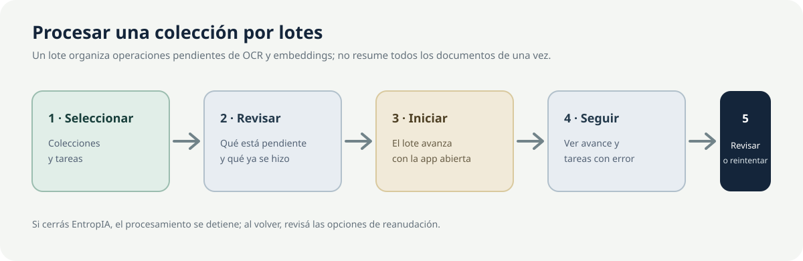

1. Open **Settings → Batches** and select one or more collections. **Select all** ticks every available one.
2. Choose **OCR** to recognise words in images or PDFs (with **Include native text** ticked, pages that only have the PDF's native text also go through OCR, and that text is replaced; pages that already went through OCR are still skipped), **Embeddings** to prepare a similarity comparison, **Entities**, **Triples**, **OCR correction**, **Summaries**, or several at once. Then click **Analyze selection**. If you ticked Embeddings, Entities, Triples, OCR correction, Summaries or a schema and have not saved the OpenRouter key yet, the button stays disabled and, on hover, says the key must first be loaded in **Settings → Remote APIs → OpenRouter**.
   **In Pro**, with the **OCRH mode** set to **Local**, the batch uses OCRL (layout + PaddleOCR, seconds per page). Tick **Local OCRH** to use layout + local OCRH (PaddleOCR-VL or GLM-OCR): more accurate and much slower. Without an NVIDIA GPU, the form warns that local OCRH takes about 15 minutes per page. The **OCRH** button of a document does the same: before running it on the processor it asks, and offers **Use OCRL** or **Run OCRH anyway**.
3. Review which documents and tasks the proposal includes. If the scope is wrong, discard it.
4. When the analysis finishes, click **Start batch**.
5. Follow the state in the tab or from the batch indicator on the status bar.

You do not need to repeat whole tasks. **A batch never overwrites text corrected by hand**: if you edited a page's text or transcription, the batch leaves it as it is. Embeddings, entities and triples require text: if a document has none yet and you also ticked **OCR**, they wait for the OCR to finish. A document that already has entities or triples is not processed again. The batch advances while EntropIA is open; when you close it, it stops. When you reopen, the recovery notice offers **Keep paused** or **Resume**. Go to **Active and recovered batches → View details** and review pending, interrupted and failed items before continuing.

- **Pause / Resume:** control execution when the state allows it.
- **Cancel:** asks for confirmation; keeps the work already confirmed, does not undo finished OCR or embeddings.
- **Retry failed:** repeat the batch's failed tasks; **Retry** acts on one task.
- **View details:** see attempts, error message or code and filter by state. The **Document** column links each unit to its document so you can open and review it.
- **Priority:** in the details of an unfinished batch, choose **Background**, **High** or **Interactive** to decide what is processed first when there are several batches.
- **Load more:** see earlier records.

An OCR that finished without text may count as complete. Open that page and check the result; creating another batch does not guarantee it will be processed again.

What you ask for by hand in a document —for example, clicking **OCRH**— jumps ahead of background batches. This tab also shows the [Library](#biblioteca) processes: syncing a Zotero library and [text reprocessing](#reprocesar-texto), with their progress, pause and cancel. Also the batches an [external assistant](#asistentes-externos) prepared, which you control like your own.

In Lite, recognising text, comparing material and extracting entities, triples or a custom schema depend on Internet services and configured keys. In Pro, the batch uses the engine of each mode in Settings (**OCRH mode**, **BGE-M3 embeddings**, **LLM mode**): with the local engines there is no cost, but the computer works harder. If you configured the Vercel fallback, entities, triples, schemas, correction and summaries use Vercel when OpenRouter fails; embeddings do not. **Entities** and **Triples** are off by default: each document is a paid OpenRouter request, and the batch proposal says how many documents go through each before you start it. **OCR correction** and **Summaries** are also off: they are paid OpenRouter calls per page, in Pro too, and the proposal says how many pages go through each. Results appear in each document's right panel, just as if you used **NER** or **TRIPLET** one at a time, and you should review them: they are the model's proposal. A batch showing progress does not guarantee that the service is available or that every task will finish correctly.

<a id="corregir-y-resumir-por-lote"></a>
### 14.1. Correct the text or summarise in a batch

**OCR correction** and **Summaries** do in a batch what **OCRC** and **OCRR/Summary** do in a document ([6.2](#capitulo-6-obtener-texto-de-documentos)), page by page.

**OCR correction** uses the correction prompt in **Settings → Prompts** and the correction model in **Model Params** and replaces each page's text with the corrected version. The original is kept: in the document, **Extracted text** above the viewer offers **Restore original OCR** to go back to it. Each page is corrected only once and already corrected ones are skipped, so repeating the batch does not pay for them again. Existing embeddings, entities and triples stay as they are: correction changes the text and does not redo derived data until you ask. Within the same batch, operations done for the first time on a page wait for its correction and use the corrected text.

**Summaries** writes a summary of each page with the summary prompt in **Settings → Prompts** and the summary model in **Model Params**. You see it in the document, in the **Summary** section of **Extracted text** for that page, and a page that already has a summary is skipped. If the same batch also corrects that page, the summary waits for the correction and summarises the corrected text.

Both are paid OpenRouter calls per page, in Pro too, and need the key saved in **Settings → Remote APIs → OpenRouter**. Review the result: the model may leave out data or change the meaning, as with a single document ([6.2](#capitulo-6-obtener-texto-de-documentos)).

<a id="esquema-propio"></a>
### 14.2. Extract a table with your own schema

Entities and triples always look for the same things. With a **custom schema** you decide which data to take from each document, and the batch builds a table with one row for each case it finds. For example, for port records: **ship**, **cargo** and **destination**.

1. In **Settings → Batches**, below the operations, find **Custom schema** and click **New schema**.
2. Name the schema and, optionally, choose in **Model** an OpenRouter model for this schema only: type part of the identifier or name and the field searches the whole catalogue, as in [New investigation](#capitulo-10-investigacion). **The general model** uses the one in **Model Params**. The catalogue loads with the saved OpenRouter key; without it, the field says so and offers **Open Settings**. Add a **Field** for each piece of data. In **What it is (helps the model)** explain in your own words what the model should look for, for example "name of the vessel".
3. Tick **Can repeat** on fields that may have several values in one case: a ship with many different cargoes.
4. Click **Save schema**. It is selected in **Custom schema**.
5. Select the collections and click **Analyze selection**. The proposal says how many documents go through the schema. Then **Start batch**.
6. When it finishes, choose the schema and click **Show results**. The table shows one row per case, with the document it came from. **Download CSV** saves it as a spreadsheet to open in Excel or LibreOffice; repeated values are separated by semicolons.

A document that already has results with that schema is not processed again. **Edit** changes the name or fields for future batches; earlier results keep the fields they were extracted with. **Delete** removes the schema and all its results.

The model copies what it finds in the text, but it may be wrong or skip cases, especially if the OCR has errors. Check a sample against the documents before using the table. In Lite each document is a paid OpenRouter request; in Pro, with the local **LLM mode**, it is processed on the computer. Schemas and their results stay on this computer: they do not travel with sync yet.

<a id="flujos-guardados"></a>
### 14.3. Save a combination as a flow

If you always process your collections with the same steps, save them once. Tick the operations (and the custom schema, if you use one), click **Save as flow**, type a name —for example "Port records"— and **Save**. Next time choose it in **Saved flow** and they are ticked by themselves. A flow only remembers what to tick: you choose the collections for each batch. Saving with an existing name replaces it.

---

<a id="capitulo-15-sincronizacion-y-nube"></a>
## Chapter 15. Sync and cloud

Sync is optional. If you work on a single computer, you can leave it off. When you turn it on, EntropIA sends the data included in sync to its cloud service. Review what is synced and the service terms before signing in.

### 15.1. Sign in and sync

1. Open **Settings → Sync**.
2. Sign in or choose **Register account** if you do not have one yet. The new password must be at least 10 characters. After registering, click **Sign in**: registering does not start sync.
3. Use **Sync now** or turn on **Automatic sync** and choose an interval in minutes (minimum 1). Those controls apply from their own section, not with the API save.
4. Review connected computers, storage and your plan. You can revoke other computers; for the current one, sign out.
5. To stop using the account on this computer, use **Sign out**.

EntropIA (Lite and Pro) uses the included service; you cannot change its address or choose individual collections to sync. If the first sync includes more than 500 MiB (about 525 MB), EntropIA asks for confirmation before continuing.

### 15.2. States, errors and data

The bottom indicator can show that sync is up to date, that there is activity, no connection, an error, differences between computers or a warning about the device clock. Click it to open the settings and read more details. If there are differences, review them before assuming both computers have the same content.

**Use the same version on every computer.** When a new version adds synced data (for example, 1.5.0 added the sentence behind each relation and the collections' context, and 1.7.0 the aliases), the first updated computer that syncs raises the account's format; computers not yet updated ignore that new data until you update them. Lite and Pro can sync with the same account.

**Refresh conflicts** queries the warnings again; details can be reviewed in **Logs**. **Mark seen** acknowledges the warning: it does not let you choose a version or resolve the difference by hand.

**Re-verify files** queues them to be sent again for checking; it does not create a backup (that is what [backups](#copias-de-seguridad) are for). **Delete my server data** requires the password and confirming **Delete everything**. It removes the remote data but keeps this computer's. Do not use it as a test to fix an error.

> **What travels and what does not.** Synced: collections (with their [Context for the AI](#contexto-ia)), documents and their files, texts, notes, topics, annotations, entities and their [aliases](#alias-de-entidades), relations (with their source sentence), summaries, embeddings and Chat conversations. **Writing** manuscripts are synced too, with their images, and can be shared with another account ([11.8](#compartir-manuscrito)); finished or failed investigations travel with their report ([10.4](#capitulo-10-investigacion)). **Not** synced: the [Library](#biblioteca) (each computer syncs it from its own Zotero, and its annotations travel through Zotero), paired external assistants and their import folders, help chat conversations, each document's process history, custom schemas and their tables, saved flows, sample collections, provider keys and Appearance preferences. What is shared from the Library is the paid result of its OCR and embeddings, so another computer of the same account does not pay again ([12.4](#biblioteca)).

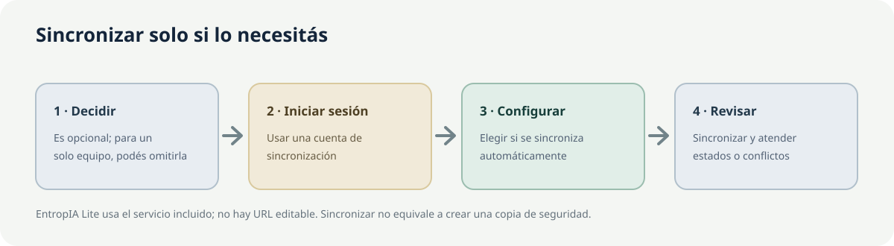

### 15.3. Request another sync plan

If you need more capacity, open **Request plan change**, choose a plan from the available catalogue, add an optional note and click **Send request**. **Request under review** means an administrator must review it: it is not a payment or an immediate change. Sync plans do not add credit to OpenRouter, AssemblyAI or GLM-OCR.

---

<a id="capitulo-16-configuracion-y-herramientas-generales"></a>
## Chapter 16. Settings and general tools

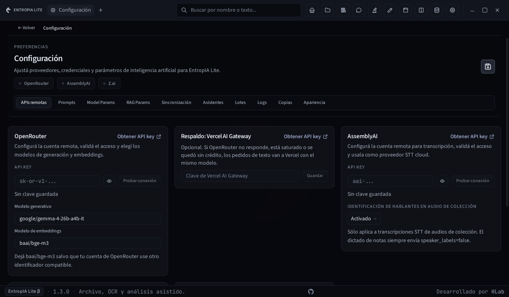

Open **Settings** with the gear button on the top bar. The tabs are the same in Lite and Pro, except **AI dependencies**, which exists only in Pro:

| Tab | What it is for | Initial recommendation |
|---|---|---|
| **Remote APIs** | Connect the services that recognise text, transcribe audio and help with AI tasks. | Configure only those you will use; test the connection and save. |
| **Prompts** | Review the instructions EntropIA follows when correcting text, summarising or proposing names and relations. | Keep the defaults unless you need to change them. |
| **Model Params** | Adjust the model and how it prepares each answer. | Leave the defaults. |
| **RAG Params** | Choose which passages of your documents the Chat consults, how many it uses and how much of the earlier conversation it considers. | Leave the defaults until you have a concrete need. |
| **Agent** | Adjust the [Research agent](#capitulo-10-investigacion) parameters: output, network and retries, archive, retrieval and questions. | Leave the defaults; they only change investigations you create afterwards. |
| **Sync** | Connect the account and share data between computers. | Do not turn it on if you do not need more than one computer. |
| **Assistants** | Let an external assistant (Claude Code, Codex, OpenCode, Pi or another MCP assistant) query the archive, connect it with one click, grant permissions and choose its import folders ([13.4](#asistentes-externos)). | Leave it off if you do not use an external assistant. |
| **Help** | Model, context, answer length, temperature, history, agent rounds and local answers of the help chat ([13.5](#ayuda-en-la-app)). | Leave the defaults; an empty model uses the general one. |
| **AI dependencies** (Pro only) | State of the local AI base and its components; install, repair or reset the environment ([16.7](#motores-locales-pro)). | Check it if a local engine does not respond. |
| **Batches** | Process several collections: OCR, embeddings, entities, triples, OCR correction, summaries and custom schemas; also follow the Library sync. | Run a test with a small collection first. |
| **Aliases** | See, edit and delete [entity aliases](#alias-de-entidades) and review the **Suggestions**. | Accept only the groups you have checked. |
| **Logs** | Read activity and error messages. | Note the visible message before sharing it with support. |
| **Backups** | Choose the backup folder and frequency, and make one right away. | Choose a folder on another disk and turn on an automatic backup. |
| **Maintenance** | Review and repair image versions that do not match their layout ([16.6](#mantenimiento)). | Use it if you see "another version of the image" notices in many documents. |
| **Appearance** | Change theme, contrast, interface zoom, typography and language. | Adjust legibility before starting a long session. |

In **Pro**, several tabs add controls for the local engines: **Remote APIs** also shows **LLM mode**, **Local model (Gemma)**, **BGE-M3 embeddings**, **Local RAG reranker**, **STT mode** and **OCRH mode** with their engines and downloads ([16.7](#motores-locales-pro)). Lite has no local engines and none of those controls.

### 16.1. Configure providers

In **Remote APIs**:

1. Find the provider for the task you need.
2. Paste the access key into **API Key**. Use the control to show or hide it while checking it.
3. Click **Test connection**.
4. When the test succeeds, click **Save changes**.

| Provider | Features that use it (in Pro, when you choose the remote or automatic mode) |
|---|---|
| **GLM-OCR / z.ai** | OCRH of supported images and PDFs. |
| **AssemblyAI** | Transcribes audio and enables microphone dictation. The **Collection audio speaker identification** selector controls speaker-turn separation in STT; dictation does not use it. |
| **OpenRouter** | Correction, summaries, Chat, Research, the Writing agent, entities, relations, custom schemas, embeddings and search by meaning in the Library. It has separate **Generative model** and **Embedding model** fields. The [help chat](#ayuda-en-la-app) uses this key too. |
| **OpenAI-compatible server (optional)** | A field on the OpenRouter card. If you type the address of your own server compatible with the OpenAI API (vLLM, Ollama or a gateway), remote text generation goes to that server instead of OpenRouter, with the model already configured and no key. |
| **Fallback: Vercel AI Gateway** | Optional. If OpenRouter does not respond, is overloaded or ran out of credit, text requests go to Vercel with the same model. |
| **Zotero** | Optional. Stores a Zotero Web API key. It is used by [Library annotations](#anotaciones-zotero) (they need write access to the personal library) and by the Browser's **Copy to Zotero**, which uses it to fill in the empty fields of a work that was already in Zotero. It is **not** needed to cite, sync or search the Library, which use this computer's Zotero. |

A valid key does not guarantee the service is working or that your account allows more use at that moment. Before sending sensitive material, check how the service treats data. EntropIA sends the content needed to recognise, transcribe or generate an answer.

**Get API key** opens the provider's site; the account and its billing are managed there. The fields let you show or hide the key and indicate when one is saved in the system store. Do not include it in screenshots or support messages.

**OpenAI-compatible server.** Use it to run a model on your own machine or on your institution's server. Type its base address (for example `http://localhost:11434/v1` for Ollama) and, in **Generative model**, the exact model name on that server (it is sent as is). While it is filled in, it replaces OpenRouter for text generation: no authentication headers are sent, there is no Vercel fallback and errors name the server. An invalid address fails instead of falling through to a paid service. Embeddings and reranking keep using OpenRouter (or Pro's local engines). Empty the field to go back to OpenRouter.

In OpenRouter, keep a valid identifier for **Generative model** and a compatible one for **Embedding model**. The interface recommends `baai/bge-m3` for embeddings unless your account uses another compatible identifier. A model shown in a screenshot is an example from that installation, not a recommendation or a guarantee of availability.

**Vercel fallback.** On the **Fallback: Vercel AI Gateway** card, the link goes to Vercel's keys page. Paste the **Vercel AI Gateway key**, click **Save** and then **Test connection**: **Connection ready: Vercel answered** confirms it works. Vercel does not serve requests until the account has a credit card on file; the test tells you. The fallback covers correction, summaries, entities, triples, custom schemas and the Chat. It does not cover **Investigate**, the **Writing agent**, embeddings or passage reranking, which still depend on OpenRouter. **Remove** deletes the key.

**Zotero key.** On the **Zotero** card, paste the **Zotero API key** created at zotero.org and click **Verify key**: the account and permissions over the personal library and groups are shown. Changes made through the Web API reach your local Zotero when Zotero syncs.

**Remove a key.** Next to each saved key (OpenRouter, AssemblyAI, GLM-OCR and Zotero) there is a **Remove … key** button. It asks for confirmation, deletes the key from the system store and leaves the features that use it unconfigured until you load another.

**Test connection does not save the key.** After **Save changes**, the field may stay empty while the state says a credential is stored; that does not mean it was deleted. With the field empty, the test may use the saved key. A successful connection does not guarantee quota or availability of every model either. The GLM-OCR test makes a real request to the provider on a test image.

### 16.2. Prompts, Model Params, RAG Params and Agent

**Prompts** lets you review or change the instructions. Keep the **`{text}`** placeholder, which inserts the material to process. **Validate changes** flags missing requirements; **Restore default** recovers the initial text. Save after restoring. If saving takes you to another tab, fix the flagged parameter: model and RAG settings are validated too.

**Model Params** organises settings for tasks such as correcting text, summarising or proposing names and relations. **RAG Params** lets you choose which passages of your documents the Chat consults, how many it uses and how much of the earlier conversation it keeps. For normal use, leave these controls as they are. If you change them, note the previous values.

Advanced **Model Params** reference, per process (OCR correction, summary, NER and triples):

| Parameter | Range or function |
|---|---|
| `model` | Model identifier for that process. |
| `temperature` | 0–2; controls the variation of the answer, not factual accuracy. |
| `maxTokens` | 1–16000; limits output length. |
| `topP` / `topK` | 0–1 / 0–1000; adjust output selection. |
| `presencePenalty` / `frequencyPenalty` | −2 to 2; presence and frequency penalties. |
| `stopSequences` | Up to 4 sequences, one per line, that stop the output. |

In **RAG Params**, the *reranker* model reorders the retrieved passages and does not replace the model that writes the answer. Change one setting at a time and compare with a known query; provider limits may be stricter than the form's.

**Agent** gathers the **Research Agent parameters**, in five groups:

| Group | What it adjusts |
|---|---|
| **Model and output** | The output cap and temperature of each model answer. |
| **Network and retries** | How long each attempt waits before aborting and the waits between retries. |
| **Archive** | The size of the text batches and fragments the agent reads from the corpus, and the citation window. |
| **Retrieval** | How many candidates each search brings, how they are merged and reranked and how many characters each fragment has. |
| **Clarification and queries** | The minimum number of questions it asks before building the plan and how many queries it prepares per modality. |

Each field shows its **Default** value, and **Restore defaults** recovers them all. An out-of-range value shows the reason and is not saved. Parameters **are frozen when the investigation is created**: changing them here does not alter existing ones, only those you create afterwards.

### 16.3. Appearance, language and visual accessibility

Open **Settings → Appearance**. Visual settings are no longer on the top bar. They apply as soon as you choose them; they do not change your documents' content.

- **Theme:** **Oscuro** (dark), **Cálido** (warm), **Claro** (light), **Lite**, **Papel** (paper), **Bosque** (forest) or **Vibrante** (vivid); the theme names are shown in Spanish. **Papel** imitates archive paper and is comfortable for reading scans for hours; **Bosque** is dark with green details; **Vibrante** is the most striking, violet and fuchsia. All keep text legible at the three contrast levels. "Lite" is the name of a visual theme; it does not switch the product to Pro.
- **Contrast:** soft, normal or high contrast.
- **Zoom:** click **+** or **−**, or **Reset zoom**. The range is 75 %–125 % in 5 % steps. On Windows you can use **Ctrl +**, **Ctrl −** and **Ctrl 0**.
- **Typography:** **Academic**, **Modern**, **Editorial** and **Archive**.
- **Language:** **Español** or **English**. It changes the interface texts, not the language of your documents. A few panels (for example, **Assistants** and **Logs**) still show Spanish labels.

Navigation is handled outside Appearance:

- **Side panel:** in a single pane and inside Collections, **Ctrl+B** collapses or shows the explorer. In split view, the explorer opens as a panel over the active area; see [tabs and split view](#pestanas-y-vista-dividida).
- **Tabs and split view:** let you work with up to four routes and see two at once from the top bar.

### 16.4. Database, status and notices

The **Database** button opens the **DB Browser**, a read-only page to consult data lists, search and sort their items and download a table as JSON or CSV. It does not recover documents or save a full backup.

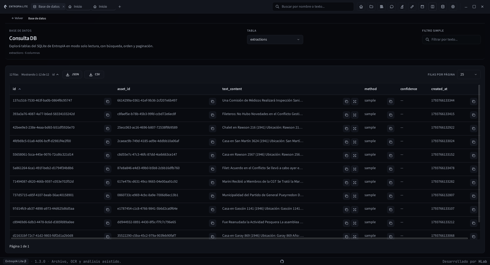

1. Choose a **Table** in the selector.
2. Use **Simple filter** to narrow what you see.
3. Click a header to sort and choose **25, 50 or 100 Rows per page**.
4. Use the copy or expand controls to read a long cell; Esc closes the expanded view.
5. If you need to share data, choose **JSON** or **CSV** and check the downloaded file before sending it: it may contain text from your sources.

The download respects the filter and order and contains **all matching rows, not only the visible page**. To download the whole table, clear **Simple filter** before exporting.

You do not need this tool to import, recognise text or write. It is an advanced query, not a database editor or a restore mechanism: that is what [backups](#copias-de-seguridad) are for.

The status bar also shows batches, sync and, when relevant, the notifications bell. An update notice may offer **View update**, which opens the Microsoft Store page; it does not install the update.
The footer also includes links to GitHub and HLab.

### 16.5. Read logs to ask for help

In **Settings → Logs**, **Refrescar** (*refresh*) updates the view and **Copiar** (*copy*) copies the last 20 records shown. **Abrir carpeta** (*open folder*) gives access to the log files; **Limpiar** (*clear*) deletes those records. Keep the message you need before clearing and check whether it contains paths or sensitive data before sharing it.

<a id="mantenimiento"></a>
### 16.6. Maintenance: review image versions

Versions before 1.6.0 did not record which file an image's layout came from, and an edited image could end up showing a different version from the one its boxes were computed on. **Settings → Maintenance → Review image versions** checks the whole archive:

1. Click **Review**. Progress is shown (**Reviewing N of M images…**). Nothing changes yet.
2. Read the **Review result**: how many images with a layout were reviewed, how many match, how many **Show an older version than their layout** (repairable) and the cases that are left alone (more than one version matches, the matching version is newer than the layout, none matches or the file is missing). For images newer than their layout, you need to **run the layout again** in each document.
3. Under **Images to repair**, each row says what it shows and which version the layout belongs to. Tick the ones you want (**Select all** / **None**). **Also record the source of N earlier layouts** records which file the old layouts that match unambiguously came from.
4. Click **Apply** and confirm. **No file is deleted or modified**: only which version is shown changes. When it finishes, **Ready** says how many images were repaired.

If the archive changed between the review and applying, nothing is applied and you have to review again. Each repair is recorded in the [process history](#historial-de-procesos).

<a id="motores-locales-pro"></a>
### 16.7. Local engines (Pro only)

EntropIA Pro includes AI engines that run on your computer. The first time it opens it downloads its **AI base** (about 2.2 GB, verified by signature) and then installs the dependencies; a notice shows progress and lets you pause or retry. The larger models are downloaded separately, from their card, when you need them.

| Setting (in **Remote APIs**) | Options | Notes |
|---|---|---|
| **LLM mode** | **Local**, **OpenRouter**, **Automatic** | The local model runs with llama.cpp, offline. Automatic prioritises the local one and uses OpenRouter as fallback. It affects correction, summaries, relations, schemas and the Chat. |
| **Local model (Gemma)** | State and download of the GGUF file | Without it, those features use OpenRouter (if configured) or are disabled. |
| **BGE-M3 embeddings** | **OpenRouter API** or **Local ONNX** | **Install local BGE-M3** downloads the model; **Local BGE-M3 model folder** lets you use another folder (with `model.onnx`, `model.onnx_data` and `tokenizer.json`). |
| **Local RAG reranker** | Installed or not | BGE Reranker v2 M3 (about 561 MB) reorders the Chat's passages on the computer. |
| **STT mode** | **Local**, **AssemblyAI**, **Automatic** | **Local STT engine**: **Parakeet (fast)** (about 2.5 GB, 25 languages) or **Whisper**. **Detect speakers**: up to 4, Parakeet only (about 400 MB more). |
| **OCRH mode** | **Local**, **GLM-OCR (z.ai)**, **Automatic** | **Local OCRH engine**: **Automatic** (local GLM-OCR with an NVIDIA GPU if installed; otherwise PaddleOCR-VL), **Local GLM-OCR** (requires its models, about 1.4 GB, and an NVIDIA GPU) or **PaddleOCR-VL**. The engine switches without restarting. |
| **Local corrector (Qwen3-VL)** | Installed or not | A 4B model (about 2.9 GB) that corrects OCR when there is no remote key. |

Each card shows whether its models are installed (**GLM-OCR models installed.**, **Missing models:**), with **Download models** and **Retry download**. Local GLM-OCR and the Qwen3-VL corrector share a local server (`llama-server`). The Pro installer for Linux includes it; on Windows it is downloaded separately with **Download llama-server (~610 MB)**, which takes ~1.1 GB on disk, and it is offered only on computers with an NVIDIA GPU: without one, the card says it downloads only with an NVIDIA GPU, and you should use PaddleOCR-VL and correction through OpenRouter. Models and the server stay in the app's folders and are not included in backups: they are downloaded again.

**AI dependencies.** This tab lists the state of the AI base and each component (Python, PaddleOCR, Faster Whisper, spaCy and its Spanish model), with **Install** per component or all together. If the AI base could not be prepared, it explains why (offline, version with no published base, untrusted source) and offers **Reparar runtime** (*repair runtime*). The environment reset deletes the local environment to reinstall it from scratch. A badge on the tab warns when something needs attention.

An external assistant or the help chat with edit permission can query this state and start the downloads with the `models_setup` MCP tool; it costs nothing but downloads several GB.

---

<a id="capitulo-17-exportar-y-descargar"></a>
## Chapter 17. Export, download and back up

Choose the format according to what you want to keep. The export buttons are not equivalent and not all of them include original files. To keep **everything** —database and files— use [backups](#copias-de-seguridad).

| From | Action/format | What it keeps or what to bear in mind |
|---|---|---|
| Collection | **Download the collection text**: TXT, Markdown, PDF, Word or CSV. | All of the collection's extracted text in one file, document by document, marking native text. |
| Collection | **Export JSON** | Saves collection data but does not include the original PDFs, images or audio. You cannot use it to rebuild the collection. |
| Document → **Extracted text above the viewer**, for PDFs/images | **Copy** and **Download** as Markdown, PDF or Word (`.docx`). | OCR text of the selected page. Audio transcription has no such menu; copy its editable field by hand. |
| Research chat | Download the conversation as PDF from the history. | Saves questions, answers and source titles to Downloads, not the original files. |
| Research | Download as Markdown, HTML or Word (`.docx`). | Saves the report and the available sources; there is no PDF option on that screen. |
| Writing | **Download** as Markdown, HTML or Word (`.docx`). | Saves the current manuscript; Writing offers no PDF download. |
| Writing → Export | Choose how citations appear and turn on **Include the bibliography**. | These are download preferences, not a download button. The bibliography includes the cited Zotero works. |
| Collection text analysis | Download a chart as PNG. | Saves the frequency chart, not the original documents. |
| 3D relations | **Save the graph for Gephi (.gexf)** | The visible graph (names and relations) in GEXF format, for Gephi or other network tools. |
| Document → **Metadata** | **Export JSON** of the process history. | Every process of the document, with tool, model, versions and fingerprints. |
| DB Browser | Download JSON or CSV. | Includes every row matching the filter, in the chosen order; not only the visible page, and not a full backup. |
| Batches → Custom schema | **Download CSV** from **Show results**. | One row per extracted case, with its document; repeated values are separated by semicolons. |
| Settings → Backups | **Back up now** or automatic backup. | A folder with the database and all of EntropIA's files. It is the only option that can recover everything. |

### 17.1. Citation preferences in Writing

In **Writing → Export**, choose how citations of passages you inserted from your documents appear:

- **Footnote**.
- **Short reference**.
- **Comment**.
- **Quoted text and note**.

You can also turn on **Include the bibliography** for the cited Zotero works. Markdown does not support comments; EntropIA turns them into footnotes and tells you. If Word cannot keep an element of the chosen format, the download stops and explains what would be lost.

### 17.2. Export versus backup

The collection's JSON file, the collection text, a table's CSV, a graph's GEXF and downloaded documents do not keep all the files and data needed to recover EntropIA: they are for reading or sharing results. To be able to recover the whole work, use [backups](#copias-de-seguridad). Cloud sync does not replace that copy either: if you delete something, the deletion is synced too.

The collection JSON may include notes, topics, OCR text and transcriptions, metadata, annotations, layout, entities, relations and AI results. File paths or references are not the PDFs, images or audio themselves. Review its content before sharing it: it may contain sensitive corpus information.

<a id="copias-de-seguridad"></a>
### 17.3. Backups

A backup saves the database and all of EntropIA's files (PDFs, images, audio, manuscript images, investigations) in a new folder called `entropia-backup-<date and time>`. It is set up in **Settings → Backups**:

1. In **Backup folder**, click **Choose folder**. It should be on another disk, a USB stick or a folder your organisation backs up. It cannot be inside EntropIA's data folder.
2. In **Automatic backup**, choose **Never**, **Every day** or **Once a week**.
3. In **Backups to keep**, say how many to keep (between 1 and 100; 5 by default). Older ones are deleted automatically.
4. To make one right away, click **Back up now**. When it finishes you see **Backup saved in** and the path; **Last backup** shows the date of the most recent one.

Automatic backups run while EntropIA is open: the application checks every hour whether one is due. If the folder is not available —for example, a disconnected disk— the backup fails and is retried at the next check. An interrupted backup does not count: it is discarded.

**What it does not include.** Provider keys and the sync session, which live in the system credential store; your original files outside EntropIA; and, in Pro, the AI models, which are downloaded again.

**Recover a backup.** There is no restore button: you copy it back by hand.

1. Close EntropIA.
2. Open the data folder: on Windows, `%APPDATA%\com.entropia.shared`; on macOS, `~/Library/Application Support/com.entropia.shared`; on Linux, `~/.local/share/com.entropia.shared`. With the Microsoft Store version, if you cannot find it there, look in `%LOCALAPPDATA%\Packages\CONICET.EntropIALite_…\LocalCache\Roaming\com.entropia.shared`: Windows keeps Store apps' data there.
3. Move its current content elsewhere, in case you need it.
4. Copy into it the whole content of the chosen `entropia-backup-…` folder.
5. Open EntropIA and check your collections. Load the keys again if you changed computers.

If you use sync, when you reopen EntropIA the recovered copy syncs with your account. Ask for help before recovering an old backup on a synced computer.

---

<a id="capitulo-18-ejemplos-paso-a-paso"></a>
## Chapter 18. Step-by-step examples

### 18.1. I have a scanned PDF and want to search its content

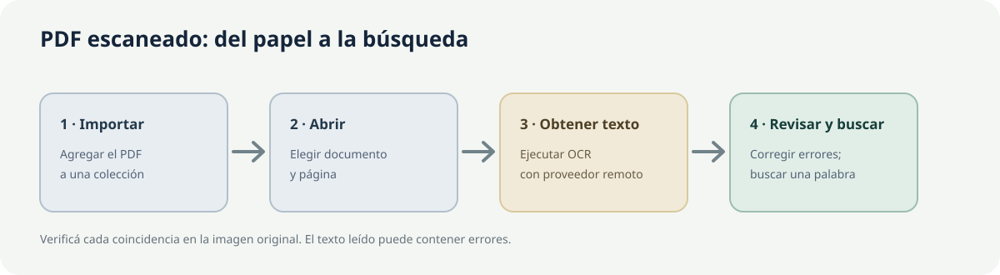

1. Create or choose a collection and click **Import document**.
2. Open the PDF and choose its first page.
3. In **Text**, run **OCRH**. In Lite you need GLM-OCR configured and a connection; in Pro you can use **OCRL** or local **OCRH**, offline.
4. Compare the text with the image; correct misread names or figures. If a whole paragraph or the end of one is missing, open **Layout** and [fix that box](#corregir-cajas) instead of typing it by hand.
5. Search a word in **Search** or on the top bar. If it does not appear, use **Analysis → INDEX** and search again.

### 18.2. I have photographs of archival documents

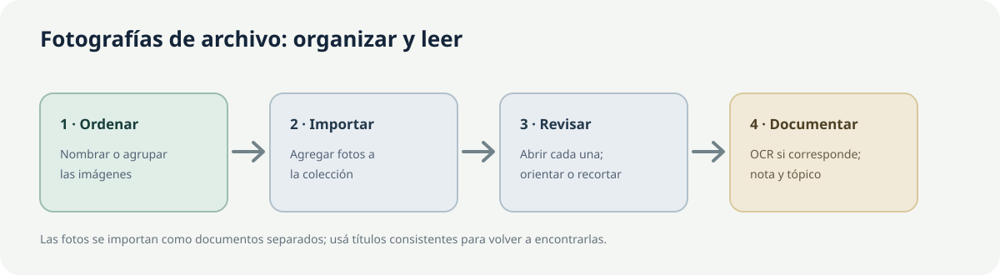

1. Keep the originals and use names that indicate fonds, date or item number.
2. Import the images into the collection. Each photo becomes a separate document.
3. Open each photo; if needed, orient or crop a copy to make reading easier.
4. In **Text**, run OCRH on PNG/JPG, review the result and add a provenance topic or note.
5. Use search to locate words and open each match on its original image.

### 18.3. I want to find a topic across many documents

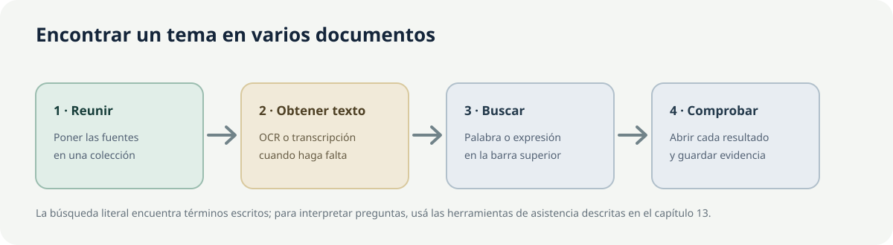

1. Gather the working sources in one or more collections.
2. Get any missing text and correct errors that affect search.
3. Search concrete terms from the top bar or **Search**; check each result and its collection.
4. To ask about sources, configure OpenRouter and open **Research chat**. For a report scoped by collections, use **Investigate with the Agent** or **Research agent** on the top bar. Review the question, choose collections with fragments, click **Investigate** and complete the clarifications and the plan approval.
5. Save relevant passages as notes with a reference to the source.

### 18.4. I want to summarise and analyse several documents

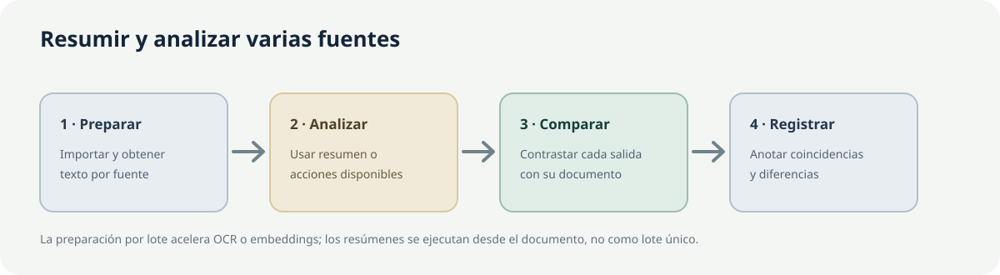

1. Import the sources and get the text of each document that needs it.
2. Open each document and select the page or file with text. Use **OCRR/Summary** to summarise it, **NER** to propose names of people or places or **TRIPLET** to suggest relations, such as who did what. For many documents, **Entities**, **Triples**, **OCR correction** and **Summaries** also run in batches: summaries stay page by page, not as a general summary of the collection. Check the scope of the output.
3. Contrast each output with its original text; use the collection's **Text analysis** to look at word frequencies and **Phrases** for recurring expressions.
4. Record agreements and differences in notes, citing which document supports them.

### 18.5. I want to write an academic text from my documents

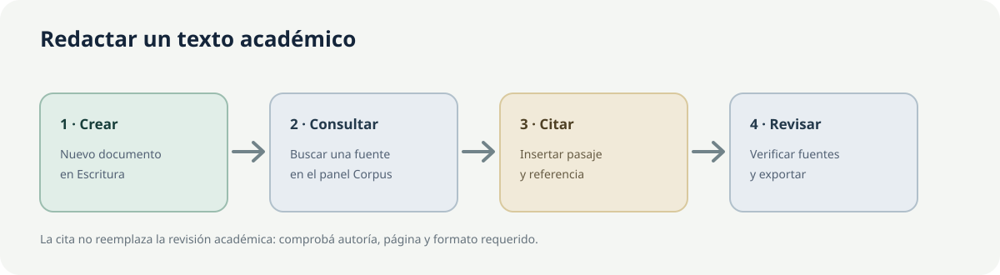

1. Prepare the sources' text. In **Writing**, create a **New document**, type the title and confirm it.
2. Place the cursor, open **Corpus**, search and open a result, choose file/page and select the passage. Click **Insert as a citation**.
3. If you use Zotero, open it with local communication enabled. In the manuscript's **Zotero** tab, find the work, click **Cite** and complete **Adjust the citation → Ready**.
4. Write the argument and check citations, pages and bibliography. Optionally select a paragraph and use **Agent → Clarity**; that assistance requires OpenRouter and the Internet.
5. In **Export**, set **Corpus citations** and **Include the bibliography**. Then use **Download** on the manuscript bar, choose Markdown, HTML or Word and the location. Check the file and any export notice.

### 18.6. I want to take notes and use them later while writing

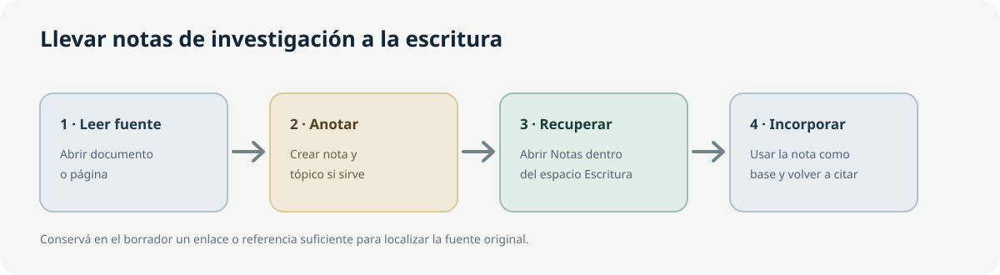

1. Open the document or page and create a note in **Notes**; add a topic if it helps to classify it.
2. Open **Writing**, create or open a manuscript and place the cursor. In the panel, choose **Notes**, search for words from the note or the title of the source document and open the result.
3. Choose **Insert as text** to copy its content or **Insert as a link** to keep a link.
4. Work the note into the draft and go back to the source before turning it into a citation or claim.

The link keeps a snapshot and lets you consult the note again; it does not automatically update the manuscript text.

### 18.7. I have an interview and want to transcribe it

1. Keep the original audio and check that you are allowed to send it to the transcription service.
2. In Lite, configure **AssemblyAI** in **Remote APIs**, test the connection and save, and choose whether you need to identify speaker turns. In Pro you can choose **STT mode → Local** so the audio never leaves the computer (and **Detect speakers**).
3. Import the audio into a collection, open it and listen to a fragment to check the file.
4. In **Text**, click **STT** and wait for the result. Importing or playing does not start the transcription.
5. Listen again to the passages you will quote; correct names, dates and attributions. If there are speaker labels, use **Rename speakers**. Write down doubtful stretches in a note.
6. Select and copy the transcription from its editable field into a file of your own. There is no **Download** menu for audio; keep the original too.

### 18.8. I want to check a report before using it

1. In **Investigate**, define a narrow question and select the relevant collections.
2. Answer the clarifications and review the proposed searches before approving them.
3. When the report appears, read the coverage table: tell material with fragments apart from unprocessed material.
4. Open a citation `[n]`, read its passage and use **Open the document** to contrast it with the source.
5. Pay special attention to general claims: neither the number of imported documents nor the presence of a citation guarantees that all the evidence is covered.
6. Export the reviewed report. To develop a manuscript, work in **Writing** and check the citations there; do not confuse downloading the report with saving a manuscript.

### 18.9. I want to bring a digitised book from Internet Archive

1. Open the destination collection and click **Import from Internet Archive** (or **Home → Import → From Internet Archive**).
2. In **Search**, type the title or the author and click **Search the archive**. If you already have the address, use **Link**.
3. Click **View files**, tick the PDF you want —the **original** is usually the full scan— and click **Continue**.
4. Confirm the **Destination**, click **Prepare import**, review duplicates and size, and click **Start import**.
5. When it finishes, open the document and process one page with **OCRH** before launching a batch for the whole book.

### 18.10. I want to search a topic in my Zotero library and cite the page

1. Open Zotero. In **Writing → Zotero**, choose the library and click **Synchronize library**. Wait for the progress to finish or at least advance substantially.
2. With a manuscript open, go to the **Works** tab and search for the topic in **Query**.
3. In **Passages**, use **Open passage** to read the fragment in context and check the page.
4. Place the cursor and click **Cite passage**: the Zotero citation is inserted with that page. Review it in **Adjust the citation**.
5. To ask about those works, open the **Research chat** with **Search in → Library** or **Both**.

### 18.11. Something failed and I do not know what to do

1. Note what you were doing and the message you saw.
2. Click the **help** bubble on the status bar.
3. Tick **Include diagnostics** and, if you like, click **See what is sent** to review the exact text.
4. Write what happened, for example "The transcription of an interview failed", and click **Send**.
5. Follow the steps in the answer and open **Sources and steps** to see which manual section they came from. If the help offers to do something for you, read the **Help asks for approval** dialog before clicking **Approve**.

### 18.12. I want Claude Code (or another assistant) to work with my archive

1. Install the assistant on your computer and check that it works on its own.
2. In EntropIA, open **Settings → Assistants** and turn on **Permitir asistentes externos**.
3. Click **Conectar Claude Code** (or your assistant's button). If it is not on the list, type its name, use **Copy setup instruction for any assistant** and paste it into its chat.
4. Restart the assistant and ask it "Show me EntropIA's status": it should answer with the version and the number of collections.
5. If you also want it to prepare batches, tick **Preparar procesamiento y editar el corpus** under its name; for it to request paid processing, **Pedir procesamiento pago**. You will approve every expense, import, text replacement or deletion in an EntropIA dialog.
6. When you no longer use it, click **Revocar**.

---

<a id="capitulo-19-que-hago-si"></a>
## Chapter 19. What do I do if…?

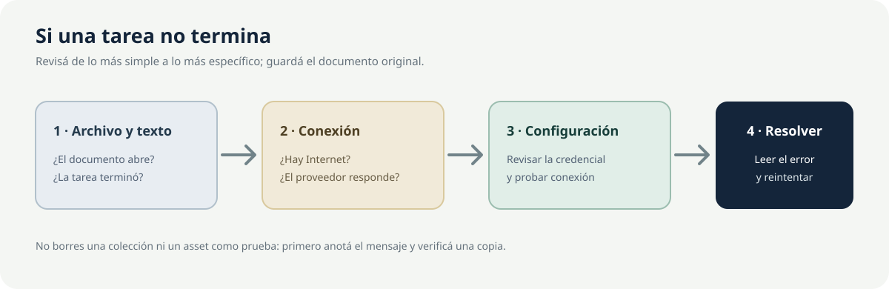

| Problem | What to check |
|---|---|
| No text appears after importing | Importing does not recognise text automatically (only the native text of digital PDFs is stored). Open **Text** and use **OCRH** for a supported image or PDF, or **STT** to turn audio into text. |
| Text recognition produced errors | Compare the result with the image and correct what is needed. For photos, use PNG/JPG and check that the image is not blurry, skewed or dark. |
| OCRH is unavailable or fails | In Lite, text recognition needs the Internet. Check GLM-OCR in **Settings → Remote APIs**, test the connection and save the changes. In Pro, check the **OCRH mode** and the chosen local engine. |
| I cannot find a document | Open the right collection, clear the filters and search by name in **Search documents...** or use the top-bar search. |
| A search returns no results | Check that the text of the right page has been recognised. In **Analysis**, click **INDEX** to prepare it and try a shorter or differently spelled word. |
| **Similar Pages** shows no results | Check that the page or file has text and that **EMBED** finished. In Lite, check the connection to OpenRouter; in Pro, the chosen embedding engine. |
| An AI operation fails | Check the connection and the access key of the relevant service. Read the message before repeating the operation. |
| No model is available | In Lite, check which model is selected in OpenRouter and whether it is available to your account. In Pro, also check the **LLM mode** and that the local model is downloaded. |
| I cannot process a file | Confirm the file opens and is in a supported format. To recognise text, try a PNG/JPG copy or a supported PDF. |
| A batch shows an error | Open **Settings → Batches**, expand the task and read the message. Fix the problem first and then try again. |
| I cannot sync | Check the bottom state, the connection and the session. In **Settings → Sync** and **Logs** you can read more details; do not delete data as a test. |
| Zotero does not appear in Writing | Open Zotero and enable **Allow other applications on this computer to communicate with Zotero** in **Edit → Settings → Advanced**. Then go back to **Writing → Zotero** and use **Refresh** if available. |
| Library annotations do not reach Zotero | Read the notice in the **Annotations** panel. You need a Web API key with write access to the personal library (**Settings → Remote APIs → Zotero → Verify key**), from the same account you have open in Zotero; groups cannot be annotated. Offline they stay **Pending**; click **Sync with Zotero** when the connection returns. See [12.7](#anotaciones-zotero). |
| An external assistant does not connect | EntropIA must be open and **Settings → Assistants → Permitir asistentes externos** turned on. Test the connector with `--check`. If you revoked it, connect it again (with the one-click button or by replacing its entry with the new line, without adding another). The table in [13.4](#asistentes-externos) explains each connector message. On Windows, an antivirus may delay the connector's start. |
| OCR is missing a paragraph or the end of a block | In **Layout**, select that block and use **Fix box**: stretch the box or draw a new one and click **Recognize box text** ([5.5](#corregir-cajas)). There is no need to repeat the OCR of the whole page. |
| The investigation stopped because of an error | Read the message it shows and click **Retry** once the problem is solved, for example the OpenRouter key or credit ([10.2](#capitulo-10-investigacion)). |
| I want to know what was done to a document | Open **Metadata → Process history**: it shows each process with its tool, model and versions, and exports to JSON ([5.5](#historial-de-procesos)). |
| Writing did not save a change | Wait for the **Saved** state. If **Save failed** appears, click **Retry** if available and copy important text before closing. |
| I want to go back to an earlier version of a manuscript | Click **Version history** on the manuscript bar, choose the version and **Restore this version** (or **Restore only this section**). What you had is saved as another version. See [11.3](#historial-de-versiones). |
| I cannot open another tab | The maximum is 4. Close one with **Close tab** and click **Open new tab** again. |
| I do not see the explorer in split view | It is not fixed on the left. In the active pane, click **Open document explorer**. Esc closes it. |
| Writing appears in another tab | It can be open in only one. Choose that tab or click **Go to that tab**. |
| **Home → Write** did not create another manuscript | If the open one is still empty with the default title, that shortcut reuses it. To create another, use **New document** from the Writing list. |
| I cannot find the theme, language or zoom controls | They are in **Settings → Appearance**. An image's viewer zoom is independent from the interface zoom. |
| Home shows many documents but little processed text | Importing does not produce OCR/STT. Check **Corpus status**, process a sample and then use batches for suitable material. |
| I clicked Retrieve and the Chat opened | **Retrieve** starts a new query about the corpus; it does not recover a backup or deleted files. |
| The investigation does not cover all my sources | Review the scope and the report's coverage table. A document without fragments provides no textual evidence; process it before repeating the investigation. |
| The manual's image looks small | Click it to open it full size in another tab. Each chapter's text also explains the steps without depending on the screenshot. |
| Split view is disabled or one side disappeared | Widen the window. Each pane needs at least 640 pixels (about 1,290 in total); with little width only the active tab is shown. |
| I cannot find Download for a transcription | That menu only exists for OCR of images/PDFs in **Extracted text** above the viewer. Copy the transcription field by hand. |
| OCRC changed my text without asking | It applies the correction when it finishes. Review it and, if needed, use **Extracted text → Restore original OCR**, keeping your manual changes first. |
| A search returns another spelling | It may include approximate variants. Open the document and check the term; it is not proof of semantic equivalence. |
| I registered in the cloud but it does not sync | After **Register account**, you must **Sign in**. |
| Save changes fails after pasting a key | Read the message and the flagged tab; Prompts, Model Params and RAG Params are validated too. |
| **Analyze selection** is disabled in Batches | Choose at least one collection and one operation. If you ticked Embeddings, Entities, Triples or a schema, save the OpenRouter key first. |
| The model list is empty or asks to go to Settings | The list loads with the saved OpenRouter key. Load it in **Settings → Remote APIs** and reopen the screen. |
| OpenRouter ran out of credit or does not respond | Check your OpenRouter account. If you configured the **Vercel AI Gateway** fallback, correction, summaries, entities, triples, schemas and the Chat continue through Vercel; Investigate, the Writing agent and embeddings do not. |
| An Internet Archive PDF says restricted, encrypted or private | Internet Archive does not allow downloading it. Look for another edition or a derivative file that is available. |
| An Internet Archive import was cut off | Reopen the Internet Archive dialog and use **Imports in progress → Resume import** (or, for a whole-search queue, **Continue the queue**). |
| The Library is empty | You have not synced any library yet. Open Zotero and, in **Writing → Zotero**, click **Synchronize library**. |
| The Library sync is paused or waiting | **Paused:** Zotero does not respond or its local communication is off; it retries by itself. **Waiting:** OpenRouter or GLM-OCR (or, in Pro, the chosen local engine) is not configured; the message says which. |
| The Chat says it did not search the Library | No chosen library is synced, indexing did not finish or the query could not be computed with the embedding provider. Read the notice and check **Settings → Remote APIs → OpenRouter**. |
| **3D relations** shows nothing | The collection has no triples yet. Extract them with **TRIPLET** or a **Triples** batch. |
| The backup fails | Check that the chosen folder exists and has space (for example, that the disk is connected). If another backup is running, wait for it to finish. |
| **Optimizing the archive…** appears when closing | EntropIA is reclaiming disk space from its database. Do not turn the computer off: the window closes by itself when it finishes. |
| I do not know how to do something and cannot find it in the manual | Open the [help](#ayuda-en-la-app) with the bubble on the status bar and ask. For an error, tick **Include diagnostics**. |
| The help only answers frequent questions | It is missing the OpenRouter key or the account has no credit. Load it in **Settings → Remote APIs → OpenRouter** ([13.5](#ayuda-en-la-app)). |
| **Conectar Claude Code** (or another) says it cannot find it or it does not respond | Use **or copy the command** and paste the line by hand, or **Copy setup instruction for any assistant**. Check the connection with `--check` ([13.4](#asistentes-externos)). |
| My assistant is not Claude Code, Codex, OpenCode or Pi | Use **Copy setup instruction for any assistant** and paste it into its chat ([13.4](#asistentes-externos)). |
| A notice says the layout or the text belongs to **another version of the image** | Click **Run the layout again** or **Run the OCR again**, or choose the right version in **Metadata → Image versions**. For many documents, use **Settings → Maintenance** ([16.6](#mantenimiento)). |
| When running OCR or transcribing again, EntropIA asks whether to continue | The text has manual corrections that will be replaced. Cancel if you want to keep them. Batches never overwrite them. |
| A name appears spelled in several ways in the entities or the graph | Join them with **Same as…** or from **Settings → Aliases** ([8.2](#alias-de-entidades)). |
| A digital PDF already has text without any OCR | It is its native text, stored at import. If it is broken or illegible, click **OCRH** to recognise the page. |
| The OCR batch skips PDF pages | They are pages with native text. Tick **Include native text** if you want to recognise them anyway. |
| **3D relations** says it hides names | A maximum or a threshold in **Settings → 3D relations** leaves them out. Lower the thresholds or use **Add all its relations to the graph** on a name. |
| (Pro) A local engine does not work or says models are missing | Check the engine's card in **Remote APIs** (**Download models**) and the **AI dependencies** tab (**Reparar runtime**). Local GLM-OCR needs an NVIDIA GPU; with **Automatic**, PaddleOCR-VL is used. |
| (Pro) The first AI base download does not progress | Check the connection; the notice lets you pause and retry. If it says the version has no published base, wait for the update or use the remote modes meanwhile. |
| I configured an OpenAI-compatible server and the AI fails | The message names the server: check that it is running, that the address ends at the API base (for example `/v1`) and that the **Generative model** is a name that server knows. Empty the field to go back to OpenRouter. |

Before asking for help, note the screen name, the step, the exact message, the file format and the version shown on the status bar. Do not share provider keys or sensitive documents in screenshots.

---

<a id="capitulo-20-consejos-y-buenas-practicas"></a>
## Chapter 20. Tips and good practice

> **Tip**
>
> Name collections and files with words you would use to find them again. Also record title, date and provenance in a note when they matter.

> **Tip**
>
> Try OCR on one page before processing a large batch. Correct clear errors and keep the image or PDF to review the result.

> **Tip**
>
> Turn on an automatic [backup](#copias-de-seguridad) to a folder on another disk. It is the only way to recover collections, files and manuscripts after a deletion or a computer failure.

> **Important**
>
> In Lite, OCR, transcription, the Chat and many AI actions send content to the external provider doing the task. In Pro, choose the **Local** modes so content does not leave the computer; Investigate, the Writing agent and box correction use remote services in both variants, and so does the help chat, except in Pro with **LLM mode** set to **Local**. Syncing a Zotero library into the Library also sends its works' text to OpenRouter and the scanned pages to GLM-OCR. Sync sends data to the cloud service only when you set up an account and turn it on. Review the provider's terms before using confidential material.

> **Important**
>
> A search match, an automatic comparison or an answer from the application are leads. Always contrast the passage, the page and the reference with the original material.

> **Warning**
>
> Deleting a collection or a document may delete its associated data and files. If you delete a cited page or file, the saved passage may no longer open the source. The collection's JSON file does not include the original documents and cannot rebuild it; only a backup made before the deletion can recover it.

> **Warning**
>
> Documents created in **Writing** sync between devices only if sync is on. Without it, save a copy to a safe folder before changing computers. The version history protects against unwanted changes, not against deleting the manuscript.

---

<a id="capitulo-21-glosario"></a>
## Chapter 21. Glossary

- **Asset:** word some controls use for a page or file inside a document.
- **FTS search:** lexical search of terms, with possible close spelling variants; it does not search by meaning.
- **Approximate search:** widens matches to similar spellings; it does not prove the words are equivalent.
- **Native PDF text:** digital text the file already contains, different from recognising a scanned image.
- **Batch:** a set of OCR, embedding, entity, triple, OCR correction, summary or custom schema tasks over several collections, with state, progress, priority and recovery.
- **Layout box:** an area of the page that OCR recognises as a unit (a title, a paragraph, a table). If it is too short or missing, it is fixed in **Layout → Fix box**.
- **Process history:** the record, in **Metadata**, of every process a document went through, with its tool, model, versions, parameters and the input and output SHA-256 fingerprints.
- **SHA-256 fingerprint:** a code that summarises a file or a text; if a single character changes, the fingerprint changes. It is used to check that something is exactly the same.
- **External assistant:** an AI program installed on your computer (Claude Code, Codex, OpenCode, Pi or another MCP-compatible one) that, if you allow it in **Settings → Assistants**, queries your archive through MCP.
- **Alias:** an alternative form of a name joined to its canonical name across the whole archive, without changing the mentions.
- **Help chat:** the assistant in the status-bar bubble that explains how to use EntropIA from this manual and can take actions with your approval.
- **Connector:** the `entropia-agent-connector` (or `entropia-pro-agent-connector`) program installed with EntropIA that connects an external assistant to the open application.
- **Context for the AI:** a description of a collection read by the Chat, Investigate, correction and the Writing agent.
- **Diagnostics:** a summary of the configuration and the latest errors, without keys or document content, that the help sends only if you tick **Include diagnostics**.
- **G² (log-likelihood):** a measure of how much more than expected two words appear together; used by **Phrases → Associated words**.
- **GEXF:** a network file format that Gephi opens; 3D relations produces it.
- **Lite / Pro:** the two variants of EntropIA; Lite uses AI over the Internet and Pro adds local engines.
- **Zotero annotation:** a highlight, underline, note, area or text on a Library PDF; it is stored in Zotero and syncs both ways.
- **Library:** the section with the works of the Zotero libraries synced into EntropIA. Their records are edited in Zotero, not in EntropIA; only their PDFs accept annotations. It does not travel with sync.
- **MCP (Model Context Protocol):** the protocol an external assistant uses to ask EntropIA for data; here it works only within this computer.
- **Backup:** an `entropia-backup-…` folder with EntropIA's database and files; it lets you recover everything by copying it back.
- **Collection:** a group of documents gathered for a topic or project.
- **Corpus:** the set of documents and collections you gather to work with.
- **Embedding:** a way of representing text to suggest pages or documents about similar topics.
- **Entity:** a name or datum identified in a text, such as a person, a place or a date.
- **Custom schema:** a list of fields you define so that a batch builds a table with the data of each document.
- **Saved flow:** a combination of batch operations saved under a name.
- **Version history:** earlier states of a manuscript that Writing keeps so you can read or restore them.
- **Internet Archive:** a public digital library (archive.org) from which you can import PDFs and images.
- **Item:** word some EntropIA messages use for a document.
- **Layout:** the tool that marks areas of a page, such as titles, paragraphs, tables or figures.
- **Metadata:** data describing a file or document.
- **AI model:** a service that proposes text, summaries or analysis from an instruction and related material.
- **OCR:** recognition of the visible words in images or scanned PDFs.
- **Work:** each Zotero reference synced into the Library, with its attachments and its text.
- **OpenRouter:** the Internet service Lite uses for text and analysis tasks, and Pro as an option or fallback.
- **OpenAI-compatible server:** your own server (vLLM, Ollama…) that can replace OpenRouter to generate text.
- **Native text:** digital text a PDF already carries; it is stored at import.
- **Image version:** the file each viewer edit leaves behind; you choose which one to show in **Metadata**.
- **Local / Automatic mode (Pro):** a setting that decides whether a task runs on the computer, on a remote service or on one with the other as fallback.
- **Passage:** a fragment of a work's text that search or the Chat show with its page or paragraph.
- **RAG / retrieval:** the option for the Chat to consult passages from your documents or the Library before answering.
- **3D relations:** the graph that draws a collection's triples.
- **Processed corpus:** the part of the archive that already has text or prepared representations. It is not the same as all imported sources and does not guarantee topical coverage.
- **API Key / access key:** a personal credential for a remote provider; it must not be shared.
- **Speaker identification:** automatic separation of speaker turns in audio; you need to check who is really speaking.
- **STT:** speech or audio to text.
- **Topic:** a tag that helps classify documents.
- **Triple:** a way of recording a relation; for example, who performed an action.
- **Vercel AI Gateway:** an optional service EntropIA uses as a fallback for some text tasks when OpenRouter fails.
- **Split view:** two tabs visible at the same time.
- **Tab:** an independent work screen. EntropIA allows up to four.

---

<a id="anexo-a-algoritmos-de-busqueda"></a>
## Annex A. Search algorithms

This annex explains how each EntropIA search works inside, in Lite and in Pro. You do not need to read it to use the application: it helps you understand why a search returns what it returns, in what order and what it cannot find. To choose which search to use, start with the table in [chapter 7](#capitulo-7-buscar-informacion).

### A.1. Map of the searches

EntropIA combines four techniques. Each search uses one or more:

| Technique | What it compares | Strength | Limit |
|---|---|---|---|
| **Lexical (FTS5 with BM25)** | The written words, ignoring case and accents. | Fast, local and exact: it finds the term you typed. | It does not recognise synonyms or paraphrases. |
| **Approximate (variants)** | Index words that differ by one or two letters. | Recovers OCR errors and typos. | It may bring a different similar word; that is why it is marked. |
| **Semantic (embeddings)** | Numerical representations of the text's meaning. | Finds similar content even when it uses other words. | Needs prepared material (and, in Lite, the Internet); similarity is not proof. |
| **Hybrid (fusion and reranking)** | The lexical and semantic lists combined and, in the Chat, reordered by a model. | Brings together the best of both. | Depends on the engines or providers; if they fail, the search degrades and says so. |

| Search | Techniques | Result order |
|---|---|---|
| **Search collections...** | Text match in the name. | The collection list order. |
| **Search documents...** (open collection) | Lexical + approximate; title and metadata fallback. | The collection's order (import folder and title). |
| **Top-bar search** | Lexical + approximate over the whole corpus; semantic and hybrid over the Library. | Documents by title; works by relevance. |
| **Search → Search by Similar Text (FTS)** | Lexical + approximate. | BM25 relevance; approximate ones last. |
| **Similar Pages** | Semantic. | Highest similarity first. |
| **Writing → Corpus** | Lexical + approximate, only documents with text. | BM25 relevance; approximate ones last. |
| **Library → Search works** and **Writing → Works** | Hybrid over Zotero records and passages. | Rank fusion. |
| **Notes** | Word matching with error tolerance. | Exact first, then approximate. |
| **Research chat** | Hybrid + model reranking. | Relevance according to the reranker. |
| **Investigate** | Hybrid + reranking, step by step. | Decided by the agent at each step. |
| **Help chat** | Its own FTS5 index with trigrams over this manual, the screen map and the frequent questions. | Relevance; it consults it only when the question needs it. |

<a id="anexo-a-indice-lexico"></a>
### A.2. The full-text index

Almost every search starts from the same local index, built with **SQLite FTS5**. Each document takes one row with three fields: **title**, **metadata** and **text** (the OCR, native text and transcriptions of all its pages, in order). The index is updated when text is obtained or when you click **Analysis → INDEX**.

When indexing and searching, text goes through the same tokenizer (`unicode61` with diacritics removed):

- **Case and accents do not count.** `Unión`, `union` and `UNION` are the same word.
- **Punctuation splits words.** `Otiz-de-Zárate` is indexed as three words, and the query is split the same way.
- **There is no stemming or lemmatisation.** `union` does not find `unions`, unless approximate search suggests it as a variant.

Before querying the index, EntropIA cleans what you typed: it removes the words `AND`, `OR`, `NOT` and `NEAR`, turns the signs `( ) " - * ^ : , . / \` into spaces and searches each remaining word separately. That is why quotation marks do not force a literal phrase and there are no Boolean operators: what you type is always read as a list of words.

<a id="anexo-a-bm25"></a>
### A.3. Lexical search: strict, relaxed and fallback

Lexical search follows a three-step ladder and stops at the first one that returns results:

1. **Strict.** The document must contain **all** the words, in any order and in any of the three fields.
2. **Relaxed.** If strict finds nothing and you typed two or more words, containing **any** of them is enough. That way a long query, such as an institution's full name, does not come back empty because of one missing word.
3. **Title and metadata fallback** (only in **Search documents...** and the top-bar search). If neither of the above finds anything, or the index is not available, it searches the full phrase, as you typed it, within the title or the metadata.

Results are ranked with **BM25**, the FTS5 relevance formula. Put simply, a document rises when:

- it contains the searched words more times;
- those words are **rare** in the corpus (a word that appears in few documents weighs more than one that appears in all of them);
- the text is shorter, because the same match in a short page says more than in a whole book.

The BM25 order shows in **Search → Search by Similar Text (FTS)** and in **Writing → Corpus**. The top-bar search takes the 20 best-ranked documents according to BM25 and shows them sorted by title. **Search documents...** filters the collection and keeps its usual order (import folder and title), so you can page through the results without them changing.

<a id="anexo-a-busqueda-aproximada"></a>
### A.4. Approximate search: OCR and typing variants

OCR rarely makes the same mistake every time. A name spelled correctly in the source may reach the index as `sindicato` hundreds of times and as `sindigato`, `sinicato` or `bindicato` a few times. An exact search misses exactly those pages. Approximate search recovers them in four steps:

1. **Only words that exist in your corpus.** Variants are taken from the index's own vocabulary, with the number of documents each word appears in. Nothing that no document has is ever suggested, and proper names not found in any dictionary work the same.
2. **Edit distance.** It measures how many operations separate two words: changing, adding or removing a letter, or swapping two neighbouring letters (restricted Damerau-Levenshtein distance). The tolerance depends on the length:

   | Searched word | Tolerated differences |
   |---|---|
   | Fewer than 5 letters | None (`mar` and `mas` are different words). |
   | 5 to 7 letters | One. |
   | 8 letters or more | Two. |
   | With any digit | None: dates, folios and shelfmarks only work exact. |

3. **Frequency decides.** Being close is not enough: `pescado` is one letter from `pesado` and both are real words. What tells a misreading apart from another word is weight:
   - a variant **at least four times rarer** than the searched word is taken as a misreading of it;
   - a variant **at least four times more frequent** is taken as the correction of what you typed (for example, a typo). Only the best one is kept;
   - if both are **rare** (fewer than 10 documents each), all spellings are kept: a surname written three ways by different hands has no "correct" form that counts could reveal;
   - words of similar weight are left out, because they are usually different words or plurals.

   Each word adds at most 8 variants, ordered by closeness and frequency.
4. **Always labelled.** Documents that appear only thanks to a variant are marked with the word they actually contain, for example **Approximate: sindigato**. In relevance-ordered lists they go **after** all exact results and, if the exact search already fills the list, they are not added. In **Search documents...** they mix with exact ones within the collection's order but keep the label.

The **Include approximate matches** switch is a single shared setting: it applies to **Search documents...**, **Writing → Corpus**, the Zotero search in Writing, Library passages and the lexical part of the Chat. The top-bar search and the document's **Search** tab always include variants. If approximate search fails for any reason, exact results are still shown.

> **Important:** an approximate match is a lead, not an equivalence. Open the document and check that the word found is really the one you were looking for.

<a id="anexo-a-busqueda-semantica"></a>
### A.5. Semantic search: embeddings and cosine similarity

An **embedding** is a list of numbers that summarises what a text is about. Texts with similar content produce similar lists, even if they use other words. EntropIA generates embeddings with the **BGE-M3** model: in Lite, by default, `baai/bge-m3` through OpenRouter; in Pro, also the local ONNX version. Each text becomes a vector of **1024 dimensions**. In Lite it needs the Internet and an OpenRouter key, and it only works on material you applied **EMBED** to (or an embeddings batch).

Similarity between two vectors is measured with **cosine similarity**: it compares the direction of the two vectors, not their length. It is 1 when they point the same way and decreases as the content diverges.

**Similar Pages** works like this:

1. It takes the embedding of the selected page or file.
2. It compares it with the embeddings of other prepared pages and files, from any collection, up to a maximum of 2,000 candidates per query.
3. It sorts by cosine similarity and shows the 5 closest, with their similarity percentage and a text preview.

In archives with more than 2,000 prepared pages, part of the material is left out of each comparison: if what you expected does not appear, use lexical search too.

> **Important:** a high percentage means two texts deal with similar topics, not that they say the same thing or that one supports the other.

<a id="anexo-a-fusion-rrf"></a>
### A.6. Hybrid search: rank fusion (RRF)

Hybrid searches run a lexical and a semantic search at the same time and then combine the two lists. Their scores are on scales that cannot be compared (BM25 on one side, cosine on the other), so EntropIA **does not add scores**: it combines **positions**. The technique is called **Reciprocal Rank Fusion (RRF)**:

- each result receives, from each list it appears in, `1 / (60 + position)`;
- the contributions from both lists are added;
- what appears high in both wins, even if it is not first in either.

The constant 60 smooths the difference between neighbouring positions: first place in one list does not crush what ranks well in both. If the semantic part is not available (no embeddings, no Internet or a provider error), the search answers with the lexical part only and says so.

<a id="anexo-a-biblioteca"></a>
### A.7. Library and Zotero Works

The Library has two levels of search, both hybrid.

**Works (records).** Each synced work has a **profile**: a text built only from the Zotero catalogue data (title, authors, year, type, publication or publisher, abstract and tags), never from the attachments. That way a work without a PDF is found just like one with full text. The search combines:

- a lexical BM25 part over the profiles (up to five candidates per requested result, between 20 and 500);
- a semantic part by cosine similarity over the profiles' embeddings;
- RRF fusion, after applying the library, year, type and tag filters.

It is what the top-bar search uses (up to 5 works) and what adds "by meaning" results to Writing's Zotero search. In that list, text matches (title, author, year and then those only Zotero finds) come first, and then the works only the hybrid search found, marked as semantic.

**Passages.** The attachments' text is split into fragments with their page or paragraph. **Library → Search works** and **Writing → Works** search all fragments:

- **Lexical part:** each word is compared as a word start (`sindic` finds `sindicato`), ignoring case, accents and the PDFs' typographic ligatures. The most common articles, prepositions and conjunctions, in Spanish and English, do not count for matching. An **exact phrase** is ranked first; with **Include approximate matches**, variants go after exact matches.
- **Semantic part:** it compares the query's embedding with each fragment's. To be fast, it first scans a compressed copy of the vectors, picks four times more candidates than needed and rescores them with the original vectors.
- **RRF fusion** of both parts, with 200 candidates per part and a cap of fragments per work, so a single work does not take over the whole list.

If the query cannot be turned into an embedding, the lexical part answers. A work whose profile changed after it was prepared is left out of the semantic part until it is processed again.

<a id="anexo-a-chat"></a>
### A.8. Research chat (RAG)

The Chat does not search and show a list: it **retrieves** fragments and hands them to the model to answer citing them. This procedure is called **RAG** (retrieval-augmented generation). Each question goes through these stages:

1. **Intent classification.** A model decides whether the question needs to consult your documents or is just conversation (for example, a greeting). It answers without searching only when it is sure it is conversation; if the question is ambiguous or classification fails, it consults the documents.
2. **Follow-up rewriting.** If the question depends on the conversation ("and what happened to him next?"), it is rewritten as a standalone query that keeps names, dates and identifiers. It searches with both the original and the rewritten question.
3. **Hybrid corpus retrieval.**
   - Semantic part: cosine similarity between the question and the fragments of pages with embeddings. Pages without prepared fragments enter whole.
   - Lexical part: the FTS5 index with BM25 and, if enabled, the approximate variants, always after exact matches.
   - 24 candidates per part, fused with RRF (constant 60) into a list of up to 40.
4. **Library, if you included it.** Zotero passages are searched separately (see [A.7](#anexo-a-biblioteca)) and interleaved by position with the corpus ones, never by score.
5. **Reranking.** The 16 best candidates go through a **reranker**: a model that reads the question and each fragment together and estimates how well one answers the other. It is more precise than the initial search but also slower, so it is only applied to the finalists. In Lite it is `cohere/rerank-4-fast` through OpenRouter; in Pro, the local BGE v2 M3 reranker when installed. If it fails or there is no key, the fusion order is kept.
6. **Context assembly.** The 6 best sources are kept, with up to 3 passages per page (neighbouring passages are merged) and about 10,000 characters in total. The model answers with `[n]` citations pointing to those sources. Retrieved fragments are fenced as data, so instructions written inside a document are not obeyed.

All these values (final sources, candidates per part, RRF constant, reranking depth, minimum similarity, reranker model and text budgets) can be adjusted in **Settings → RAG Params** ([16.2](#capitulo-16-configuracion-y-herramientas-generales)). If a stage cannot run, for example without embeddings, the answer says which part of the retrieval was left out.

> **Important:** a source appearing in the answer means retrieval considered it relevant, not that it supports what the model says. Open each citation and check the passage.

### A.9. Investigate

**Investigate** uses the research agent's own hybrid retrieval engine: embeddings and reranking with your OpenRouter key over the chosen collections and, if you included it, the Library. Unlike the Chat, the agent runs several searches throughout the work, one for each step of its plan, and gathers what it finds into the report. Without the key, the engine falls back to lexical search and the report warns about it.

### A.10. Notes and collections

**Notes.** Notes are short texts written by hand, so they are all read instead of querying an index. A note matches when it contains **all** the searched words, in any order, ignoring case and accents. Each word may appear inside a longer one (`miller` finds `millers`) or, if it does not, with the same error tolerance as approximate search ([A.4](#anexo-a-busqueda-aproximada)). The title of the note's document also counts. Exact matches come first and approximate ones after. The search covers all your notes: in Writing it is not limited to the manuscript's collections.

When the Writing agent searches notes from a passage (the **Notes** action), it does not require all the words. It first discards empty words, such as articles and prepositions; then it counts how many of the rest each note shares and sorts from most to fewest, with the most recently edited note first in case of a tie. If the passage has four or more meaningful words, a note needs at least two in common to count.

**Search collections...** compares what you type with each collection's name, ignoring case. Accents do count: if a collection does not appear, try typing the name exactly as shown.

### A.11. Tips by algorithm

| If you want to… | It is best to… |
|---|---|
| Find an exact name or term | Lexical search, with the rarest and most distinctive word you know. |
| Recover pages misread by OCR | Keep approximate matches on and check the **Approximate** label. |
| Search a date, folio or shelfmark | Type it exactly: with digits there are no variants. |
| Find singular and plural | Search both forms: the index does not reduce words to their root. |
| Find material on the same topic in other words | **Similar Pages**, after preparing the embeddings of all the material you want to compare. |
| Locate a passage in your bibliography | **Library → Search works** or **Writing → Works**; typing the exact phrase ranks it first. |
| Get an explanation with sources | **Research chat**, and open each citation. |
| Make the Chat find more or fewer sources | Adjust **RAG Params**; start with the number of final sources. |

---

## Contents and navigation

You can read the manual in order or open the chapter that explains each task. In the web edition, **Filter chapters** searches the titles in the index, not the full content: for a word inside the text use the browser's search (**Ctrl+F**). This page's theme button changes only the manual, not the application. The index can be collapsed on small screens and images open full size in another tab.

**Companion document:** [EntropIA Pro and Lite feature inventory](inventario-funciones-manual.en.md). **Edición en español:** [Manual de usuario](manual-usuario.md).
