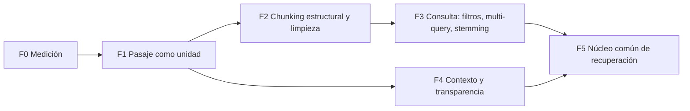

# Plan: optimización de la recuperación del Chat de Investigación

Estado: **propuesta para revisión. No hay nada implementado.**
Fecha: 2026-10-16 (revisión 2: incorpora el Juicio Final, Engram `#6979`).
Memorias en Engram: `#6977` (diagnóstico), `#6978` (plan) y `#6979` (juicio).

## 1. Problema

El Chat de Investigación responde que el corpus "no menciona" temas que sí están en documentos
recuperados. Caso de referencia, en el perfil de desarrollo `prueba-sync`:

- Pregunta: *¿Qué mirada sobre la mujer tiene el periódico 'El Obrero'?*
- Respuesta: "El fragmento no permite determinar qué mirada tiene *El Obrero* sobre la mujer".
- Fuente única citada: `[UY-OBR-1905] El Obrero, 1905`, página `1905-08-26_page_1.pdf`. La página tiene
  14.124 caracteres e incluye el artículo **"La Mujer"**, cuyo título (`## La Mujer`) empieza en el carácter 12.034.

La hipótesis inicial era que solo se embebían los primeros 800 caracteres y que el chat no usaba FTS5.
**Las dos cosas son falsas** (sección 2.3).

## 2. Diagnóstico

### 2.1 Causa raíz

La recuperación encuentra la página correcta. Lo que falla es **qué parte de la página llega al LLM y al
reranker**.

1. **La unidad de recuperación por defecto es la página (`asset`).** `rag_retrieval_unit` no está
   configurado, así que `RetrievalUnit::from_setting` devuelve `Asset` (`rag/retrieval.rs:35`). Una página
   de diario con unos diez artículos es un solo registro.
2. **De cada página se envía un solo recorte** de `rag_snippet_max_chars` (1.600) caracteres:
   `build_sources` → `snippet_window` (`rag/retrieval.rs:704`, `:913`).
3. **El recorte se ancla en el término más largo de la pregunta que aparezca como subcadena.**
   `extract_query_terms` conserva los términos de 4 o más caracteres, sin filtrar stopwords, y los ordena
   del más largo al más corto. `find_chars` busca subcadenas sin límite de palabra.
   - Términos del caso: `periódico, mirada, obrero, sobre, mujer, tiene`.
   - `periódico` y `mirada` no aparecen en la página.
   - `obrero` coincide dentro de **"ELOBRERO"**, la cabecera del diario, en el carácter 26. El recorte
     empieza en el carácter 0.
4. **El LLM recibió la cabecera** (precios, director, dirección) y respondió con honestidad. El campo
   `sources` guardado en `rag_messages` lo confirma: el snippet empieza con
   `
 # ELOBRERO`.
5. **El reranker tiene el mismo defecto.** `reranker.rs::candidate_documents` usa el mismo
   `snippet_window`, con 6.000 caracteres. Cohere puntuó los caracteres 0–6.000 (score 0,424) y nunca vio
   "La Mujer". En un corpus más grande, esa página habría bajado en el ranking.

En un corpus de prensa esto **falla de forma sistemática**: toda pregunta que nombra la publicación ancla
el recorte en la cabecera, porque el nombre está en todas las páginas.

### 2.2 Prueba de que el camino por pasajes lo resuelve

La infraestructura de chunks ya existe (migración 0029; Engram `#4539`), pero está apagada: el modo Asset
sigue siendo el default y no hay ningún control en la interfaz. Se consultó `rag_chunks_fts` con los
términos de la pregunta: **el chunk 17 (caracteres 11.900–12.700, "La Mujer") sale primero.**

### 2.3 Lo que no es la causa

- **Embeddings.** Se embebe el texto completo: por asset, ventanas de 6.000 caracteres promediadas
  (`bge-m3-6000-char-weighted-mean-l2-v1`); por chunk, ventanas de 800 caracteres con solapamiento de 100
  que cubren todo el documento (`plan_rag_chunks`). El 800 es el tamaño del chunk, no un corte.
- **FTS5.** Ya participa como pierna léxica, fusionada por RRF (`hybrid_retrieve_candidates`).

### 2.4 Problemas secundarios

| # | Problema | Dónde |
|---|---|---|
| S1 | Los términos que anclan el recorte no filtran stopwords (FTS sí lo hace) y coinciden como subcadenas sin límite de palabra | `extract_query_terms`, `find_chars` |
| S2 | La pierna léxica en modo Asset puntúa por ítem con BM25 y después devuelve las páginas del ítem por fecha de creación, no por coincidencia | `lexical_leg` (`retrieval.rs:430-441`) |
| S3 | En modo Chunk solo entra un chunk por asset (`cited_assets`), así que se pierden otros pasajes relevantes de la misma página | `retrieval.rs:152` |
| S4 | Chunks de 800 caracteres fijos, sin respetar los títulos (`## La Mujer`) ni los párrafos del OCR | `plan_rag_chunks` |
| S5 | No se limpia el markup del OCR (`
`, ``) antes de embeber e indexar. Se ve en "Páginas similares" | no existe; Zotero sí usa `ocr_markup_to_text` |
| S6 | La pregunta nombra un ítem o una colección ("El Obrero") y se trata como término temático, no como filtro | consulta |
| S7 | FTS5 usa `unicode61` sin stemming: "mujer" no encuentra "mujeres" | DDL de `rag_chunks_fts` y `fts_items` |
| S8 | En `prueba-sync` solo 6 de 1.700 assets tienen texto. No es la causa, pero cualquier evaluación sobre ese perfil sería anecdótica | datos |

## 3. Referencias internas

### 3.1 Búsqueda de pasajes de Zotero (Escritura)

Archivos: `bibliography/retrieval.rs::search_passages` y `bibliography/chunks.rs`.

**Para adoptar:**

- La unidad es **siempre el pasaje**, y se devuelve el texto del chunk, sin heurística de recorte.
- Chunking alineado a **párrafos**, con solapamiento de párrafo y spans exactos por página.
- Normalización con `ocr_markup_to_text` antes de partir en chunks; el contrato es versionado
  (`bibliography-chunk-800-paragraph-v2`).
- Coincidencia **por inicio de palabra** (`" casa"` encuentra "casas" pero no "ocasa"), sin acentos, sin
  stopwords y con variantes difusas.
- RRF por rango (nunca por score) y **límite de pasajes por obra**.
- Índice vectorial en memoria (`bibliography/vector_index.rs`).

**Para no copiar:** el ranking léxico no tiene IDF y exige alrededor de ¾ de los términos. Sirve para
búsquedas por palabras clave, pero no para preguntas en lenguaje natural: "La Mujer" no contiene "mirada"
ni "periódico". En el Chat, la pierna léxica sigue siendo BM25 de FTS5.

### 3.2 Recuperador del Agente de Investigación (`EntropIA-Agent`)

Archivos: `recuperacion.rs`, `investigacion.rs`, `puerta_lectura.rs`, `repositorio.rs`, `bench.rs`.

**Para adoptar:**

| Idea | Dónde |
|---|---|
| Unidad = chunk: devuelve el chunk **entero** con offsets ("quien cite decide el recorte") | `FragmentoRecuperado` |
| Rerank sobre el chunk | `recuperar_en_colecciones` |
| Varias consultas planificadas por el LLM, ordenadas por prioridad y con dedup | `Plan.queries`, `investigacion.rs:1573` |
| Filtros previos a la semántica: colección, rango de fechas, entidad | `puerta_lectura::Filtros` |
| Pierna léxica ancha (`LEG_K*8`) que después se filtra al recorte, para que un filtro chico no la deje vacía | `recuperacion.rs:273` |
| La degradación se declara ("sin pierna semántica", "sin rerank") | `Recuperacion.degradacion` |
| Diagnóstico de ranking por pierna y por fusión | `ranking_diagnostico` |
| Cadena de atribución de fallos: no se recuperó / se razonó mal / el documento no estaba procesado | `bench.rs` |

**Para no copiar:** carga todo el corpus en memoria con kNN por fuerza bruta; usa chunks fijos de 800 (los
mismos `rag_chunks`); no limita pasajes por ítem; no tiene stemming ni expansión a chunks vecinos.

## 4. Plan

Síntesis: **la estructura de pasajes y la normalización de Zotero, más la planificación de consultas, los
filtros y la transparencia del Agente, sobre BM25 + BGE-M3 + RRF + rerank**, que las tres
implementaciones ya comparten.

### F0. Medición

- Portar la cadena de atribución de `bench.rs` y el `ranking_diagnostico` al baseline SOIP del desktop
  (`rag/baseline.rs`).
- Agregar preguntas sobre prensa, con "El Obrero / la mujer" como caso fijo.
- Métricas por pasaje: Recall@k, MRR y posición de la evidencia en cada pierna, en la fusión y después del
  rerank. Para la respuesta: fidelidad (estilo RAGAS).
- Correr sobre un perfil de desarrollo con un corpus procesado representativo, no sobre `prueba-sync` (S8).
  Ese corpus no existe hoy en el repositorio: `rag/baseline.rs` solo corre contra el golden SOIP 1961
  (`GOLDEN_MANIFEST_JSON`). Primera tarea de F0: construir un fixture reducido de prensa (unos pocos
  números de *El Obrero*, con texto OCR y el artículo "La Mujer") versionado junto al golden, para que las
  aceptaciones de F0 y F1 corran en CI sin depender de un archivo personal.

**Aceptación:** el baseline reporta, para cada pregunta, si el fallo es de recuperación, de selección del
pasaje o de generación. El caso de referencia aparece como "falla de selección del pasaje".

### F1. El pasaje como unidad (causa raíz)

- `rag_retrieval_unit = chunk` por defecto, con backfill de `rag_chunks` para todo asset con texto y estado
  de cobertura visible. El cambio de default **no es un interruptor global**: `rag_chunks.embedding` es
  `NOT NULL` (migración 0029) y el modo Chunk devuelve cero resultados para un asset sin chunks
  (`rag/retrieval.rs:120-130`), con lo que `rag_ask` corta sin llamar al LLM (`rag/commands.rs:654`). Por
  eso la recuperación es **híbrida por asset**: el asset con chunks se recupera por Chunk; el asset sin
  chunks (sin backfill, sin proveedor de embeddings) cae al modo Asset y a `fts_items`, como hoy. El
  default solo se activa cuando el backfill está completo o el modo híbrido está implementado.
- La decisión Chunk/Asset por asset vive **dentro de `hybrid_retrieve_candidates`**, no en `rag_ask`:
  el editor (`writing_corpus_retrieve`, `writing/commands.rs:912-955`) lee el mismo `rag_retrieval_unit`
  y llama a esa función sin rerank ni fallback propio. Si el fallback queda en el Chat, el cambio de
  default vacía la evidencia del corpus en Escritura.
- "Tiene chunks" significa **chunks con el contrato de embedding efectivo**, no cualquier fila de
  `rag_chunks`. Hoy `chunk_vector_leg` filtra por `CANONICAL_EMBEDDING_MODEL` y
  `CANONICAL_EMBEDDING_CONTRACT_V1` (`rag/retrieval.rs:357-378`), mientras el procesamiento guarda los
  chunks con el contrato de `resolve_effective_embedding_contract` (`processing/eligibility.rs:105-147`):
  con proveedor local o un modelo API propio, la pierna semántica por chunk no devuelve nada. La pierna
  por asset (`vector_leg` sobre `vec_assets`, `retrieval.rs:197`) no filtra por modelo, así que hoy esos
  usuarios sí tienen recuperación semántica. Cambio requerido: `chunk_vector_leg` filtra por el contrato
  efectivo, y la consulta se embebe con el mismo proveedor.
- El estado de cobertura (assets con texto vs. assets con chunks) se muestra en F1, no en F4: sin él, el
  usuario no puede distinguir un corpus a medio indexar de una búsqueda sin resultados.
- El backfill re-embebe cada asset sin chunks. El costo depende del **proveedor efectivo**, no de la
  variante: `embedding_provider` vale `api` por defecto en Pro y en Lite (`processing/eligibility.rs:113`),
  así que Pro también paga API salvo que el usuario elija `local`. Además `rag_chunks` no está en
  `SYNCED_TABLES` (`sync/capture.rs:16-38`): cada dispositivo de la cuenta corre su propio backfill y paga
  su propio costo, y la cobertura es un estado por dispositivo. La interfaz estima el costo antes de
  lanzarlo. Se corre en segundo plano y se valida con `ENTROPIA_DEV_PROFILE` (ver §5).
- Reemplazar el filtro `cited_assets` por un límite de 2–3 pasajes por asset, uniendo chunks adyacentes.
- Reranker sobre el pasaje, no sobre un recorte de la página.
- El contexto lleva el pasaje entero ±1 vecino. `pack_sources` hoy **no** lo garantiza: en modo Chunk
  une los chunks contiguos y después vuelve a aplicar `snippet_window` al texto unido
  (`rag/retrieval.rs:841-842`) con el presupuesto `rag_snippet_max_chars` (1.600,
  `rag/params.rs:33`). Tres chunks de 800 caracteres con solape de 100 suman 2.200 y se recortan por la
  misma heurística "término más largo, primera aparición" que este plan diagnostica. Cambio requerido:
  en modo Chunk el pasaje unido entra entero al contexto, con un presupuesto propio por pasaje
  (`rag_passage_max_chars`, sin `snippet_window`); si excede el presupuesto, se recorta en el límite de
  chunk, nunca por ventana de términos. `RagSourceProvenance.start/end` cubren el rango efectivamente
  enviado.
- Mientras exista el modo Asset, `snippet_window` elige la ventana de mayor densidad de términos con IDF,
  stopwords y límite de palabra, en vez de "el término más largo, primera aparición" (corrige S1).
- Pierna léxica por asset, no por ítem (corrige S2).

**Aceptación:** en el caso de referencia, el contexto enviado al LLM contiene el artículo "La Mujer" y la
respuesta lo cita. Una prueba de `pack_sources` con tres chunks consecutivos y términos distractores en el
vecino anterior confirma que el texto empaquetado llega sin recorte por ventana. Un asset sin chunks sigue
recuperándose por el modo Asset, **tanto en el Chat como en `writing_corpus_retrieve`**. Con
`embedding_provider = local`, una consulta sin coincidencias léxicas recupera el pasaje por la pierna
semántica de chunks. El baseline de F0 no empeora en ninguna otra pregunta.

### F2. Chunking estructural y limpieza

- Normalizar antes de partir en chunks con dos pasos. (1) `ocr_markup_to_text`, que convierte tablas HTML
  y quita etiquetas. (2) Una limpieza propia de marcadores de OCR en Markdown, como
  ``: `ocr_markup_to_text` devuelve intacto todo texto sin etiquetas HTML
  (`ocr/markup.rs:286-289`), así que por sí sola no los quita (corrige S5).
- Los offsets de cada chunk se guardan sobre el **texto normalizado**, igual que el contrato V2 de
  `bibliography/chunks.rs:29-44` (`page_text_is_normalized`). Ese contrato no tiene mapa de vuelta al
  original, y `rag-citation.ts` (`locateSnippet`, líneas 98-120) busca el snippet en el texto crudo. Por
  eso las citas resuelven así: el lector aplica la misma normalización determinista al texto fuente,
  ubica el rango del chunk en ese texto normalizado y lo lleva al texto original con un mapa de
  posiciones construido en lectura. `RagSourceProvenance` registra el `chunking_contract` para que el
  lector sepa sobre qué texto se cortó el rango.
- Cortar primero por títulos markdown (cada artículo es un bloque), después por párrafos, con un objetivo
  de 800–1.200 caracteres. Reusar la lógica de `bibliography/chunks.rs` (corrige S4).
- **Encabezado de contexto** en cada chunk, para BM25 y para el embedding: publicación, fecha y título de
  la sección (técnica de *Contextual Retrieval*). Vive en un campo separado del cuerpo citable:
  `text_content` y los offsets describen solo texto de la fuente, para que el ensamblado de pasajes y el
  resaltado nunca incluyan texto sintético.
- Nuevo `chunking_contract`, con re-chunking y re-embebido versionados, como en Zotero.
- **Frescura del procesamiento.** `expected_chunk_count` (`processing/eligibility.rs:31-54`) calcula la
  cantidad de chunks suponiendo ventanas de 800 con solape de 100, y `:379-402` exige que la cantidad
  guardada coincida, filtrando además por `RAG_CHUNKING_CONTRACT_V1`. Con chunking estructural nunca
  coincide: el asset queda `IncompleteChunks` y se re-embebe en cada admisión, con costo repetido. El
  predicado de frescura pasa a depender del contrato: para el contrato nuevo compara contra el número de
  chunks que produce el chunker estructural (o contra un conteo guardado al procesar), no contra la
  fórmula de ventanas.
- **Ensamblado de pasajes con chunks estructurales.** El chunker de `bibliography/chunks.rs` saltea el
  whitespace entre párrafos y une los tramos con `"\n\n"` (`:119-199`): el cuerpo de un chunk no es un
  slice contiguo del texto y puede tener varios spans. `pack_sources` (`rag/retrieval.rs:827-837`)
  supone rangos contiguos, deduplica el solape por diferencia de offsets y corta con `break` en el
  primer hueco, así que si el vecino anterior no se solapa con el chunk central, **el central queda
  afuera**. Cambio requerido: el chunk RAG guarda su texto como slice contiguo del texto normalizado
  (sin unir párrafos con un separador sintético), y el ensamblado une chunks contiguos o separados solo
  por whitespace, sin descartar el chunk central.

**Aceptación:** ningún chunk cruza un título de sección; los chunks no contienen markup del OCR, incluidos
los marcadores `` (prueba con una entrada de solo texto y un marcador); las citas siguen
resaltando el rango correcto del texto original, tanto en chunks nuevos como en los del contrato anterior;
el encabezado de contexto no aparece en ningún snippet citado. Un asset procesado con el contrato nuevo
queda `Fresh`, y una segunda admisión no lo vuelve a embeber. Una prueba de `pack_sources` con párrafos
separados por whitespace variable y vecinos sin solape incluye siempre el chunk central, y su rango
resalta el texto correcto.

### F3. Comprensión de la consulta

- Detectar nombres de ítem, colección, fecha o entidad en la pregunta y aplicarlos como **filtros
  previos**, con la pierna léxica ancha y filtrada del Agente. Esos términos se quitan de la consulta
  temática (corrige S6).
- Multi-query: 2–4 subconsultas generadas por el LLM, en lugar de una sola reescritura, fusionadas por RRF.
  Hoy `query_rewrite` produce como máximo una consulta adicional.
- Stemming en español junto al índice exacto, para que "mujer" encuentre "mujeres". El SQLite empaquetado
  (rusqlite `bundled`) solo trae los tokenizadores `unicode61`, `ascii`, `porter` (inglés) y `trigram`; no
  hay Snowball en español. El mecanismo es **pre-stemmear en Rust**: un stemmer en español (crate
  `rust-stemmers`) genera el texto raíz que se guarda en una columna FTS5 adicional, y la consulta se
  stemmea igual. Costo: duplica el almacenamiento del índice léxico y exige una migración (ver el riesgo
  de sync en §5). La alternativa sin migración es reconstruir el índice como tabla local no sincronizada.
  Se mantienen las variantes difusas para errores de OCR (corrige S7).

**Aceptación:** "¿Qué mirada sobre la mujer tiene El Obrero?" se resuelve con el filtro del ítem y con
subconsultas temáticas; la traza muestra el filtro aplicado y cada subconsulta.

### F4. Contexto y transparencia

- Ordenar el contexto con los mejores pasajes al principio y al final (*lost in the middle*).
- Revisar `rag_context_max_chars`: con pasajes de alrededor de 1 KB, 10.000 caracteres son unos 10
  pasajes. Pero `rag_top_k` vale 6 por defecto (`rag/params.rs`), así que las fuentes están acotadas a 6
  sin importar el presupuesto de contexto: subir solo `rag_context_max_chars` no agrega pasajes. Hay que
  ajustar los dos parámetros juntos.
- Mostrar en la interfaz la degradación (sin pierna semántica, sin rerank, cobertura de chunks
  incompleta).
- Opción para ver las fuentes que se recuperaron pero no se citaron; hoy `filter_cited_sources` las
  oculta.

**Aceptación:** una respuesta producida con un pipeline degradado lo declara en la interfaz.

### F5. Núcleo común de recuperación

Extraer una biblioteca de recuperación de pasajes que usen el Chat, el Agente (que ya lee `rag_chunks`)
y Zotero: normalización, chunking por párrafos, coincidencia por inicio de palabra, RRF, límite por
obra, filtros y diagnóstico. Así se eliminan tres implementaciones paralelas con convenciones distintas.
La pierna léxica **no** se unifica entre los tres: el Chat y el Agente usan BM25 de FTS5; Zotero conserva
su ranking por inicio de palabra, sin IDF (§3.1), porque sirve a búsquedas por palabras clave.

**Aceptación:** el Chat y el Agente producen el mismo ranking de candidatos **antes del rerank** para la
misma consulta y los mismos filtros, y comparten las funciones de normalización, chunking, BM25, RRF y
límite por obra (una sola implementación, probada una vez). Zotero comparte normalización, chunking, RRF
y límite por obra, pero no BM25. El rerank queda fuera de la igualdad: difiere
por variante (Cohere en Lite, cross-encoder local en Pro) y Zotero no tiene rerank. El recorte no se
unifica: el Agente devuelve el chunk entero y quien cita decide el recorte, mientras el Chat arma el
pasaje de F1. Este alcance toca otro repositorio (`EntropIA-Agent`), por lo que F5 se divide en una
parte de este repositorio (biblioteca y migración del Chat y de Zotero) y una parte de adopción en el
Agente, con entrega separada.

## 5. Riesgos

- **Migración y re-embebido.** El backfill de F1 y el nuevo `chunking_contract` de F2 re-embeben el
  corpus: el costo es de API o de cómputo según el proveedor efectivo (por defecto API, también en Pro),
  y se paga una vez por dispositivo, porque `rag_chunks` no se sincroniza. Para no pagarlo dos veces, el backfill
  masivo de F1 no se activa en corpus reales hasta que el contrato de F2 esté definido; antes se valida
  solo en perfiles de desarrollo. Esto se valida con `ENTROPIA_DEV_PROFILE`, nunca sobre el archivo
  real (`AGENTS.md`).
- **Sincronización entre dispositivos.** Toda migración nueva (columna FTS con stemming de F3, columnas
  de `rag_chunks` de F2) sube el head de `_migrations`, y con él el `schema_tag` que el cliente informa
  (`sync/engine.rs`). El servidor responde 426 `schema_upgrade_required` a todo tag menor
  (`EntropIA-Cloud/docs/PROTOCOL.md`), y `sync/pull.rs` detiene el pull si el servidor anuncia un esquema
  posterior: apenas un dispositivo actualiza y migra, los demás de la cuenta dejan de sincronizar hasta
  actualizar la app. Decisión por fase: los índices que solo existen localmente (FTS con stemming) se
  reconstruyen como estructura local fuera de las migraciones sincronizadas; lo que sí exija migración se
  entrega en una versión que se publica antes de activar la fase, y nunca se prueba sobre el archivo real
  (`ENTROPIA_DEV_PROFILE`).
- **Paridad Pro/Lite.** El reranker local (`bge-reranker-v2-m3`, 2.048 tokens) y Cohere tienen que recibir
  los mismos pasajes. Los pasajes cortos además entran sin truncar en el cross-encoder.
- **Citas existentes.** Las conversaciones guardadas con fuentes de unidad Asset tienen que seguir
  abriéndose; la procedencia de chunk ya existe (`RagSourceProvenance`).
- **Latencia de la multi-query.** Cada subconsulta suma un embedding; el rerank se hace una vez, sobre la
  fusión.

## 6. Bibliografía

- Cormack, Clarke y Büttcher. *Reciprocal Rank Fusion outperforms Condorcet and individual rank learning
  methods*. SIGIR 2009. https://dl.acm.org/doi/10.1145/1571941.1572114
- Bruch, Gai e Ingber. *An Analysis of Fusion Functions for Hybrid Retrieval*. ACM TOIS.
  https://arxiv.org/abs/2210.11934
- Chen et al. *BGE M3-Embedding*. https://arxiv.org/abs/2402.03216
- Thakur et al. *BEIR*. https://arxiv.org/abs/2104.08663
- Qu et al. *Is Semantic Chunking Worth the Computational Cost?* NAACL Findings 2025.
  https://arxiv.org/abs/2410.13070
- Chen et al. *Dense X Retrieval: What Retrieval Granularity Should We Use?*
  https://arxiv.org/abs/2312.06648
- Günther et al. *Late Chunking*. https://arxiv.org/abs/2409.04669
- Anthropic. *Introducing Contextual Retrieval*. https://www.anthropic.com/news/contextual-retrieval
- Zhang et al. *OCR Hinders RAG* (OHRBench). ICCV 2025. https://arxiv.org/abs/2412.02592
- Liu et al. *Lost in the Middle*. TACL 2024. https://arxiv.org/abs/2307.03172
- Es et al. *RAGAS*. https://arxiv.org/abs/2309.15217

## 7. Decisiones pendientes del owner

1. ¿Arrancar por F0 + F1, que solas resuelven el caso de referencia?
2. ¿El modo Asset se elimina después de F1 o se conserva como opción avanzada?
3. ¿F5 (núcleo común con el Agente) entra en este plan o queda como plan propio?

## 8. Pendientes detectados en F0–F1

### 8.1 Etiqueta del espacio de embedding en Pro sin `embedding_provider`

Sin el setting configurado, el motor y el sello no nombran el mismo proveedor:

- **Motor (consulta y chunks).** En Pro, `EmbeddingProvider::from_setting(None)` devuelve `Local`
  (`nlp/embeddings.rs:191`; en Lite, `Api`: `:193`). Lo usan tanto la consulta del Chat
  (`rag/commands.rs:1311-1316`, `config_from_settings` → `engine.embed_text`) como el procesamiento,
  que embebe cada chunk con el mismo motor (`processing/embedding.rs:409`, vía
  `nlp/mod.rs:462`).
- **Sello.** `resolve_effective_embedding_contract` trata la ausencia del setting como `api`
  (`processing/eligibility.rs:113`) y, con el modelo por defecto, sella el contrato canónico
  (`:125`, `:135`), que el procesamiento escribe en `rag_chunks` (`processing/embedding.rs:362`,
  `:454-455`).

**Es solo la etiqueta, no el espacio.** Las dos ramas son BGE-M3 denso de 1.024 dimensiones con
normalización L2: el motor local corre el ONNX de `BAAI/bge-m3` (`nlp/embeddings.rs:161`, `:1625`) y
toma el vector CLS (`:2056`); el API pide `baai/bge-m3` (`:37`, `:40`) con 1.024 dimensiones (`:41`);
ambos pasan por `l2_normalize` en la agregación (`:1338`). En un mismo dispositivo la consulta y los
chunks salen además del mismo motor, y `rag_chunks` no se sincroniza, así que `chunk_vector_leg`
compara vectores comparables. Que el ONNX local y el endpoint de OpenRouter den el mismo vector para
el mismo texto se infiere de que ambos son el modelo BGE-M3 publicado; no está medido.

**Pendiente.** (1) Que el sello nombre el proveedor que realmente embebió (`local` en Pro sin setting),
o que el default de los dos resolutores sea el mismo. Cambiar el sello invalida la frescura de lo ya
procesado (re-embebido), así que va con el contrato nuevo de F2. (2) Caso borde: en Pro sin
`embedding_provider` pero con `openrouter_embedding_model` distinto del canónico, el sello nombra ese
modelo (contrato hash) aunque embebe el BGE-M3 local. (3) El frontend ya asume `local` por defecto en
Pro (`src/lib/settings.ts:233`); conviene verificar si persiste el valor en instalaciones nuevas, que
haría este caso raro en la práctica.
